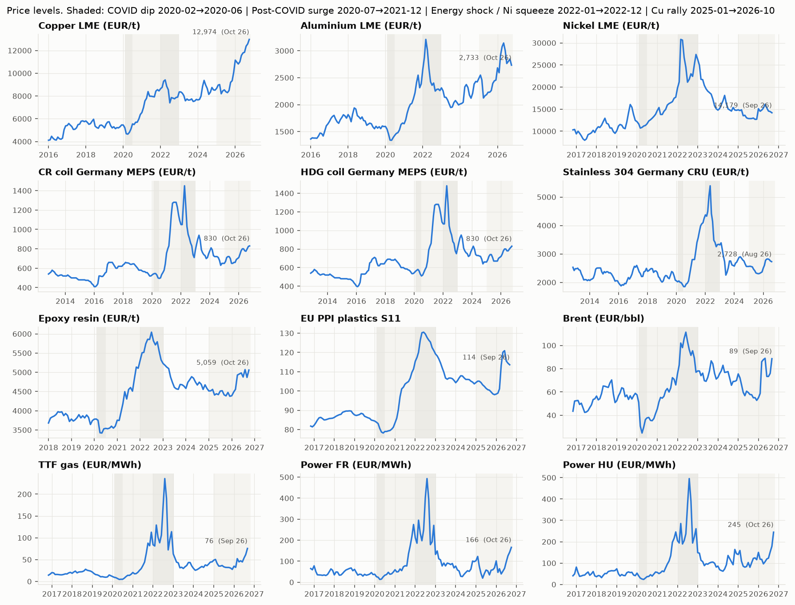
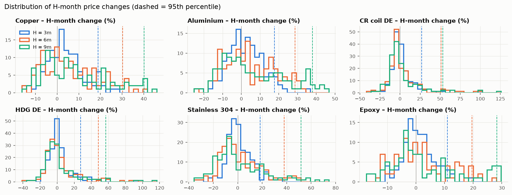
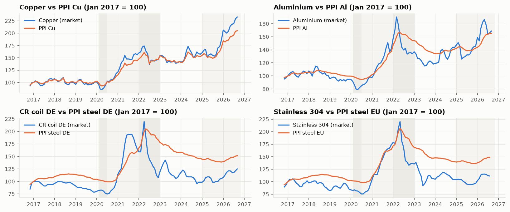
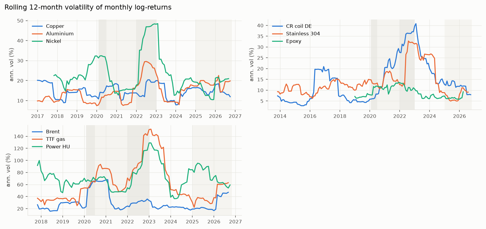
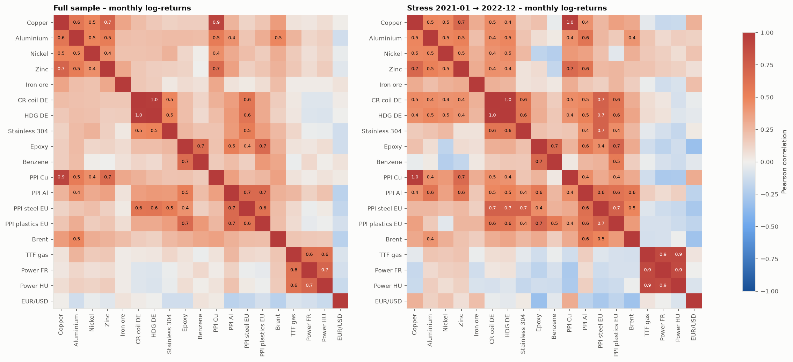
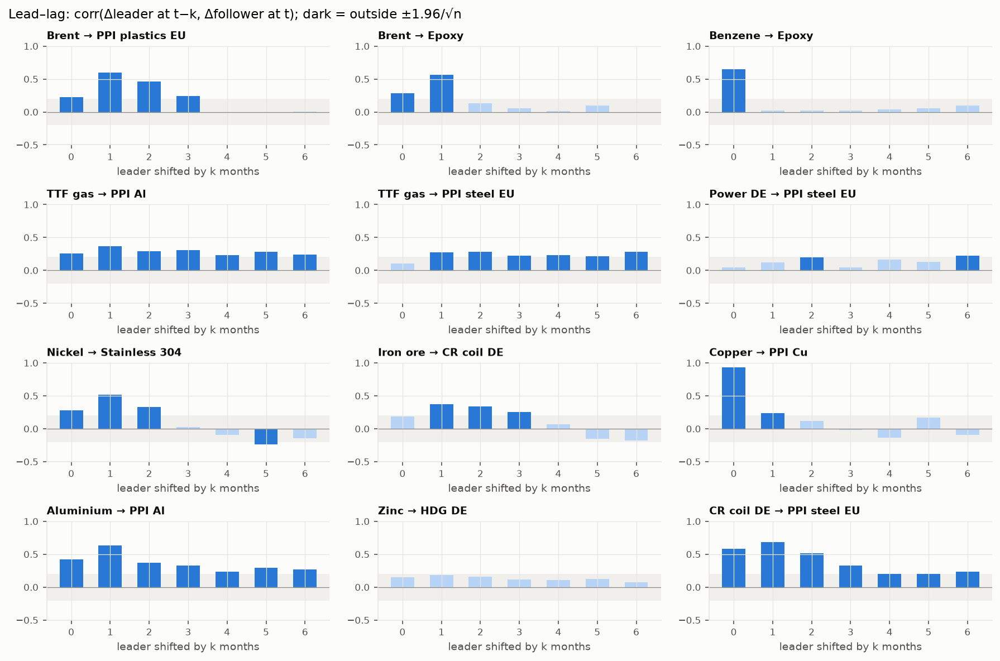
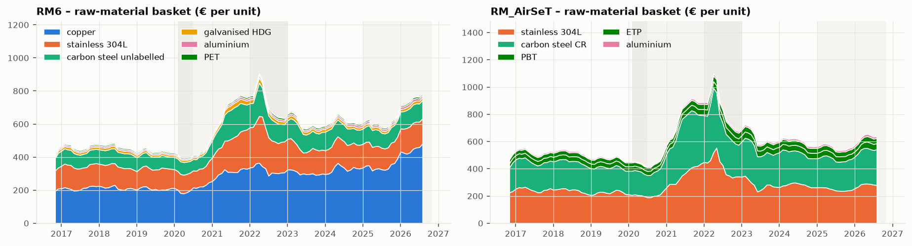
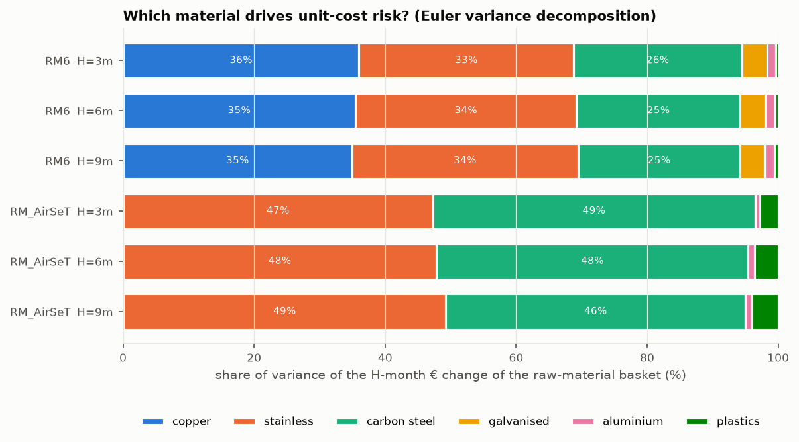
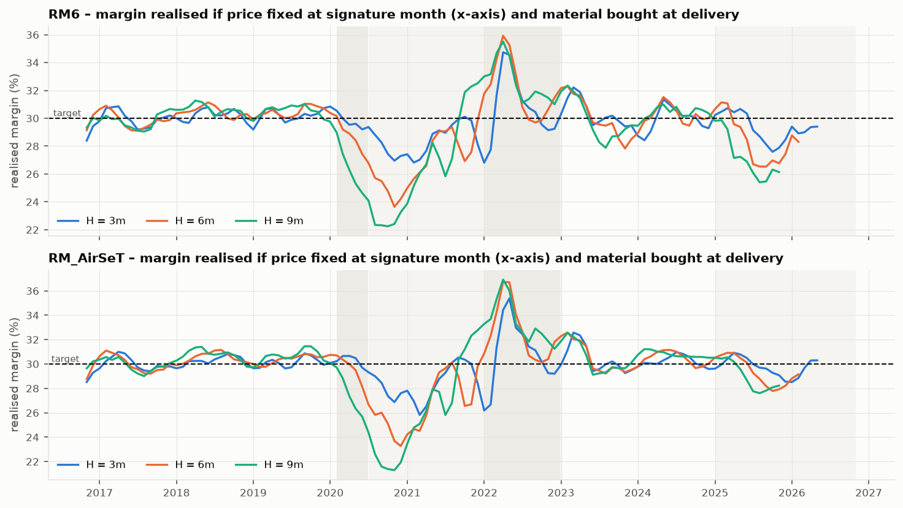
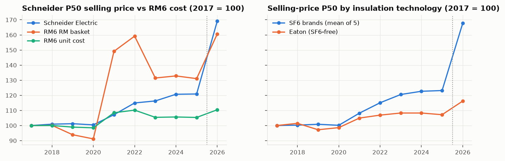

# Step 3 – Exploratory Data Analysis: report

**Scope:** plan Step 3 (3.1 univariate, 3.2 multivariate, 3.3 business EDA) plus extra checks.
**Code:** `src/data_loading.py`, `src/cost_model.py`, `src/eda.py`, `src/plotting.py`, called from `analysis/03_eda.ipynb`.
**Config and assumptions:** `configs/eda.yaml`. **Plots:** `plots/`. **Full tables (CSV):** `report/tables/`.
**Reproduce:** `uv sync && cd analysis && uv run jupyter nbconvert --to notebook --execute --inplace 03_eda.ipynb`

---

**What we learned**
1. Prices are hard to predict but easy to describe. Over 3–9 months most materials move only slightly up or down. When they move, though, they tend to rise much more than they fall. Steel nearly tripled in 2021, while falls are usually milder. Raw-material risk works like insurance: the danger is in rare big shocks, not in everyday movement.

2. The longer the quote, the bigger the risk. With a 3-month price, the bad case costs about 2–3 margin points. With 9 months it's about 6, and in the worst historical case almost 9.

3. Copper is not the only problem. Copper is the most expensive material in RM6, but steel and stainless steel cause just as much price risk, because their prices swing more wildly. For RM AirSeT, which uses no copper, steel and stainless account for almost all of the risk.

4. We need the right price data. The official statistics (PPIs) for steel are too smooth and slow to show what Schneider actually pays. The market prices its suppliers really use (MEPS/CRU) show the true swings. For copper, the two give the same answer.

5. Some prices give early warnings. Oil moves about a month before plastics and epoxy, and nickel moves about a month before stainless steel. These signals can help forecasting.

6. In a crisis, everything goes up together. In normal times copper and steel move fairly independently, so their swings partly cancel out. In 2021–22 they all rose at once. Planning for "average" behaviour therefore underestimates the bad case.

7. Two missing facts matter more than any model. The two sources disagree on how much copper RM6 contains (39 kg vs 9 kg), and nobody knows what 86 kg of AirSeT's "Other" material is. Those answers change the risk picture more than any forecasting technique would.

**What this means for the business**
* The safety margin added to a quote should grow with the validity period: roughly +2.5% of price at 3 months, +4.5% at 6, +6% at 9.
* For long quotes (9 months), a price-adjustment clause tied to steel and copper indices is safer than a fixed price.
* RM AirSeT's risk is almost entirely steel. A steel-linked clause would remove most of its uncertainty, which matters given its thinner margin.

---

## 1. Data used and preparation

| Source | Series used | Notes |
|---|---|---|
| LME file (Westmetall) | Cu, Al cash in EUR/t, Jan-2016 → Oct-2026 | Matches the IMF-based D01/D02 within a **median 0.12 % / 0.18 %** (max 0.8 % / 1.1 %). Used instead of D01/D02 because it is one month longer. |
| `rm_prices_monthly_wide.csv` | Ni, Zn, iron ore (converted to EUR with S06), EUR/USD, PPIs S07–S13 | The empty columns L01–L08 are dropped. |
| `Copia de Europe Steel INDEXES.xlsx` | MEPS CR / HDG / HR coil Germany and France (2012-11 → 2026-10); CRU stainless 304 Germany, **base + alloy surcharge** (→ 2026-08) | Mid-month dates moved to the first of the month. Column positions are checked against the header labels. |
| `Epoxy for student.xlsx` | Epoxy resin, benzene (2018-01 → 2026-10) | Dates on the 3rd or 4th of the month moved to the first. An isolated-spike filter masks one typo (see §5). |
| `energy_prices_monthly_wide.csv` | Brent EUR, TTF EUR/MWh, day-ahead power DE / FR / HU | |
| RMU benchmark, teardown | Yearly selling-price P10/P50/P90 per brand; RM6 should-cost | Used in §4. |

The result is one monthly panel with 25 series, in EUR wherever a price exists. No imputation is done. **Publication lags are not applied in the EDA.** They matter from Step 4 onward: the lead–lag results below are *before* lags, and IMF and Eurostat publish 1–2 months late.

---

## 2. Univariate analysis (3.1)

**Regimes.** Every series shows the 2021–22 surge. The size differs a lot by series: CR coil ×2.7 and stainless ×2.5 at the peak, power and gas ×10–20. Copper is the only series at a record high now (12,974 €/t in Oct-2026). Steel is recovering (CR coil 830 €/t), and power and gas are rising again in autumn 2026 (Hungarian power is 245 €/MWh in October).

**Monthly log-returns** (full table: `tables/return_summary.csv`):

| | vol %/yr | skew | excess kurtosis | lag-1 autocorr. of returns |
|---|---|---|---|---|
| Copper | 15.2 | −0.2 | 1.6 | 0.20 |
| Aluminium | 15.9 | −0.2 | 0.9 | 0.30 |
| Nickel | 24.8 | +1.1 | 5.1 | 0.29 |
| CR coil DE (MEPS) | 17.6 | +0.6 | 3.7 | **0.54** |
| Stainless 304 | 16.2 | −0.8 | 3.6 | **0.42** |
| Epoxy (cleaned) | 9.9 | – | – | 0.04 |
| PPI steel EU | 7.4 | +1.3 | 2.1 | **0.79** |
| TTF gas / Power HU | 71 / 76 | – | – | ~0 |

* Almost every series rejects normality (Jarque–Bera p < 0.01). Quantile and bootstrap methods are a better fit than Gaussian intervals.
* **Steel and PPIs have strong momentum.** Their monthly returns are autocorrelated (0.4–0.8) because MEPS and CRU are price assessments and PPIs are smoothed contract prices. Recent trend is therefore a real predictive feature for steel. Metals traded on the LME behave much more like a random walk.

### Distribution of H-month changes: a naive cost-at-risk

* x-axis: the % price change over the horizon. Left of 0, the material got cheaper (good for your margin); right of 0, it got more expensive (margin loss).
* y-axis: how many past signature months gave that change.
* Dashed vertical lines: the 95th percentile for each horizon. Only 5% of past contracts saw a rise bigger than that.

| H-month change (%) | q05 3m | q95 3m | q05 6m | q95 6m | q05 9m | q95 9m |
|---|---|---|---|---|---|---|
| Copper | −9 | +19 | −10 | +30 | −10 | +40 |
| Aluminium | −11 | +18 | −14 | +29 | −15 | +38 |
| CR coil DE | −15 | +27 | −18 | +51 | −20 | +53 |
| Stainless 304 | −13 | +18 | −20 | +38 | −25 | +52 |
| Epoxy | −7 | +11 | −11 | +20 | −15 | +28 |

The upside tails are about 2–3 times the downside tails, which means a symmetric buffer under-protects. For steel, the upper tail comes almost entirely from the 2021 episode. **With H = 9 there are only 10–17 independent windows**, so every q95 here has a wide error band.

### PPI vs market price

| Market vs PPI | PPI vol / market vol | corr (same month) | best lead of market | corr at that lead |
|---|---|---|---|---|
| Copper LME vs PPI Cu | 0.66 | **0.93** | 0 | 0.93 |
| Aluminium LME vs PPI Al | 0.35 | 0.42 | 1 m | 0.63 |
| CR coil DE vs PPI steel DE | 0.37 | 0.55 | 1 m | 0.58 |
| Stainless 304 vs PPI steel EU | 0.42 | 0.54 | 0 | 0.54 |

**Decision for Steps 2 and 4:**

* For **steel and stainless**, use MEPS/CRU €/t as the cost driver. Schneider's purchase contracts are indexed to MEPS/CRU (the `Q4-2017` sheet maps the Hungarian plant to *CR Germany* and *HDG Germany*). The PPI is much smoother, lags, and has drifted away in level (after 2023 the PPI stays at about 150 while CR coil is at 105–125, both rebased to Jan-2017 = 100).
* For **copper**, the PPI and LME are interchangeable. LME is available earlier and has a forward curve.
* PPIs remain useful as **targets** in the challenge CSV (S-series) and as slow, predictable followers of market prices.

### Volatility clustering and stationarity

* The Ljung–Box test on squared returns is strongly significant for **steel (p < 1e-7), stainless, the PPIs, TTF and German power**. It is not significant for copper, nickel or Brent. Forecast intervals for steel therefore need a volatility state, such as GARCH or EWMA. For LME metals, a constant-volatility model is defensible.
* **ADF/KPSS** (`tables/stationarity.csv`): log levels are non-stationary or ambiguous for every series, and returns are stationary for 21 of 25. The exceptions (MEPS CR and HDG, PPI Cu and Al) are borderline because of the strong momentum. **Modelling should use log-returns.** Cointegration was skipped, as the plan says.
* **Seasonality** (F-test on calendar-month means): significant only for **day-ahead power** (FR p = 0.001, HU p = 0.01, DE p = 0.03) and weakly for MEPS CR coil (p = 0.03, with a March peak and a June trough). PPIs and metals show none. A month-of-year feature is only worth adding for energy.

---

## 3. Multivariate analysis (3.2)

* In normal times, materials form **clusters**: LME metals (Cu–Zn 0.7, Cu–Al 0.6), flat steel (CR–HDG 1.0, CR–stainless 0.5), the epoxy chain (epoxy–benzene 0.7) and energy (TTF–power 0.6). Correlation **between clusters is low** (copper–CR coil 0.23).
* **In the 2021–22 stress period, diversification breaks down.** Copper–CR coil goes from 0.23 to 0.46, CR coil–aluminium from 0.22 to 0.45, CR–stainless from 0.48 to 0.58, and TTF–Hungarian power from 0.61 to 0.91. A cost simulation that assumes average correlations will understate the tail. Step 8 should use a block bootstrap or a t-copula, not a Gaussian with full-sample correlations.

### Lead–lag (correlation of Δx at t−k with Δy at t)

| Leader → follower | best lead | ρ | Useful feature? |
|---|---|---|---|
| Brent → PPI plastics EU | 1 m | 0.60 | **Yes** (confirms the data README) |
| Brent → Epoxy | 1 m | 0.56 | **Yes** |
| Benzene → Epoxy | 0 (same month) | 0.65 | Nowcast only |
| Nickel → Stainless 304 | 1 m | 0.52 | **Yes**, through the alloy surcharge |
| Iron ore → CR coil DE | 1–3 m | 0.37 | Yes (weaker) |
| TTF gas → PPI Al | 1 m | 0.37 | Yes (weaker) |
| TTF / power → PPI steel EU | up to 6 m | 0.23–0.28 | Weak; check in backtest |
| MEPS CR coil → PPI steel EU | 1 m | 0.69 | **Yes**, for forecasting the PPI |
| LME Al → PPI Al | 1 m | 0.63 | **Yes** |
| LME Cu → PPI Cu | 0 | 0.93 | Same month only |
| Zinc → HDG | – | < 0.19 | No |

The significance band is about ±0.19 for monthly data. **Caution:** these leads are measured on reference months. Once Step 4 applies publication lags (IMF and Eurostat publish about 1–2 months late), a 1-month lead from an IMF series can disappear. Market-sourced data (LME, MEPS, Westmetall, Ember) is available almost in real time and keeps its lead.

---

## 4. Business EDA (3.3)

### Provisional cost model (placeholder for Step 2)

`UnitCost(t) = NonRM + Σ kg_i × Price_i(t) / 1000`. The masses come from `bom_materials.csv`. **Assumptions** (all in `configs/eda.yaml`):

* RM6's unlabelled 45 % slice (139.5 kg) is carbon steel priced as MEPS CR France.
* AirSeT carbon steel is priced as MEPS CR Germany, which is the plant's own index according to the `Q4-2017` sheet.
* Polymers use an assumed 2021 level (PBT 2,800, PET 1,400, ETP 3,000 €/t), moved with PPI S11.
* NonRM is held constant and sized so that unit cost in Aug-2026 equals the **RM6 teardown should-cost of €3,009**. For AirSeT we assume **€3,610** (+20 %, because the brief says it has a "higher cost structure"; no should-cost exists).

| Aug-2026 | RM basket | Share of unit cost | Value split of the RM basket |
|---|---|---|---|
| RM6 | €784 | 26 % | copper 61 %, stainless 19 %, carbon steel 14 %, HDG 2 % |
| RM AirSeT | €639 | 18 % | stainless 44 %, carbon steel 41 %, plastics 13 % |

**H-month change of total unit cost** (`tables/cost_h_changes.csv`): q95 = **+3.7 / +6.2 / +8.6 %** for RM6 and **+3.9 / +6.5 / +8.8 %** for AirSeT at 3 / 6 / 9 months. The raw-material basket alone moves 5–7 times more (q95 at 9 m: +52 % for RM6, +62 % for AirSeT).

### Risk decomposition

This is an Euler decomposition: each material's share of the variance of the H-month € change of the basket. Shares are almost the same for every horizon.

* **RM6:** copper 35 %, stainless 34 %, carbon steel 25 %, HDG 4 %. The plan expected copper to dominate. It does not, because steel and stainless had much larger swings in € terms in 2021–22.
* **RM AirSeT:** carbon steel 46–49 %, stainless 47–49 %, plastics about 3 %. Copper is 0, as the BOM states.
* **BOM sensitivity** (`tables/bom_scenarios.csv`):
  * With the teardown copper mass (8.6 kg instead of 38.8 kg), RM6's basket falls to €410, copper's risk share falls to **9 %**, and stainless becomes the main driver (48 %). **The disagreement between the two copper masses is the largest open question for RM6.**
  * If AirSeT's 85.6 kg of "Other" is epoxy, the basket rises to €1,073, epoxy takes 19 % of the risk, and the 6-month q95 rises from 6.5 % to 8.9 %.

### Historical "margin gamble"

The rule simulated here: at each past month, price = cost / (1 − 30 %), held fixed for H months, with material bought at delivery. This is the worst case, with no early purchasing, no indexation and no hedge.

| | H | mean erosion (pts) | P95 loss (pts) | worst (pts) | P(margin < target) | P(loss > 2 pts) |
|---|---|---|---|---|---|---|
| RM6 | 3 | −0.2 | −2.6 | −3.2 | 55 % | 10 % |
| | 6 | −0.4 | −4.3 | −6.4 | 54 % | 18 % |
| | 9 | −0.6 | −6.0 | −7.8 | 48 % | 24 % |
| AirSeT | 3 | −0.1 | −2.8 | −4.2 | 50 % | 9 % |
| | 6 | −0.2 | −4.5 | −6.7 | 45 % | 13 % |
| | 9 | −0.2 | −6.2 | −8.7 | 38 % | 18 % |

* On average the gamble is close to neutral. The risk is concentrated in **regime shifts**: contracts signed between mid-2020 and early 2021 lost 6–9 margin points. Contracts signed in 2021–22 *gained* up to 7 points when prices fell back. **RM6 contracts signed in 2025 are losing again** (copper rally), with realised margin at about 25.5 % for 9-month contracts.
* A **historical P95 buffer** would be about **2.5 % / 4.5 % / 6 % of price** for 3 / 6 / 9 months. These numbers scale roughly linearly with the assumed RM share of unit cost (26 % / 18 %). Treat them as an order of magnitude until Step 2 is final.

---

## 5. Extra exploration

**Data quality**

* **Epoxy file typo.** May-2026 epichlorohydrin is 257 €/t, with neighbouring months around 2,500. It drags epoxy from about 4,900 to 3,593 for one month. This single point doubled epoxy's measured volatility and created the fake "spike-and-revert" pattern (excess kurtosis 24, lag-1 autocorrelation −0.45). `isolated_spikes()` masks it. The April-2020 benzene crash (206 €/t) is real and is kept.
* The only other isolated spike in the panel is a dip in French power in May-2025. It is plausible (spring surplus) and left as is.
* **Teardown benchmark.** The SGC column has a total should-cost of €19, so it is unusable. Eaton's should-cost (€767) is also implausibly low.
* **Coverage ends:** stainless ends in Aug-2026; Ni, Zn, iron ore, the PPIs and Brent end in Sep-2026; LME Cu/Al, MEPS, epoxy and power end in Oct-2026. The forecast origin and the nowcast must handle these ragged edges (`tables/coverage.csv`).

**Selling price vs cost** (synthetic RMU benchmark, yearly P50)

* Up to 2025, Schneider's P50 price follows the unit cost loosely, with a lag (YoY correlation with the RM basket is 0.66 excluding 2026, n = 8). The price kept rising in 2023–25 while raw-material costs fell, so margin was rebuilt after 2021–22.
* **2026: every SF6 brand jumps by +33 % to +40 %; Eaton (SF6-free) by +8 %.** This is consistent with the EU F-gas ban on SF6 in new ≤24 kV switchgear from 2026, which pushes SF6 products into a premium or niche position. This is relevant for Goal B (price convergence of SF6-free products), but the panel is **synthetic**, so treat it as a scenario signal, not evidence.

---

## 6. Implications for the next steps

| Step | Recommendation from the EDA |
|---|---|
| 1–2 Data / cost model | Use MEPS/CRU €/t for steel, not S09/S10. Resolve the copper mass (38.8 vs 8.6 kg) and the composition of AirSeT's "Other" with Schneider. These two questions move the answer more than any model will. |
| 4 Features | Lag-1 own return (momentum for steel and PPIs), Brent → plastics and epoxy, nickel → stainless, iron ore → CR coil, MEPS → PPI steel, LME Al → PPI Al. Month-of-year only for energy. All of these are subject to publication lags. |
| 5 Baselines | A random walk will be hard to beat for LME metals. Steel and PPIs, which have momentum, are where models can add skill. |
| 6–7 Models | Use log-returns. Use volatility-state models (GARCH or EWMA) for steel and energy. Use quantile or bootstrap intervals, not Gaussian ones. Expect few independent windows at H = 9. |
| 8 Simulation | Use stress-aware joint dependence (block bootstrap or t-copula). Correlations rise sharply in crises. |
| 9 Pricing | The buffer must grow with H. Indexation for RM6 should cover **stainless and steel as well as copper**. For AirSeT, a steel and stainless clause (MEPS CR / CRU 304) covers about 95 % of RM risk. |

## 7. Limitations

* The cost model is provisional: BOM gaps, assumed polymer levels, and an assumed AirSeT total cost.
* The margin simulation assumes all material is bought at delivery, a constant NonRM cost, and no indexation. Real exposure is smaller if purchases happen earlier.
* Only about 120 months of data. The 2008–09 crisis is not covered, except in the steel series, which go back further.
* Lead–lag results are computed on reference months, not publication vintages.
* The RMU price benchmark is synthetic and yearly.
