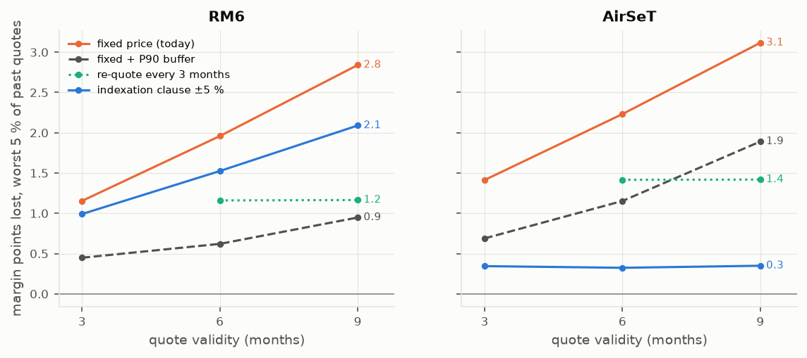

# Step 10 – Story, recommendations and limitations

*Owner: everyone · Status: draft for the slides · Feeds the presentation, Step 11 (app), Step 12 (README) and Problem 2*

> **Run from the repo root**, after Steps 7–9:
>
> ```bash
> uv run python -m src.story          # key numbers + headline tables + cross-step checks
> uv run python -m src.story_plots    # the one new chart
> uv run pytest tests/test_story.py   # mechanics + "is every claim of this story still true?"
> ```

| What | Where |
|---|---|
| Code | `src/story.py`, `src/story_plots.py` |
| Tests | `tests/test_story.py` (committed tables only, runs in CI) |
| Tables | `report/problem1/step10_tables/` |
| Chart | `plots/step10/01_validity_vs_loss.png` |

**Rule for the slides:** every number comes from `step10_tables/key_numbers.csv`. Numbers are not types in by hand. 

---

## 0. Decisions behind the headline

Set in `src/story.py`.

| # | Decision | Setting |
|---|---|---|
| 1 AirSeT 9-month risk: 0.9–1.4 points (Step 8 summary) vs 1.00 (Step 9 main case) vs 1.2–1.8 (market steel) | Headline cases = the Step 9 main cases; other cases shown as a range | RM6; **AirSeT epoxy low, stainless priced through nickel** |
| 2 AirSeT main case = epoxy low, stainless priced through nickel | AirSeT main case confirmed | as above |
| 3 Largest uplift sales can add = 1 point (MAX_BUFFER_PTS) | Largest uplift sales can add before switching to a clause | **1 margin point** (`MAX_BUFFER_PTS`) |
| 4 Steel at producer prices (PPI) vs market prices (MEPS) as the headline | Steel case | **Market prices (MEPS-like spread) for the recommendation**; producer prices (PPI) for the CSV, which forecasts S09 / S10 |
| 5 RM6 copper 38.8 kg (internal BOM) vs 8.6–13.8 kg (teardown): 1.73 vs 0.74–0.88 points | RM6 copper mass | **38.8 kg (internal BOM)** headline; 8.6–13.8 kg (teardown) shown as "the answer if the teardown is right" |
| 6 Step 3 found 4–8.5 points at 9 months; Step 8 finds 1.7 | Which numbers are the answer | **Step 8 / 9 outputs**, built on all previous steps. Step 3's historical figures are background only (§5, Q&A) |
| 7 Problem 2 found AirSeT may carry copper if the teardown masses are right | AirSeT and copper | The AirSeT steel-clause recommendation holds **on condition that AirSeT carries no significant copper** (Problem 2 found the teardown may show otherwise) |
| – | Confidence and accepted loss for the headline quote rule | **90 %, 0.5 margin points** (a choice made for this draft: the client gives no target margin; 0.25 / 1 / 2 points and 95 % are in `quote_rule.csv`) |

1 margin point = 1 % of the selling price: **€87 for RM6** (€8,740), **€105 for AirSeT** (€10,488, assumed = RM6 + 20 %).

---

## Summary (the story in five sentences)

1. **Today's fixed prices are a margin bet.** Between 2018 and 2022, RM6's raw-material cost rose **58 %** while its price rose **14 %**, costing **2.4 margin points**.
2. **The two products rely on different metals.** Copper is **70 %** of RM6's bad case. Steel and stainless (including the nickel surcharge) are **96 %** of AirSeT's.
3. **We cannot accurately forecast the median, but we can size the risk.** Our median forecast is no better than "no change". Our P10–P90 band is the right width and beats the naive band by **+4 / +7 / +11 %** at 3 / 6 / 9 months in the backtest; on the most recent 18 months it only matches it.
4. **Risk grows with the quote's validity.** At 90 % confidence, a fixed price loses up to **0.7 / 1.3 / 1.9 points** on RM6 and **0.7 / 1.1 / 1.2** on AirSeT at 3 / 6 / 9 months.
5. **Recommendation:**
   - **Quotes up to 6 months:** a fixed price plus a small uplift.
   - **9-month quotes:** add an indexation (price-adjustment) clause that follows copper (RM6) or steel and stainless (AirSeT) because a buffer alone doesn't protect enough.

---

## 1. Storyline (slide by slide)

Key-number names are in `code` -- find them in `key_numbers.csv`.

### Slide 1 – The question
- **Headline:** *"Every fixed-price quote is a bet on copper and steel. How big is the bet, and how do we price it?"*
- **Evidence:** the chain RM forecast → BOM exposure → product cost → margin at risk → quote rule.
- **Say:** "We forecast raw materials at 3, 6 and 9 months with their uncertainty, convert them into the cost of one unit, and from there into a price rule that sales can use."

### Slide 2 – Fixed prices already cost margin
- **Headline:** *"In 2022, fixed prices cost RM6 2.4 margin points: cost +58 %, price +14 %."*
- **Evidence:** `rm6_margin_pts_2022_vs_2018`, `rm6_rm_cost_change_2018_2022`, `rm6_price_change_2018_2022`. *Chart:* `plots/step9/03_margin_backtest.png`.
- **Say:** "Selling prices are sticky, at most about +7 % a year and almost never cut, so a cost shock stays in the margin for years." Raw materials are only about **9 %** of the RM6 price (`rm6_rm_share_of_price`), but that is enough to wipe out several points of margin.
- *Caveat on the slide:* synthetic selling prices, 8 yearly points; an illustration, not a test.

### Slide 3 – Two products, two different bets
- **Headline:** *"RM6 is a copper bet; AirSeT is a steel and stainless bet."*
- **Evidence (9 months, € increase in the bad case, market steel):**
  - RM6: copper **€118 of €167** (`rm6_eur_copper_p90_9m_market`, `rm6_eur_total_p90_9m_market`);
  - AirSeT: steel + stainless **€127 of €131**, of which the nickel surcharge alone is €58.
  - *Chart:* `plots/step8/02_eur_per_material_p90.png`.
- **Say:** "This chain is mechanical: kg in the unit × price change = euros. So each product needs protection on a different metal."

### Slide 4 – What the forecast can and cannot do
- **Headline:** *"We don't predict the direction better than 'no change'. We predict the size of the risk better."*
- **Evidence** (`pinball_skill_*`, `coverage_80_*`, `mae_skill_*`):

| | 3 m | 6 m | 9 m |
|---|---|---|---|
| Pinball skill vs naive, backtest Feb 2022 → Mar 2025 | **+4.3 %** | **+7.0 %** | **+10.7 %** (all significant) |
| Pinball skill vs naive, hold-out Apr 2025 → Sep 2026 | +2.5 % | −0.5 % | +0.8 % (matches naive) |
| P10–P90 coverage, hold-out (target 80 %) | 84 % | 80 % | 82 % |
| Median error vs "no change" (MAE skill) | −3.7 % to +1.6 % across horizons and windows | | |

- **Say:** "This beats the naive baseline at every horizon in the backtest, as the jury requires, and honestly matches it on the hold-out. The value is in the band: well-calibrated and narrower than the naive one, so the buffer we charge is no bigger than it needs to be."
- **Also say:** the forecast of AirSeT's cost index beat naive by **+16 to +29 %** on the hold-out. *Chart:* `plots/step8/01_bom_index_fan.png`.

### Slide 5 – Margin at risk grows with validity
- **Headline:** *"A 9-month RM6 quote can lose up to 1.9 margin points (≈ €165 per unit) to raw materials, at 90 % confidence."*
- **Evidence** (`margin_at_risk.csv`, market steel; PPI steel in brackets):

| Margin points at risk (P90) | 3 m | 6 m | 9 m | € per unit at 9 m |
|---|---|---|---|---|
| RM6 | 0.71 (0.60) | 1.34 (1.16) | **1.89** (1.73) | €165 |
| AirSeT | 0.72 (0.49) | 1.08 (0.85) | **1.23** (1.00) | €129 |

- **Say:**
  - "Almost all of it is uncertainty, not expected drift. The expected change is at most 0.3 points (`*_price_adjustment_9m`). So the risk is something a clause or a hedge can take away, rather than a price increase we can predict."
  - **Range:** AirSeT 0.9–1.8 points at 9 months across the epoxy, nickel and steel cases. RM6 falls to 1.0–1.15 if the teardown's 8.6–13.8 kg of copper is right.

### Slide 6 – The quote rule (slide 15's four items)
- **Headline:** *"Up to 6 months: a fixed price plus a small uplift. 9 months: add an indexation clause."*
- **Evidence** (`quote_rule_headline.csv`; 90 % confidence, accepted loss 0.5 points, market steel; uplift in margin points):

| | 3 months | 6 months | 9 months |
|---|---|---|---|
| **RM6** | fixed + **0.21** | fixed + **0.84** | **copper clause ±15 % + 0.97** |
| **AirSeT** | fixed + **0.22** | fixed + **0.58** | fixed + 0.73 at 90 %; at 95 % the rule picks a **steel + stainless clause ±15 % + 0.36** → we recommend the clause (slide 7) |

- **Each uplift has two parts:**
  - the **price adjustment**: the expected drift, ≤ 0.3 points, charged on every quote;
  - the **risk buffer**: the rest of the uplift.
- **Indexation trigger:** the price is revised when the indexed metals' cost moves more than ±15 % (tested band: ±2–15 %).
- **Longest fixed validity without a clause:** 6 months for RM6, 9 months for AirSeT.
- *Chart:* `plots/step9/01_buffer_vs_breach.png`. **Say:** "Even a 1-point buffer on a 9-month RM6 quote is not enough 27 % of the time (AirSeT: 16 %). That trade-off between buffer size and competitiveness is why the clause takes over."

### Slide 7 – What actually protects the margin (past quotes)
- **Headline:** *"On every quote since 2018, AirSeT's steel clause kept the worst loss under 0.5 points, for a price uplift of 0.14 points."*
- **Evidence:** `plots/step10/01_validity_vs_loss.png`. Worst 5 % of past 9-month quotes, market steel (`*_hist_9m_*`):

| Strategy, 9-month quote | RM6: P95 loss | RM6: customer pays | AirSeT: P95 loss | AirSeT: customer pays |
|---|---|---|---|---|
| Fixed price (today) | 2.84 | – | 3.12 | – |
| Fixed + P90 buffer | 0.95 | +1.89 | 1.89 | +1.23 |
| Indexation clause ±5 % | 2.09 | +0.21 | **0.35** | **+0.14** |
| Copper hedge | 1.95 | +0.21 | – | – |
| Re-quote every 3 months | **1.17** | **+0.21** | 1.42 | +0.06 |

- **Say:**
  - "For AirSeT, the clause is best on both counts: it has the smallest loss and the smallest uplift. A P90 buffer still lost up to 2.7 points on past paths."
  - "For RM6, no single tool is both cheap and safe. A buffer works but adds almost 2 points to every quote. A copper-only clause leaves the steel part exposed. Hence a clause plus a smaller buffer, or a re-quote every 3 months."



### Slide 8 – Limitations
- **Headline:** *"For RM6, our 90 % line is a floor, not a ceiling."*
- **Evidence:** during the 2025–26 copper rally, **33 % / 28 %** of RM6's 6- / 9-month outcomes ended above our P90, against a 10 % target (`rm6_holdout_above_p90_*`). Only 2–3 independent windows, so the estimate is noisy, but it points one way.
- **Say:** "That is a second reason to put a clause on 9-month RM6 quotes rather than relying on a bigger buffer. For AirSeT, the clause rests on how Schneider already buys steel, not on a forecast miss: AirSeT's hold-out outcomes stayed inside the band."

### Slide 9 – Bridge to Problem 2
- **Headline:** *"The forecast won't close AirSeT's price gap, but it lets us price AirSeT more sharply without taking the raw-material bet."*
- **Evidence:**
  - RM6's cost rises more than AirSeT's in only **57 %** of paths to June 2027 (`p_rm6_rises_more_jun2027`).
  - The gap moves **+€10** at P50 (P10 −€66, P90 +€105). *Chart:* `plots/step9/04_outlook_2027.png`.
- **Say:** "Raw materials will not make AirSeT relatively cheaper on their own. What Problem 1 gives the SF6-free offer is a steel + stainless clause that covers most of AirSeT's raw-material risk. So a sharper AirSeT price does not also carry the commodity gamble."

---

## 2. Recommendations as cause → effect chains

**M** = mechanical (accounting identity or the cost formula: true once prices are known). **P** = predictive (rests on the forecast, so it is uncertain).

| # | Recommendation | Chain | Strength |
|---|---|---|---|
| R1 | **All quotes:** charge the price adjustment + risk buffer from the quote rule, growing with validity (≈ 0.2 / 0.6–0.8 / 0.7–1.0 points at 3 / 6 / 9 months) | Forecast band widens with H **(P)** → wider cost band per unit **(M: kg × price)** → bigger buffer for the same confidence **(M)** | The band beats naive in the backtest. RM6's tail was too short in the copper rally, so its buffer is a floor. |
| R2 | **RM6, 9 months: copper indexation clause (±15 %) + ≈ 1 point uplift.** If the customer refuses a clause: re-quote every 3 months, or hedge copper on the LME | RM6's bad case is 70–83 % copper **(M)** → a copper clause passes copper moves beyond ±15 % to the customer **(M)** → what's left is the steel part and the move inside the band, which the uplift covers **(P)** | On simulated paths the rule picks it at every confidence level. On past paths, a ±5 % copper-only clause cut the worst loss by only a quarter (2.84 → 2.09), while re-quoting every 3 months did best. **Next step: test a copper + steel clause for RM6.** |
| R3 | **AirSeT, 9 months: steel + stainless indexation clause, including the alloy (nickel) surcharge, + a small uplift (≈ 0.4 points)** | AirSeT's bad case is 96 % steel and stainless **(M)** → Schneider already buys steel on MEPS / CRU indices, updated quarterly **(M, Step 0)** → the clause passes on a risk Schneider already carries, at the same rhythm **(M)** → margin protected beyond 6 months | **Strongest recommendation.** It does not depend on the forecast: on past quotes it lost at most 0.46 points for a +0.14 uplift. The rule picks it at 95 %; at 90 % a fixed price + 0.73 also works, as a fallback. **Holds only if AirSeT has no significant copper** (decision 7). If it does, add copper to the clause. |
| R4 | **Quotes up to 6 months: fixed price + uplift, no clause** | 3–6-month band is narrow **(P)** → uplift ≤ 0.84 points stays under the 1-point cap **(M, decision 3)** | Holds for both steel cases, except RM6 at 6 months with an accepted loss of 0.25 points (clause needed). |
| R5 | **Set the accepted loss explicitly** (0.25 / 0.5 / 1 point) per product, and use the app to read the rule | No target margin from the client → accepted loss is a business choice **(M)**; the rule follows from it | Decision variable, not a model result. |

---

## 3. Limitations that could change the answer

| Limitation | Direction | Could it flip a recommendation? |
|---|---|---|
| **Purchase lag not modelled.** We assume material is bought at the end of the validity period. | Overstates exposure | **Yes.** If Schneider buys copper 2–3 months after the quote, the exposure on a 9-month RM6 quote is only those 2–3 months, closer to the 3-month figure (0.7 points), and R2's clause may be unnecessary. **The first question to ask the client.** |
| **RM6 copper mass:** 38.8 kg (BOM) vs 8.6–13.8 kg (teardown) | Headline may overstate | **Possibly.** RM6's 9-month risk falls from 1.89 to 1.03–1.15 points; R2 should be rerun on that case (Step 9). The corrected BOM `a_v1` decides. |
| **AirSeT copper content** (Problem 2: the teardown may show Xiria-like copper) | Unknown | **Yes, for R3's design:** the clause would need copper too. |
| **AirSeT selling price assumed** (RM6 + 20 %) | ±10 % on price = ∓10 % on AirSeT's points | Only near thresholds: the 9-month AirSeT uplift (0.73) is near the 1-point cap |
| **1-point uplift cap** (team assumption) | Lower cap → more clauses | Yes at the margin: with a 0.5-point cap, RM6 at 6 months (0.84) and AirSeT at 6–9 months (0.58, 0.73) would also need a clause |
| **Steel: PPI vs market** | Market steel raises risk | Already covered: recommendations use market steel (decision 4) |
| **Copper tail under-covered** in the 2025–26 rally (28–33 % above P90) | Understates RM6 risk | No: it strengthens R2 |
| **Short history** (119 months; 92-month bootstrap window; ≈ 13 independent 9-month windows) | Wide confidence intervals on coverage | No single flip, but every coverage figure is uncertain; shown with intervals in Step 7 |
| **Synthetic selling prices, no AirSeT price; 2026 excluded** (SF6-ban jump) | – | No: the margin backtest is an illustration only |
| **Raw materials only:** no labour, energy or overhead; **electronics not forecast** (no price data) | Understates total cost risk | No for the raw-material rule; the total risk is larger |
| **One configuration** (3-function IQI unit; 1F–4F not modelled) | Scale differs by configuration | No: the rule is in margin points, which scale |
| **Plastics unpriced** (no €/t level) | ≤ 4 % of mass | No |
| **Hedge: no broker fees**, cost scaled linearly from the 3-month spread | Hedge looks slightly cheap | No: the hedge is not the main recommendation |
| **Historical replay uses today's recipe and today's buffer** at every past date | – | No: it compares mechanisms on real paths, not the buffer we would have charged at the time |
| **MEPS / CRU licence status** (open client question) | – | No: the CSV uses S09 / S10, and the market-steel case only borrows MEPS's spread |

---

## 4. Handover to Problem 2

> *Our raw-material forecast points the right way but barely moves AirSeT's price gap by mid-2027 (+€10 at P50, +€105 at P90; RM6 rises more in only 57 % of paths). Its role in the SF6-free case is to protect the margin on a sharper AirSeT price: AirSeT's 9-month raw-material risk is about 1.0–1.2 margin points at P90, almost all steel and stainless, and a steel + stainless clause covers most of it (worst past loss 0.46 points).*

**Check before the slides are final:**
- Problem 2 quotes AirSeT's risk as "0.9–1.4 points" (Step 8's PPI range). The headline in this story is **1.23 points (market steel), range 0.9–1.8**. Align on one wording.
- Problem 2's pricing rule `max discount = AirSeT margin − Problem 1 risk buffer − margin floor` should take the buffer from `quote_rule_headline.csv`: **0.36 points with a clause, 0.73 without**, at 9 months.


## 6. For the next steps

- **Slides:** sections 1 (storyline) and 2 (recommendations) are the deck's skeleton. 
- **Step 11 (app):** headline defaults = §0 settings (market steel, 90 %, accepted loss 0.5, main cases). The **purchase lag** input in the app is the most valuable addition (§3, first row).


