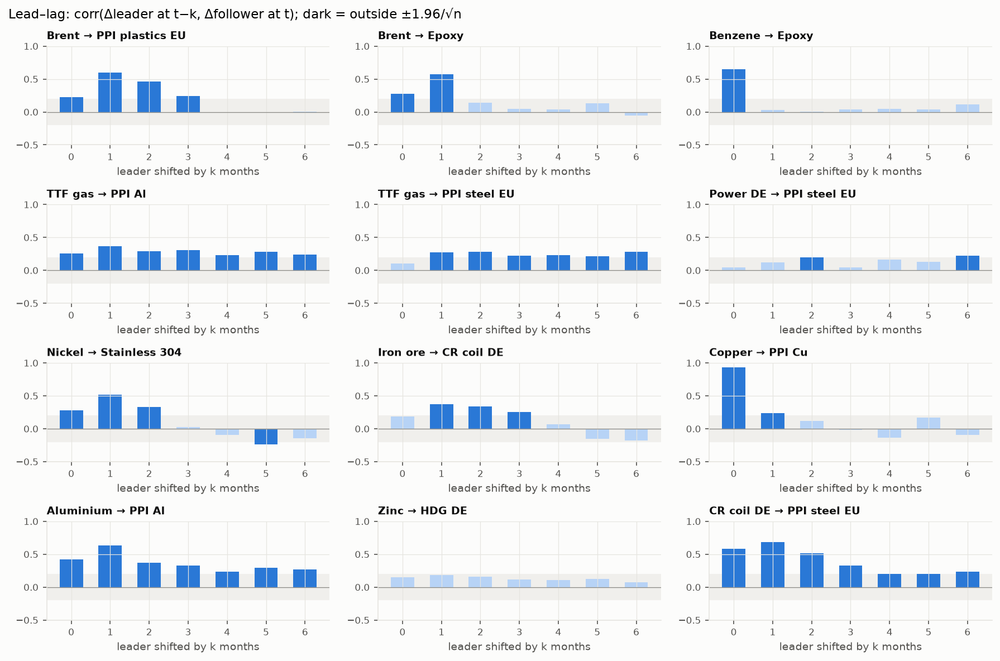
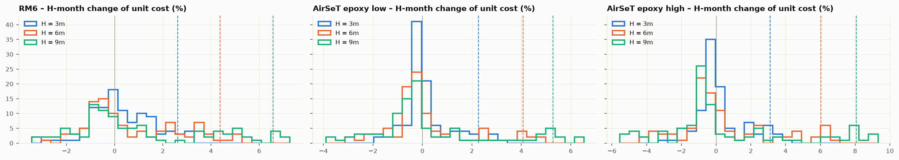
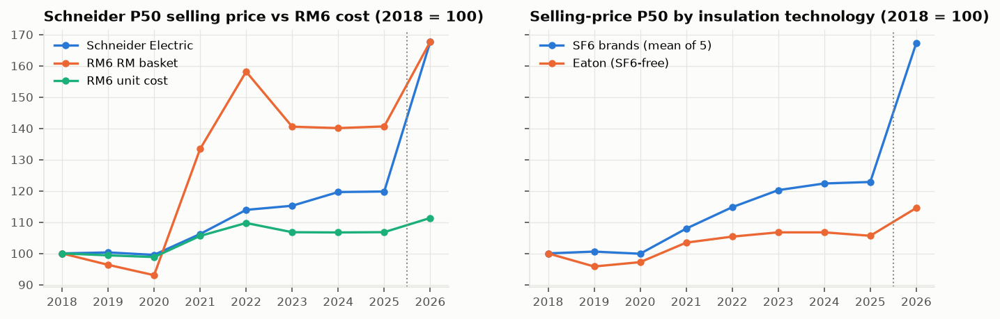

# Step 3 – Exploratory Data Analysis

**Scope:** plan Step 3 (3.1 univariate, 3.2 multivariate, 3.3 business EDA) plus extra checks.
**Built on:** the Step 1 panel (`src/data_prep.py`) and the Step 2 cost model (`src/cost_model.py`), both by Karin. The EDA does no cleaning of its own.
**Code:** `src/data_loading.py`, `src/eda_cost.py`, `src/eda.py`, `src/plotting.py`, called from `analysis/03_eda.ipynb`.
**Config and assumptions:** `configs/eda.yaml`. **Plots:** `plots/step3/`. **Full tables (CSV):** `report/problem1/step3_tables/`.

**Reproduce** (from the repo root):

```bash
uv sync
uv run python -m src.data_prep     # Step 1
uv run python -m src.cost_model    # Step 2
cd analysis && uv run jupyter nbconvert --to notebook --execute --inplace 03_eda.ipynb
```

---

**What we learned**
1. Prices are hard to predict but easy to describe. Over 3–9 months most materials move only slightly up or down. When they move, though, they tend to rise much more than they fall. Steel nearly tripled in 2021, while falls are usually milder. Raw-material risk works like insurance: the danger is in rare big shocks, not in everyday movement.

2. The longer the quote, the bigger the risk. With a 3-month fixed price, the bad case (1 contract in 20) costs about 2–3.5 margin points. With 9 months it is about 4–8.5, and the worst historical case reached 8–10 points (section 4).

3. Copper is not the only problem. Copper is 61 % of the value of RM6's raw materials, but with market prices it explains only about 35 % of the cost risk. Stainless and carbon steel explain most of the rest, because their prices swing more. For RM AirSeT, which has no copper in the BOM, steel and stainless account for almost all the risk, unless its "Other" material turns out to be epoxy.

4. We need the right price data. The official statistics (PPIs) for steel are too smooth and slow to show what Schneider actually pays. The market prices its suppliers really use (MEPS/CRU) show the true swings. For copper, the two give the same answer. **This matters for the Step 2 cost model**, which moves steel and stainless with the S09 PPI: it makes RM6 look like a copper-only risk and makes the 9-month bad case of AirSeT about 40 % smaller than with market prices (section 4).

5. Some prices give early warnings. Oil moves about a month before plastics and epoxy, and nickel moves about a month before stainless steel. These signals can help forecasting.

6. In a crisis, everything goes up together. In normal times copper and steel move fairly independently, so their swings partly cancel out. In 2021–22 they all rose at once. Planning for "average" behaviour therefore underestimates the bad case.

7. One missing fact matters more than any model: what the 86 kg of AirSeT's "Other" material is. If it is epoxy, epoxy becomes the largest single cost risk of AirSeT. (The RM6 copper question is mostly settled: Schneider's environmental profile gives about 38.7 kg, the same as the BOM.)

**What this means for the business**
* The safety margin added to a quote should grow with the validity period. Based on market prices: about +2.5–3.5 % of price at 3 months, +4.5–6 % at 6 months, +6–8.5 % at 9 months (P95, section 4).
* For long quotes (9 months), a price-adjustment clause tied to steel and copper indices is safer than a fixed price.
* RM AirSeT's risk is almost entirely steel and stainless. A clause on MEPS CR coil and CRU stainless 304 would remove most of its uncertainty, which matters given its thinner margin.

---

## 1. Data used

The EDA reads the Step 1 panel (`Data/processed/panel_monthly.csv`) and keeps 25 series under short names (mapping in `src/data_loading.py`). All cleaning is Step 1's:

- dates moved to the first of the month;
- USD converted with the ECB rate;
- the May-2026 epoxy typo fixed;
- data cut at the September 2026 origin.

| Group | Series (Step 1 ID) | From |
|---|---|---|
| LME metals in EUR | copper, aluminium cash (LME_*_CASH_EUR); nickel, zinc, iron ore (S03/S05/S04_EUR) | 2016 |
| Steel market prices | MEPS CR / HDG / HR coil Germany and France | Nov 2012 |
| Stainless | CRU 304 Germany, base + alloy surcharge | Jan 2008 |
| Producer price indices | S07–S13 | Nov 2016 |
| Epoxy chain | epoxy resin, benzene | Jan 2018 |
| Energy | Brent EUR, TTF gas EUR/MWh, day-ahead power DE / FR / HU | Nov 2016 |

- **Checks:** the Westmetall LME copper and aluminium prices match the IMF-based D01/D02 within a median 0.12 % / 0.18 % (max 0.8 % / 1.1 %).
- **Coverage:** every series ends in September 2026, except CRU stainless (August 2026).
- **Publication lags are not applied in the EDA.** They are handled in Step 4. The lead–lag results below are on reference months.

---

## 2. Univariate analysis (3.1)


**Regimes.** Every series shows the 2021–22 surge, but its size differs a lot: CR coil ×2.7 and stainless ×2.5 at the peak, power and gas ×10–20. Copper is the only series at a record high now (12,580 €/t in September 2026). Steel is recovering (CR coil 825 €/t), and power and gas are rising again (Hungarian power 179 €/MWh in September).

**Monthly log-returns** (full table: `step3_tables/return_summary.csv`):

| | vol %/yr | skew | excess kurtosis | lag-1 autocorr. of returns |
|---|---|---|---|---|
| Copper | 15.2 | −0.2 | 1.6 | 0.20 |
| Aluminium | 15.9 | −0.2 | 0.9 | 0.30 |
| Nickel | 24.8 | +1.2 | 5.1 | 0.28 |
| CR coil DE (MEPS) | 17.7 | +0.6 | 3.7 | **0.54** |
| Stainless 304 (since 2008) | 17.1 | −0.4 | 2.1 | **0.47** |
| Epoxy | 9.8 | +0.1 | 0.8 | 0.09 |
| PPI steel EU | 7.4 | +1.3 | 2.1 | **0.79** |
| TTF gas / Power HU | 71 / 75 | – | – | ~0 |

* Most series are not normal (Jarque–Bera p < 0.01): steel, stainless, nickel, iron ore, copper, the PPIs, oil, gas and German power. Aluminium, zinc, epoxy, EUR/USD and French and Hungarian power are not rejected at 1 %. Quantile and bootstrap methods fit better than Gaussian intervals.
* **Steel and PPIs have strong momentum.** Their monthly returns are autocorrelated (0.5–0.8) because MEPS and CRU are price assessments and PPIs are smoothed contract prices. Recent trend is therefore a real predictive feature for steel. LME metals behave much more like a random walk.

### Distribution of H-month changes: a naive cost-at-risk


* x-axis: the % price change over the horizon. Left of 0, the material got cheaper (good for your margin); right of 0, it got more expensive (margin loss).
* y-axis: how many past signature months gave that change.
* Dashed vertical lines: the 95th percentile for each horizon. Only 5 % of past contracts saw a rise bigger than that.

| H-month change (%) | q05 3m | q95 3m | q05 6m | q95 6m | q05 9m | q95 9m |
|---|---|---|---|---|---|---|
| Copper | −9 | +19 | −10 | +30 | −10 | +40 |
| Aluminium | −11 | +18 | −14 | +29 | −15 | +38 |
| CR coil DE | −15 | +27 | −18 | +53 | −20 | +54 |
| Stainless 304 (since 2008) | −18 | +22 | −25 | +38 | −28 | +44 |
| Epoxy | −7 | +10 | −11 | +20 | −15 | +28 |
| PPI steel EU (S09) | −6 | +15 | −11 | +28 | −14 | +40 |

* **The upside tails are 2–3 times the downside tails** for most materials, so a symmetric buffer under-protects. For carbon steel, the upper tail comes almost entirely from the 2021 episode.
* **Stainless** has a longer history (from 2008), which includes the 2008–09 crash. That is why its downside is deeper than the others'.
* **Overlapping windows:** with H = 9 there are only 10–23 independent windows, so every q95 here has a wide error band.

### PPI vs market price


| Market vs PPI | PPI vol / market vol | corr (same month) | best lead of market | corr at that lead |
|---|---|---|---|---|
| Copper LME vs PPI Cu | 0.66 | **0.93** | 0 | 0.93 |
| Aluminium LME vs PPI Al | 0.35 | 0.42 | 1 m | 0.63 |
| CR coil DE vs PPI steel DE | 0.37 | 0.55 | 1 m | 0.58 |
| Stainless 304 vs PPI steel EU | 0.42 | 0.54 | 0 | 0.54 |

* **Steel and stainless:** the PPI is 2.4–2.7 times calmer than MEPS/CRU, lags by about a month, and has drifted away in level. After 2023 the PPI stays near 150 while CR coil is at 105–125, both rebased to Jan-2017 = 100. Schneider's steel purchases are indexed to MEPS/CRU (the `Q4-2017` sheet maps the Hungarian plant to *CR Germany* and *HDG Germany*).
* **Copper:** the PPI and the LME price are interchangeable.
* **Consequence for Step 2:** the cost model moves carbon steel and stainless with S09, because Step 8 needs drivers that are forecast targets. Section 4 measures what this costs in risk.

### Volatility clustering and stationarity


* **Volatility clustering.** The Ljung–Box test on squared returns is strongly significant for steel and stainless (p < 1e-9), the aluminium and steel PPIs, TTF and German power, and not significant for copper, nickel, Brent or epoxy. Forecast intervals for steel need a volatility state (GARCH or EWMA). For LME metals, constant volatility is defensible.
* **Stationarity (ADF/KPSS)** (`step3_tables/stationarity.csv`). Log levels are non-stationary or ambiguous for every series, while returns are stationary for 21 of 25. The four exceptions (MEPS CR and HDG, PPI Cu and Al) are borderline because of their strong momentum. **Modelling should use log-returns.** Cointegration was skipped, as the plan says.
* **Seasonality** (F-test on calendar-month means). It is significant only for day-ahead power (FR p = 0.001, HU p = 0.01, DE p = 0.02) and, weakly, for MEPS CR coil (p = 0.03, March peak, June trough). PPIs and metals show none. A month-of-year feature is only worth adding for energy, and Step 4 confirmed that none of the 15 targets needs one.

---

## 3. Multivariate analysis (3.2)


* **In normal times, materials form clusters:** LME metals (Cu–Zn 0.7, Cu–Al 0.6), flat steel (CR–HDG 1.0, CR–stainless 0.5), the epoxy chain (epoxy–benzene 0.65) and energy (TTF–power 0.6). Correlation between clusters is low (copper–CR coil 0.23).
* **In the 2021–22 stress period, diversification breaks down:**
  - copper–CR coil 0.23 → 0.46
  - CR coil–aluminium 0.22 → 0.45
  - CR–stainless 0.48 → 0.58
  - TTF–Hungarian power 0.61 → 0.91

  A cost simulation that assumes average correlations will understate the tail. Step 8 should use a block bootstrap or a t-copula, not a Gaussian with full-sample correlations.

### Lead–lag (correlation of Δx at t−k with Δy at t)



| Leader → follower | best lead | ρ | Useful feature? |
|---|---|---|---|
| Brent → PPI plastics EU | 1 m | 0.60 | **Yes** (confirms the data README) |
| Brent → Epoxy | 1 m | 0.57 | **Yes** |
| Benzene → Epoxy | 0 (same month) | 0.65 | Nowcast only |
| Nickel → Stainless 304 | 1 m | 0.52 | **Yes**, through the alloy surcharge |
| Iron ore → CR coil DE | 1–3 m | 0.37 | Yes (weaker) |
| TTF gas → PPI Al | 1 m | 0.37 | Yes (weaker) |
| TTF / power → PPI steel EU | up to 6 m | 0.23–0.28 | Weak; check in backtest |
| MEPS CR coil → PPI steel EU | 1 m | 0.69 | **Yes**, for forecasting the PPI |
| LME Al → PPI Al | 1 m | 0.63 | **Yes** |
| LME Cu → PPI Cu | 0 | 0.93 | Same month only |
| Zinc → HDG | – | < 0.19 | No |

The significance band is about ±0.19. These leads are measured on reference months. Step 4 tests them again with publication lags and a backtest: Brent → plastics/epoxy and LME Al → PPI Al survive; MEPS → steel PPI does not add anything once the PPI's own momentum is in the model.

---

## 4. Business EDA (3.3), using the Step 2 cost model

### How the cost is built

The raw-material cost of one unit is Karin's Step 2 model (`src/cost_model.py`), unchanged:

```
cost_i(t) = kg_i × €/t_i(Sep 2026) / 1000 × driver_i(t) / driver_i(Sep 2026)
```

- **Masses:**
  - RM6: BOM, with the unlabelled 45 % slice read as carbon steel, plus 1.6 kg epoxy from the environmental profile;
  - AirSeT: BOM, with two epoxy cases (3.9 kg "low", 85.6 kg "high", i.e. all of "Other").
- **Plastics** have no €/t level and are left out, as in Step 2.
- `src/eda_cost.py` reproduces Step 2's BOM index to within 0.0005 points.
- **History starts in January 2018**, because epoxy is part of every case and its series starts then.

**Two ways to move prices back in time**, compared throughout this section:

| | Step 2 drivers (team definition) | Market prices (sensitivity) |
|---|---|---|
| Carbon steel, stainless | S09 EU steel PPI | MEPS CR coil, CRU stainless 304 |
| Galvanised | S10 German steel PPI | MEPS HDG Germany |
| Copper, aluminium, epoxy | D01, D02, epoxy price | same |

The market version is closer to what Schneider pays. The Step 2 version is what Step 8 can produce from the forecast targets.

**For the margin simulation only**, a constant non-raw-material cost is added so that the unit cost in September 2026 is €3,009 for RM6 (teardown should-cost) and €3,610 for AirSeT (assumption: +20 %).


| Sep 2026 | Raw-material cost | Share of unit cost | Value split |
|---|---|---|---|
| RM6 | €795 | 26 % | copper 61 %, stainless 19 %, carbon steel 15 %, galvanised 2 %, aluminium 2 %, epoxy 1 % |
| AirSeT, epoxy low | €583 | 16 % | stainless 48 %, carbon steel 46 %, epoxy 3 %, aluminium 2 % |
| AirSeT, epoxy high | €981 | 27 % | epoxy 42 %, stainless 29 %, carbon steel 28 %, aluminium 1 % |

### How much the cost moves over 3, 6 and 9 months

H-month change of the raw-material cost (BOM index), January 2018 → September 2026. Full table: `step3_tables/cost_h_changes.csv`.

| | Step 2 drivers: P90 / P95 | Market prices: P90 / P95 |
|---|---|---|
| RM6, 3 m | +10.5 / +12.5 % | +13.6 / +19.0 % |
| RM6, 6 m | +17.4 / +24.8 % | +23.9 / +37.5 % |
| RM6, 9 m | +27.3 / +37.5 % | +34.6 / +53.1 % |
| AirSeT low, 3 m | +12.2 / +15.7 % | +16.0 / +24.7 % |
| AirSeT low, 6 m | +22.4 / +28.4 % | +26.4 / +48.4 % |
| AirSeT low, 9 m | +32.4 / +41.5 % | +42.9 / +73.9 % |
| AirSeT high, 9 m | +30.4 / +35.4 % | +33.1 / +52.1 % |

* The P90 values with Step 2 drivers are exactly Step 2's own table (`bom_index_changes.csv`).
* **With market prices, the tail is much fatter**, by 40–80 % at the 95th percentile. AirSeT is the most affected because it is almost all steel and stainless, the two materials the PPI smooths.
* On the **total unit cost**, raw materials are only 16–27 %, so the moves are much smaller. The 9-month P95 is +6.6 % (RM6) and +5.3 % (AirSeT low) with Step 2 drivers, and +9.0 % and +9.3 % with market prices.



### Which material drives the cost risk?


This is an Euler decomposition: each material's share of the variance of the H-month € change of the raw-material cost.

| Case | Step 2 drivers | Market prices |
|---|---|---|
| RM6 | copper 50–62 %, stainless 19–25 %, carbon steel 14–19 % | **copper 35 %, stainless 33–35 %, carbon steel 25–26 %** |
| AirSeT, epoxy low | stainless 49 %, carbon steel 47–48 % | stainless 48–51 %, carbon steel 47–51 % |
| AirSeT, epoxy high | epoxy 36–37 %, stainless 32 %, carbon steel 31 % | stainless 41–42 %, carbon steel 36–42 %, epoxy 15–22 % |
| AirSeT low, nickel check (Step 2) | stainless 64–79 % (almost all of it the nickel-driven surcharge), carbon steel 19–33 % | – |

* **RM6:** with the Step 2 drivers, RM6 looks like a copper bet, as the Step 2 report says. With market prices, copper is only a third of the risk; stainless and carbon steel together are 60 %. The difference comes entirely from the smoothing of the steel PPI.
* **AirSeT:** steel and stainless share the risk about equally in both versions. In the "epoxy high" case, epoxy looks like the biggest risk with Step 2 drivers, but only because the steel driver is so smooth. With market prices it is the smallest of the three.
* **Nickel check:** if the stainless surcharge followed nickel one for one, it would dominate AirSeT's risk. The real CRU surcharge (market version) moves less than nickel, so this case is an upper bound.

### Historical "margin gamble"

At each past month, the price is set at unit cost / (1 − 30 %) and held for H months, with material bought at delivery. This is the worst case: no early purchasing, no indexation, no hedge.


Loss in margin points (negative = margin below the 30 % target). Full table: `step3_tables/margin_gamble_summary.csv`.

| | H | P95 loss, Step 2 drivers | P95 loss, market prices | Worst, market prices | P(loss > 2 pts), market |
|---|---|---|---|---|---|
| RM6 | 3 | −1.8 | −2.6 | −3.2 | 11 % |
| | 6 | −3.1 | −4.4 | −6.3 | 20 % |
| | 9 | −4.6 | −6.3 | −7.8 | 27 % |
| AirSeT, epoxy low | 3 | −1.6 | −2.9 | −4.0 | 10 % |
| | 6 | −2.8 | −4.7 | −6.4 | 14 % |
| | 9 | −3.7 | −6.5 | −8.4 | 19 % |
| AirSeT, epoxy high | 3 | −2.2 | −3.5 | −4.7 | 12 % |
| | 6 | −4.2 | −5.9 | −7.9 | 18 % |
| | 9 | −5.6 | −8.5 | −10.5 | 23 % |

* **On average the gamble is close to neutral** (mean loss below 1 point). The risk is in regime shifts:
  - contracts signed between August and December 2020 lost the most: up to 5 points with Step 2 drivers, 8–10 points with market prices;
  - contracts signed in spring 2022 gained up to 2–3 points (Step 2) or 5–7 points (market) when prices fell back;
  - RM6 contracts signed in autumn 2025 are losing again because of the copper rally: about −3 to −4.5 points at 9 months.
* **A historical P95 buffer**, with market prices, is about **2.5–3.5 % of price at 3 months, 4.5–6 % at 6 months and 6–8.5 % at 9 months**. With the Step 2 drivers it is 25–45 % lower. These buffers scale with the raw-material share of unit cost, which is assumed for AirSeT.

---

## 5. Extra exploration

**Data quality**

* **Epoxy file typo.** In the raw file, May-2026 epichlorohydrin is 257 €/t, against about 2,500 around it, which drags epoxy from about 4,900 to 3,593 for one month. Step 1 replaces both values by interpolation. The isolated-spike scan in the notebook finds this point in the raw file and nothing left in the Step 1 panel. Without the fix, epoxy's measured volatility doubles and shows a fake spike-and-revert pattern.
* The April-2020 benzene crash (206 €/t) is real and is kept.
* The only other isolated spike is a dip in French power in May 2025. It is plausible (spring surplus) and left as is.
* **Teardown benchmark.** The SGC column has a total should-cost of €19, so it is unusable. Eaton's should-cost (€767) is also implausibly low.

**Selling price vs cost** (synthetic RMU benchmark, yearly P50, Step 1 output)



* Up to 2025, Schneider's P50 price follows the RM6 raw-material cost loosely and with a lag. The year-on-year correlation is 0.80 excluding 2026, but on only 7 points.
* Prices are sticky. Raw-material cost rose 58 % from 2018 to 2022 while the price rose 14 %. The price kept rising in 2023–25 while costs fell back, so the margin was rebuilt.
* **2026: every SF6 brand jumps by +33 % to +40 %; Eaton (SF6-free) by +8 %.** This fits the EU F-gas ban on SF6 in new ≤24 kV switchgear from 2026. It is relevant for Goal B (price convergence of SF6-free products), but the panel is synthetic and Step 1 leaves 2026 out of margin backtests.

---

## 6. Implications for the next steps

| Step | Recommendation from the EDA |
|---|---|
| 2 Cost model | Keep the S09 drivers for the forecast chain, but **report the market-price version next to it**. Better still, forecast MEPS CR coil and CRU stainless internally (not CSV targets) and use them in Step 8, because the S09 version gives a 9-month P95 30–45 % below the market-price version. Ask Schneider what AirSeT's "Other" (86 kg) is. |
| 4 Features | Done in Step 4: own momentum for the PPIs, Brent → plastics and epoxy, LME Al → PPI Al, iron ore → US steel. No calendar features. |
| 5 Baselines | A random walk will be hard to beat for LME metals. Steel and PPIs, which have momentum, are where models can add skill. |
| 6–7 Models | Use log-returns. Use volatility-state models (GARCH or EWMA) for steel and energy. Use quantile or bootstrap intervals, not Gaussian ones. Expect few independent windows at H = 9. |
| 8 Simulation | Use stress-aware joint dependence (block bootstrap or t-copula); correlations rise sharply in crises. Never add up material P90s (Step 2 says the same). |
| 9 Pricing | The buffer must grow with H. Indexation for RM6 should cover stainless and steel as well as copper. For AirSeT, a steel and stainless clause (MEPS CR / CRU 304) covers about 95 % of raw-material risk in the "epoxy low" case. |

## 7. Limitations

* **Cost model gaps:** plastics are unpriced, AirSeT's "Other" is unknown, and AirSeT's total unit cost (€3,610) is an assumption.
* **History:** the cost history starts in January 2018 (epoxy), so the 2008–09 crisis is only in the stainless series.
* **Margin simulation:** it assumes all material is bought at delivery, a constant non-raw-material cost, a 30 % target margin and no indexation. Real exposure is smaller if purchases happen earlier.
* **Lead–lag** results are computed on reference months, not publication vintages (handled in Step 4).
* **The RMU price benchmark** is synthetic and yearly.
