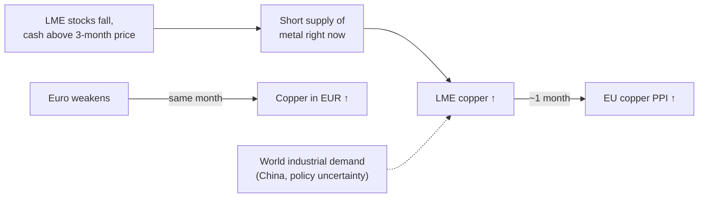
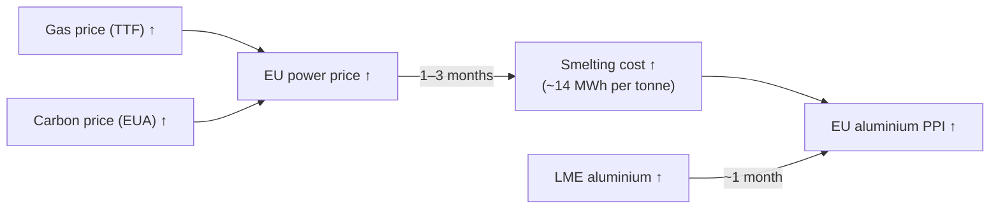
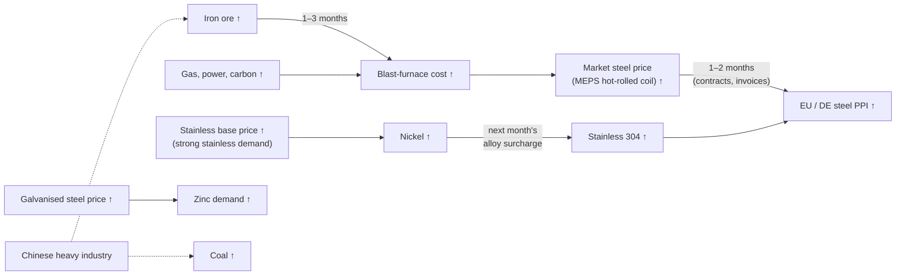
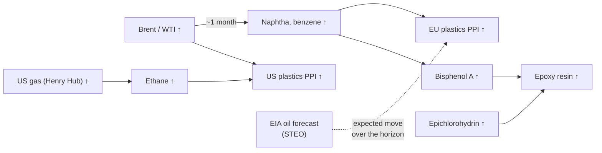
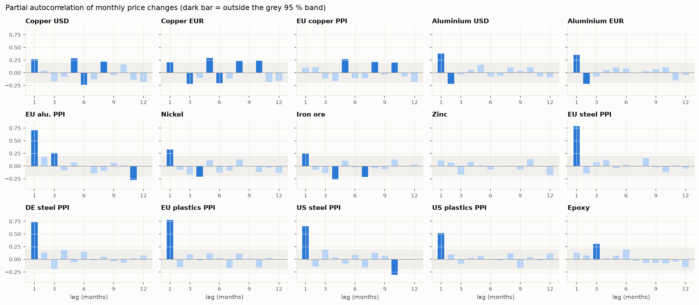
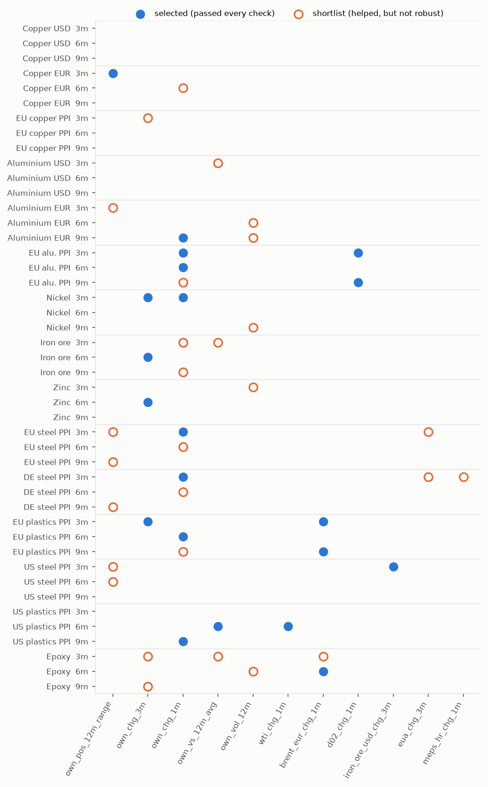
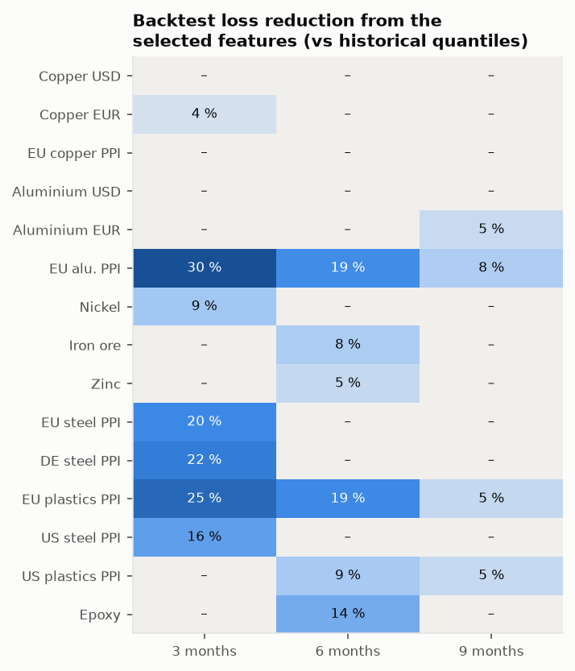
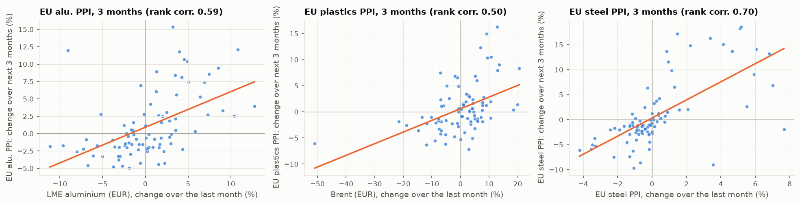
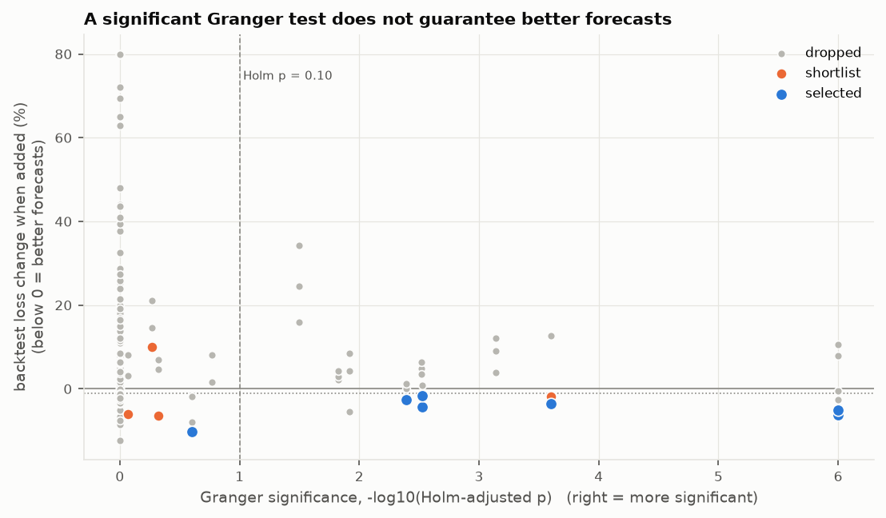

# Step 4 – Forecast targets and feature engineering

*Status: first version, ready for Steps 5–7*

> **Run from the repo root, in this order:**
>
> ```bash
> uv run python -m src.data_prep           # Step 1: panel, lags, targets
> uv run python -m src.external_data       # free external data (needs internet once, then cached)
> uv run python -m src.features            # feature tables + leakage test
> uv run python -m src.feature_selection   # evidence and selected features
> uv run pytest tests/                     # leakage tests
> ```
>
> The notebook `analysis/04_features.ipynb` runs the same code and shows every table and chart.

| What | Where |
|---|---|
| Feature catalogue (definition, reason, expected sign, delay) | `configs/features.yaml` |
| Code | `src/external_data.py`, `src/features.py`, `src/feature_selection.py`, `src/feature_plots.py` |
| Feature tables, one per target and horizon | `Data/processed/features/<target>_h<H>.csv` (not committed) |
| Tables used in this report | `report/problem1/step4_tables/` |
| Charts | `plots/step4/` |

---

## Summary

- We built **37 candidate features**: 5 based on each material's own price and 32 "drivers" (other prices, energy, carbon, supply chains, policy uncertainty, oil forecasts). Every one has a written cause → effect reason and an expected sign.
- Each candidate had to pass four tests: a Granger or lead–lag signal, a rolling backtest gain, the right sign, and a bootstrap robustness check. **21 feature slots survived** across the 45 models (15 targets × 3 horizons). Another 28 helped in the backtest but were not reliable enough; they are kept on a shortlist.
- **The plan expected 5–10 features per model. The data supports 0 to 2.** With about 38 test months, most of them during the 2022 shock, every extra feature costs more in noise than it adds in signal.
- **28 of the 45 models keep no feature** (17 keep one or two). Their best forecast is the historical distribution of past changes. This includes copper (LME and PPI) and LME aluminium in dollars, which behave like random walks.
- The features that do work fall into three groups:
  1. **Momentum in producer price indices.** The EU steel, aluminium and plastics PPIs keep moving the way they moved last month.
  2. **Market prices leading the indices.** LME aluminium leads the EU aluminium PPI, Brent leads EU plastics and epoxy, iron ore leads the US steel PPI.
  3. **Reversal in iron ore and nickel** after a large 3-month move.
- Where features are kept, they lower the backtest loss against the historical-quantile baseline by up to **30 %** (EU aluminium PPI, 3 months), **25 %** (EU plastics PPI) and **20–22 %** (EU and German steel PPI).
- **No feature uses data published after the forecast date.** Two automatic checks prove it: a rule check on 286 feature/origin pairs, and a test that fills all future data with random numbers and verifies that no feature changes (540 cases).

---

## 1. What we forecast

The targets come from Step 1 (`data_dictionary.csv`). They are the 14 priceable BOM proxies plus epoxy resin.

| Region | Targets |
|---|---|
| EU | D01 copper (EUR), S07 copper PPI, D02 aluminium (EUR), S08 aluminium PPI, S09 steel PPI, S10 German steel PPI, S11 plastics PPI, epoxy resin |
| WW | S01 copper, S02 aluminium, S03 nickel, S04 iron ore, S05 zinc (all USD), S12 US steel PPI, S13 US plastics PPI |

**What the models predict.** For a target price *P*, origin month *o* and horizon *H* (3, 6 or 9 months):

```
y = log(P[o+H]) − log(P[o])
```

This is roughly the % change over the next H months. We build **one model per horizon** (the "direct" approach): one for 3 months, one for 6, one for 9. Each model sees the same information at the origin, and errors do not pile up from month to month. Working in log changes also removes the trend, which Step 3 showed is needed (prices are non-stationary, changes are stationary).

The two BOM cost indices (RM6, AirSeT) are not modelled here. They come from the material forecasts through the Step 2 cost formula in Step 8.

## 2. Timing: what is known when

At the submission origin (September 2026), the forecast is actually made in November 2026: that is when IMF, Eurostat and BLS publish September. We apply the same rule at every past origin:

- **origin *o*** = the last month of the target we know;
- **forecast date** = start of month *o* + 2;
- a series with publication lag *L* is known up to month *o* + 2 − *L*, and **never after month *o***, even if it is out already.

The lags come from Step 1 (`SOURCE_LAGS` in `src/data_prep.py`), plus the external sources in section 3. The rule is applied by the team's `available_at()` function.

At the September 2026 origin this gives:

| Series | Lag (months) | Last month used |
|---|---|---|
| IMF metals and oil, Eurostat and US PPIs, MEPS, LME, Ember power, epoxy file | 1–2 | Sep 2026 |
| CRU stainless 304 | 3 | Aug 2026 |
| NY Fed GSCPI | 3 (see below) | Aug 2026 |
| Global policy uncertainty index | 4 | Jul 2026 |
| EIA STEO forecast | release of the origin month | Sep 2026 release |

The rule is strict. MEPS, LME and Ember have already published October, but at a September origin we do not use October. This matches the Step 1 decision to stop the data at the submission origin.

## 3. External data

We looked at every source you listed. A source is used only if it is free, its licence allows use with attribution, and it is published early enough. Each source was also checked for revisions after release, because a revised history contains information that was not available at the time.

| Source | Used? | Licence | Lag | Notes |
|---|---|---|---|---|
| **NY Fed Global Supply Chain Pressure Index (GSCPI)** | Yes | Free, attribution (NY Fed terms) | 3 | Published after 1 month, but the NY Fed re-estimates it every month and only the current version can be downloaded. At origin *o* we use month *o*−1, which has already been through one revision. |
| **Economic Policy Uncertainty (Global, Europe, US)** | Yes | Free, cite Baker, Bloom & Davis (2016) | 1 (EU, US), 4 (Global) | Counts of newspaper articles, not revised. The Global index comes out about 3 months late. |
| **EIA Short-Term Energy Outlook (STEO)** | Yes | US government, public domain | release month | We downloaded all 120 monthly archives, Nov 2016 → Oct 2026. Feature: the change in Brent (or WTI) that the EIA expected over our horizon, taken from the release of the origin month. |
| **Ember EU carbon price (EUA)** | Yes | CC BY 4.0 | 1 | Daily prices from Ember's published "ETS prices – EU only" chart, averaged by month. **Starts January 2018**, so models using it lose 14 months of history. |
| EIA daily spot prices (Brent, WTI, Henry Hub) | No | Public domain | – | Under our timing rule the monthly IMF prices up to the origin are already available, so the daily series adds nothing. |
| OECD Composite Leading Indicators | **No** | CC BY 4.0 | 1 | The CLI is smoothed with a filter that is revised heavily for the most recent months. Only today's version can be downloaded, so its past values contain information that was not available at the time. Using it would be leakage. It could be used with the OECD real-time vintages, which we did not have time to collect. |
| Outokumpu / Aperam alloy surcharges | **No** | Company websites | – | The sites block automated download (HTTP 403) and keep no historical archive. The effect they would capture (nickel → next month's stainless surcharge) is tested with nickel itself. |

**Before submission, check with Schneider.** The NY Fed and policy-uncertainty licences are "free with attribution", not a formal open licence. Someone at Schneider should confirm they are acceptable. Ember (CC BY 4.0) and EIA (public domain) are clear.

## 4. Candidate features and why each one should help

Every feature is computed from the latest month of its series that is known at the origin (section 2). The full catalogue, with the exact formula, is in `configs/features.yaml` and `step4_tables/candidate_catalogue.csv`.

### 4.1 Features built from the target's own price (all 15 targets)

| Feature | What it measures | Why it should help | Expected effect |
|---|---|---|---|
| `own_chg_1m` | % change over the last month | **Momentum.** PPIs are built from invoices on contracts that are reset slowly, so a rise last month often continues. Used only if the partial autocorrelation at lag 1 is significant (section 5.1). | + |
| `own_chg_3m` | % change over the last 3 months | **Medium-term momentum.** Many steel and chemical contracts are reset each quarter. A move that started this quarter is often not finished. | + |
| `own_vs_12m_avg` | Price compared with its 12-month average | **Reversal.** A price far above its 12-month average tends to come back down (new supply, buyers wait). It can also show a trend, so we let the data choose the sign. | − or + |
| `own_pos_12m_range` | Where the price sits between its 12-month low (0) and high (1) | Same idea, but one spike does not distort it. A price at its 12-month high has more room to fall. | − or + |
| `own_vol_12m` | Volatility of monthly changes over 12 months | **Not a direction signal.** After volatile months, the next months are usually volatile too (Step 3), so the P10–P90 band should be wider. | widens the band |

### 4.2 Drivers, by material

Each diagram reads left to right: a cause, the cost or market it hits, and the price we forecast, with the expected delay. Dotted arrows are shared causes. They can create a correlation without one price driving the other.

#### Copper (S01, D01, S07)



| Feature | Measures | Why | Sign | Used for |
|---|---|---|---|---|
| `cu_spread` | LME 3-month price minus cash price, as % of cash | Cash above the 3-month price (backwardation) means buyers pay extra to get metal now. Stocks are short and the price tends to stay firm. | − | S01, D01, S07 |
| `cu_stocks_chg_3m` | 3-month change of LME copper stocks | Stocks rise when supply runs ahead of demand, which weighs on the price. | − | S01, D01 |
| `eurusd_chg_3m` | 3-month change of the euro against the dollar | The euro price is the dollar price divided by EUR/USD. The euro tends to keep its direction for a few months (Step 3: autocorrelation 0.32). | − | D01, D02 |
| `d01_chg_1m` | Last month's change of LME copper in euros | The EU copper PPI is what EU producers invoice. Their prices follow the LME with a short delay. | + | S07 |
| `cu_gap_3m` | 3-month change of LME copper minus that of the copper PPI | If the market moved more than the PPI last quarter, the PPI still has to catch up. | + | S07 |
| `gscpi` | NY Fed supply-chain pressure (0 = normal) | When supply chains are stressed, buyers order more than they need and suppliers can charge more, as in 2021. | + | most metals |
| `epu_global_chg_3m` | 3-month change of global policy uncertainty | When uncertainty rises (trade wars, sanctions), companies delay investment and orders, so demand for metals weakens. | − | world metals |

#### Aluminium (S02, D02, S08)



| Feature | Measures | Why | Sign | Used for |
|---|---|---|---|---|
| `al_spread`, `al_stocks_chg_3m` | Same as copper, for aluminium | Short supply now (backwardation, falling stocks) supports the price. | − | S02, D02 |
| `ttf_chg_3m` | 3-month change of the EU gas price | Gas sets the EU power price most of the time. Smelting uses about 14 MWh per tonne. In 2022, EU smelters cut output when gas spiked. | + | S02, D02, S08, zinc, steel, plastics |
| `eua_chg_3m` | 3-month change of the EU carbon price | Smelters pay for carbon through their power price, steelmakers directly. | + | D02, S08, steel |
| `d02_chg_1m` | Last month's change of LME aluminium in euros | The EU aluminium PPI follows the LME about a month later (Step 3: correlation 0.63). | + | S08 |
| `al_gap_3m` | 3-month change of LME aluminium minus that of the PPI | Catch-up of the PPI to the market. | + | S08 |

#### Steel and stainless (S09, S10, S12) and their raw materials (S03 nickel, S04 iron ore, S05 zinc)



| Feature | Measures | Why | Sign | Used for |
|---|---|---|---|---|
| `meps_hr_chg_1m` | Last month's change of the MEPS hot-rolled coil price, Germany | MEPS surveys what steel actually trades at. The PPI comes from invoices on contracts agreed 1–3 months earlier, so the market moves first (Step 3: 0.69 one month ahead). | + | S09, S10 |
| `steel_gap_3m_s09`, `_s10` | 3-month change of MEPS minus that of the PPI | Catch-up of the PPI to the market. | + | S09, S10 |
| `iron_ore_eur_chg_3m`, `_usd_` | 3-month change of iron ore | Main raw material of blast-furnace steel: about 1.6 t of ore per t of steel. | + | S09, S10, S12 |
| `nickel_eur_chg_1m` | Last month's change of nickel in euros | The EU steel PPI also covers stainless and ferro-alloys. Mills set next month's alloy surcharge from this month's nickel price (304 grade is about 8 % nickel). | + | S09 |
| `power_de_chg_3m` | 3-month change of German power | German mills, especially electric-arc furnaces, buy a lot of power. | + | S10 |
| `ss_base_chg_3m` | 3-month change of the stainless base price (CRU) | Two thirds of nickel goes into stainless. When mills can raise the base price, stainless demand is strong and they buy more nickel. | + | S03 |
| `coal_chg_3m` | 3-month change of thermal coal | A sign of Chinese heavy-industry activity, which also buys most iron ore. This is a shared cause, not a cost link. | + | S04 |
| `hdg_chg_3m` | 3-month change of galvanised steel (MEPS) | About half of zinc is used to galvanise steel. | + | S05 |
| `hh_chg_3m` | 3-month change of US gas (Henry Hub) | US mills are mostly electric-arc furnaces that depend on gas-fired power. | + | S12, S13 |
| `epu_us_chg_3m`, `epu_europe_chg_3m` | Regional policy uncertainty | Same reason as the global index. | − | S12, S07 |

#### Plastics and epoxy (S11, S13, epoxy)



| Feature | Measures | Why | Sign | Used for |
|---|---|---|---|---|
| `brent_eur_chg_1m` | Last month's change of Brent in euros | Plastics and epoxy are made from oil products. Producers pass the cost on about a month later (Step 3: 0.60 with the plastics PPI). | + | S11, epoxy |
| `benzene_chg_1m` | Last month's change of benzene | Benzene is the starting point of bisphenol A, the largest ingredient of epoxy. | + | S11, epoxy |
| `ech_chg_1m` | Last month's change of epichlorohydrin | The second main ingredient of epoxy. | + | epoxy |
| `wti_chg_1m` | Last month's change of WTI | Oil cost in US resin prices. | + | S13 |
| `steo_brent`, `steo_wti` | EIA's forecast of the oil price change between the origin and the target month | If the EIA expects oil to rise over our horizon, plastic costs should follow. It is the only forward-looking feature, and it was public at the origin. | + | S11, S13, epoxy |

**Not used as candidates:**
- **Power prices in France and Hungary.** They drive the cost of running Schneider's own plants, not the price of the materials we forecast. They belong in a conversion-cost model, not here.
- **Calendar features.** No target shows a significant month-of-year pattern (section 5.1).

## 5. How features were chosen

All selection work uses **origins whose target month is at or before March 2025**. The last 18 months (April 2025 → September 2026) are kept untouched for the Step 7 hold-out.

### 5.1 Own-price lags and seasonality



- **Lag 1 is significant for 12 of 15 targets.** The partial autocorrelation is strongest for the producer price indices: EU steel 0.79, EU plastics 0.78, German steel 0.74, EU aluminium 0.71, US steel 0.65. These indices really do carry last month's move into the next month.
- **For the copper PPI, zinc and epoxy, lag 1 is not significant**, so `own_chg_1m` is not a candidate for them. For epoxy, only lag 3 is significant. This fits a price recalculated each quarter from its inputs.
- The scattered lags at 5, 6, 8 and 10 for copper make no economic sense and fall just outside a ±0.20 band. We treat them as noise and did not add 5- or 8-month features (`step4_tables/own_lag_decision.csv`).
- **Seasonality:** we tested whether the 12 calendar-month averages differ. The lowest p-value is 0.048 (iron ore), and it becomes 0.71 once we correct for testing 15 series. **No calendar features.**

### 5.2 The evidence for each candidate

For every target, horizon and candidate we recorded (`step4_tables/evidence.csv`):

1. **Lead–lag.** Rank correlation between the feature at the origin and the change that followed. H-month windows overlap, so the significance band uses n/H independent points: ±0.37 at 3 months, ±0.53 at 6, ±0.66 at 9.
2. **Granger test.** Does the driver's past (3 months) help predict the target's next monthly change, beyond the target's own past? We ran 65 tests, so p-values are corrected with the Holm method. "Helps predict" here does not mean "causes".
3. **Backtest gain.** A rolling-origin quantile regression (P10, P50, P90) is trained only on origins whose outcome was already known, and refitted every 3 months. Features are standardised with training-window statistics only. We measure the pinball loss with and without the feature on the same months. A feature must lower the loss by at least 1 %.
4. **Sign check.** The fitted effect of a driver on the median must have the sign the economics predicts. A driver with the wrong sign is dropped, even if it helps the backtest.

### 5.3 The decision rule

1. **Own-price features first.** Starting from a model with no features (the historical quantiles of past changes), add the own-price feature that lowers the loss the most. Repeat until nothing lowers it by 1 % (maximum 4).
2. **Then drivers.** Only drivers with a statistical signal can enter: Holm-adjusted Granger p < 0.10, or a lead–lag correlation outside the band. Add them one at a time in the same way, but only if the sign is right (maximum 4).
3. **Robustness gate.** Each kept feature is tested last, with the others already in. It must:
   - still lower the loss by 1 %;
   - lower it in at least 80 % of block-bootstrap resamples of the test months (blocks of H months, because the windows overlap);
   - if it is a volatility feature, widen the P10–P90 band rather than shift the median.

   Features that won step 1 or 2 but fail this gate go on a **shortlist**.

## 6. Results

### 6.1 Selected features



| Target | 3 months | 6 months | 9 months |
|---|---|---|---|
| Copper USD (S01) | – | – | – |
| Copper EUR (D01) | `own_pos_12m_range` | – | – |
| EU copper PPI (S07) | – | – | – |
| Aluminium USD (S02) | – | – | – |
| Aluminium EUR (D02) | – | – | `own_chg_1m` |
| EU aluminium PPI (S08) | `own_chg_1m`, `d02_chg_1m` | `own_chg_1m` | `d02_chg_1m` |
| Nickel (S03) | `own_chg_3m`, `own_chg_1m` | – | – |
| Iron ore (S04) | – | `own_chg_3m` | – |
| Zinc (S05) | – | `own_chg_3m` | – |
| EU steel PPI (S09) | `own_chg_1m` | – | – |
| German steel PPI (S10) | `own_chg_1m` | – | – |
| EU plastics PPI (S11) | `own_chg_3m`, `brent_eur_chg_1m` | `own_chg_1m` | `brent_eur_chg_1m` |
| US steel PPI (S12) | `iron_ore_usd_chg_3m` | – | – |
| US plastics PPI (S13) | – | `own_vs_12m_avg`, `wti_chg_1m` | `own_chg_1m` |
| Epoxy | – | `brent_eur_chg_1m` | – |

"–" means no feature passed. The model for that cell is the historical distribution of past H-month changes. Steps 5–6 can still try time-series models there (GARCH, Chronos).

### 6.2 How much they help



The numbers are the % reduction of the backtest pinball loss against the historical-quantile model, over the selection window. The gain is largest for the EU indices at short horizons and fades at 9 months, as expected: a price index's own momentum lasts a few months, not three quarters.

### 6.3 What each kept feature means in business terms

The "typical move" is one standard deviation of the feature over the training window. The effect is how much the forecast H-month price change moves when the feature makes a typical move, all else equal. "Confidence" is the share of bootstrap resamples in which the feature helped. Source: `step4_tables/selected_features_detail.csv`.

| Target, horizon | Feature | Typical move | Effect on median | Effect on P10 / P90 | Confidence | How to read it |
|---|---|---|---|---|---|---|
| EU aluminium PPI, 3 m | own last-month change | 1.7 % | +2.8 % | +1.1 / +4.4 % | 98 % | The index keeps moving in the same direction. |
| | LME aluminium, last month | 4.6 % | +1.5 % | +1.1 / +0.6 % | 91 % | A rise on the LME reaches the EU index within 3 months. |
| EU aluminium PPI, 6 m | own last-month change | 1.8 % | +6.5 % | +2.5 / +10.4 % | 81 % | Same momentum, larger over 6 months. |
| EU aluminium PPI, 9 m | LME aluminium, last month | 4.6 % | +3.7 % | +2.2 / +9.1 % | 100 % | |
| EU steel PPI, 3 m | own last-month change | 2.4 % | +3.9 % | +0.9 / +7.4 % | 91 % | Steel contracts carry last month's trend for about a quarter. |
| German steel PPI, 3 m | own last-month change | 2.3 % | +3.9 % | +1.2 / +7.1 % | 96 % | Same. |
| EU plastics PPI, 3 m | own 3-month change | 4.6 % | +2.0 % | +1.9 / +3.4 % | 88 % | Momentum. |
| | Brent, last month | 9.7 % | +1.4 % | +0.9 / +1.7 % | 81 % | A 10 % oil move adds about 1.4 % to plastics within 3 months. |
| EU plastics PPI, 6 m | own last-month change | 1.7 % | +4.7 % | +2.4 / +7.0 % | 86 % | |
| EU plastics PPI, 9 m | Brent, last month | 9.9 % | +1.6 % | +2.0 / +4.3 % | 96 % | |
| Epoxy, 6 m | Brent, last month | 10.2 % | +1.9 % | +4.7 / +4.3 % | 97 % | Oil feeds benzene and bisphenol A, then epoxy. |
| US steel PPI, 3 m | iron ore, 3-month change | 19.9 % | +3.6 % | +4.7 / +4.8 % | 100 % | US mills pass higher ore costs on within a quarter. |
| US plastics PPI, 6 m | price vs 12-month average | 6.6 % | +0.9 % | +0.3 / +6.6 % | 100 % | When resins are above their 12-month average, the upside risk is larger. Here it is a trend, not a reversal. |
| | WTI, last month | 13.1 % | +1.9 % | +1.0 / +0.7 % | 88 % | |
| US plastics PPI, 9 m | own last-month change | 2.1 % | +1.9 % | −1.1 / +4.8 % | 90 % | |
| Nickel, 3 m | own last-month change | 7.8 % | +8.1 % | +1.3 / +5.7 % | 98 % | Last month's move continues… |
| | own 3-month change | 16.4 % | −7.9 % | −4.0 / −4.1 % | 96 % | …but a large 3-month move partly reverses. |
| Iron ore, 6 m | own 3-month change | 20.3 % | −7.3 % | −16.1 / −0.6 % | 100 % | After a big 3-month rise, iron ore tends to fall back, and the downside widens a lot. |
| Zinc, 6 m | own 3-month change | 11.7 % | +2.8 % | −6.9 / 0.0 % | 100 % | Mostly a wider downside after big moves. |
| Aluminium EUR, 9 m | own last-month change | 4.6 % | +3.2 % | −1.3 / +10.2 % | 100 % | Mostly a wider band, skewed up. |
| Copper EUR, 3 m | position in 12-month range | 37 pts of range | 0 % | −4.4 / +1.6 % | 97 % | The median does not change, but when copper sits at its 12-month high, the downside is larger. Copper is at the top of its range today (Sep 2026: 1.0), so the 3-month band should be wider on the downside. |



### 6.4 What did not work, and why

This is as useful for the jury as what worked, because it shows the selection was not tuned to look good.

- **A significant Granger test does not mean better forecasts.** MEPS steel → EU steel PPI is one of the strongest Granger results (Holm p = 0.0007), and the catch-up gaps for copper, aluminium and steel are also significant. Yet none of them improves the backtest. The PPI's own last-month change already carries the market signal (the PPI follows MEPS, so its own momentum *is* the lagged MEPS move). Adding MEPS on top only adds noise. The chart below shows this for all drivers.

  

- **LME copper and aluminium (USD): nothing helps.** The spreads, stocks, euro, supply-chain and uncertainty features show no Granger signal (all Holm p ≥ 0.3) and no backtest gain. This is the random-walk behaviour Step 3 found. For these targets the work is in the uncertainty band, not in the median.
- **GSCPI and policy uncertainty:** no signal anywhere. The supply-chain index looks convincing in 2021, but that is a single episode. Out of sample it never helped.
- **EIA oil forecasts (STEO):** the correlation with what actually happened is close to zero, or negative (−0.19 for EU plastics at 3 months). The EIA's forecasts did not anticipate oil moves well enough to help. Last month's actual oil price change works better.
- **Gas (TTF), carbon (EUA), nickel for the steel PPI:** some correlation (up to 0.54), but once the PPI's own momentum is in, they add little. The carbon price came close for EU and German steel at 3 months (−4 to −6 % loss), but helped in only 70 % of resamples. It is on the shortlist.
- **Volatility as a model input hurts:** +50 % to +170 % loss in a linear quantile model. After the 2022 shock, high volatility was followed by falling prices, so the model learned a direction instead of a wider band. Volatility belongs in the GARCH and EWMA models of Step 6, which scale the band directly.

### 6.5 The shortlist (helped, but not robust)

These 28 features won forward selection but failed the robustness gate. They are not in the selected sets. Step 6 can try them as covariates in more flexible models (LightGBM, Chronos with covariates), as long as they are judged on the Step 7 hold-out. The main ones:

| Target, horizon | Feature | Gain when tested last | Helped in |
|---|---|---|---|
| EU steel PPI, 6 m | own last-month change | −13 % | 71 % of resamples |
| German steel PPI, 6 m | own last-month change | −10 % | 69 % |
| Epoxy, 9 m | own 3-month change | −19 % | 54 % |
| Epoxy, 3 m | price vs 12-month average | −11 % | 78 % |
| EU steel PPI, 3 m | carbon price, 3-month change | −6 % | 72 % |
| Aluminium EUR, 6 and 9 m | volatility | −7 to −10 % | 100 %, but it narrows the band instead of widening it |

Full list: `step4_tables/selected_features.csv` (column `shortlist_only`).

## 7. Proof that every feature was known at forecast time

1. **Rule table** (`step4_tables/known_at_forecast_time.csv`). For every target, every candidate, and the origins June 2022 and September 2026, it lists the series used, its source, its publication lag, the latest month allowed and the last month actually used. **All 286 rows pass.**
2. **Poisoned-future test** (`step4_tables/poisoned_future_test.csv`). We picked 12 random origins. For each one, every value not yet published at the forecast date, and every later STEO release, was replaced with random numbers between 1 and 1,000,000. We then rebuilt all features for 15 targets × 3 horizons. **All 540 feature sets were identical.** No code path reads future data.
3. **No full-sample scaling.** Features are stored unscaled. Standardisation happens inside each backtest fit, with training-window statistics only.
4. **No overlap between training and test.** At a test origin *T*, the model only trains on origins whose H-month outcome was known by *T* (*o* + *H* ≤ *T*).
5. The same checks run as `uv run pytest tests/` (3 tests, skipped when the confidential data is missing).

## 8. What the next steps should do with this

- **Step 5 (baselines):** the "no feature" cells in section 6.1 are where a random walk or the historical quantiles will be hardest to beat.
- **Step 6 (models):** use the selected features in the quantile regression and treat the shortlist as optional covariates. Handle volatility with GARCH or EWMA, not as a regression input.
- **Step 7 (backtest):** the selection here used data up to March 2025. A rolling backtest over earlier origins must **redo the selection inside each fold**, with `run_selection(data, tables, cfg, end=<fold origin>)`. Otherwise the backtest reuses information from later folds. The hold-out (April 2025 → September 2026) was never used here and is clean.
- **Submission:** the live feature rows (origin September 2026) are the last rows of each table in `Data/processed/features/`.

## 9. Limits

- **Small sample.** About 90 origins per target in the selection window, 38 test months, most of them in 2021–2023. Decisions depend heavily on one shock and its reversal.
- **Revised data.** PPIs are the current versions, not the first releases (Step 1 limit). GSCPI is the current version too; we reduce the problem by using it one month late.
- **Short external histories.** EUA starts in 2018 and epoxy in 2018, so their models have about 70 training rows instead of 86.
- **The Ember carbon data** is read from the data behind a published chart, not from a download file. If Ember changes the chart, `src/external_data.py` stops with a clear error.
- **Licences.** NY Fed and policy-uncertainty data are "free with attribution". Schneider should confirm this is acceptable for a commercial tool.

## Appendix: settings

All in `configs/features.yaml`:

| Setting | Value | Meaning |
|---|---|---|
| `quote_gap_months` | 2 | forecast made 2 months after the origin |
| `max_staleness_months` | 6 | data older than this is treated as missing |
| `select_end` | 2025-03 | last target month used for selection |
| `min_train_months` | 48 | first backtest origin is 48 months after the first row |
| `refit_every` | 3 | refit the backtest model every 3 months |
| `alpha_rel` | 0.02 | L1 penalty, relative to the size of y (results barely change between 0 and 0.1) |
| `gain_threshold` | −1 % | minimum loss reduction to keep a feature |
| `holm_threshold` | 0.10 | Granger significance after Holm correction |
| `p_helps_min` | 80 % | robustness gate |
| `max_own`, `max_drivers` | 4, 4 | caps |

New Python packages for this step: scikit-learn (BSD-3), statsmodels (BSD-3), scipy (BSD-3), xlrd (BSD), requests (Apache-2.0), pyyaml (MIT); dev only: nbconvert, nbclient, nbformat, pytest.
