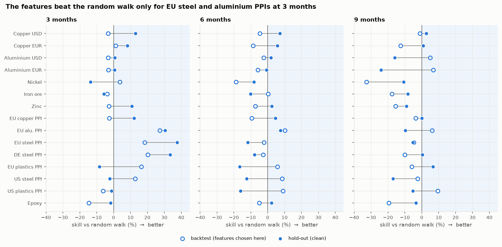
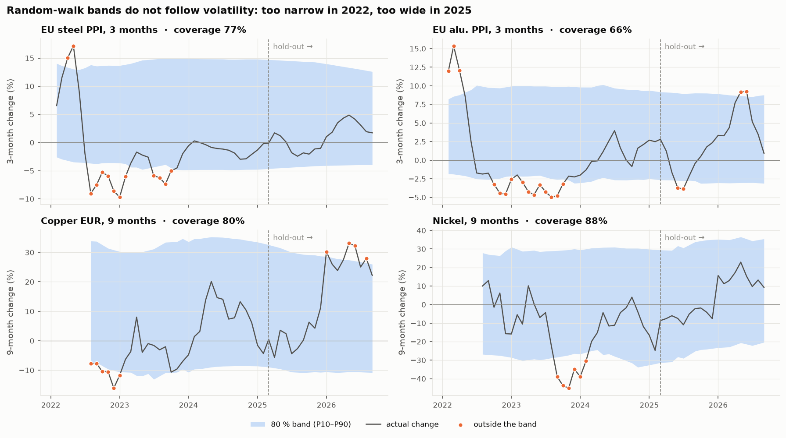
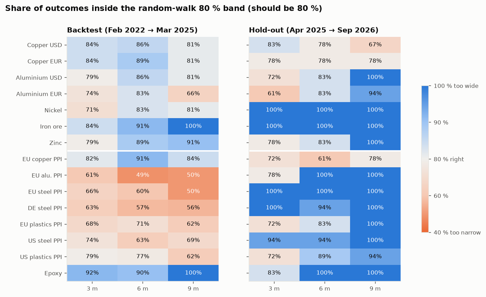

# Step 5 – Baselines

*Owner: Chloe · Status: first version, ready for Steps 6–7*

> **Run from the repo root**, after Steps 1 and 4:
>
> ```bash
> uv run python -m src.data_prep
> uv run python -m src.external_data
> uv run python -m src.features
> uv run python -m src.baselines        # ≈ 1.5 min
> uv run python -m src.baseline_plots   # charts
> ```

| What | Where |
|---|---|
| Code | `src/baselines.py` (models, backtest), `src/baseline_plots.py` (charts) |
| Charts | `plots/step5/` |
| Every forecast of every baseline (one row per target, horizon, model, origin) | `Data/processed/baselines/predictions.csv` (not committed) |
| Metrics per target × horizon × model × window | `report/problem1/step5_tables/metrics.csv` |
| Baseline forecasts at the September 2026 origin | `report/problem1/step5_tables/live_forecast_202609.csv` |

---

## Summary

- We built **five baselines** for the 15 material targets at 3, 6 and 9 months, all giving a **P10 / P50 / P90**: random walk, historical drift, historical quantiles, the LME 3-month forward (copper and aluminium, 3 months only), and a simple **quantile regression on the Step 4 selected features**.
- **The random walk is the baseline to beat.** Over Feb 2022 → Mar 2025 (the post-2021 fall in prices), no "no-feature" baseline beats it on average at any horizon.
- **The Step 4 features beat the random walk at 3 months for the producer price indices (PPIs)**: −12 % pinball loss on average, up to −27 % (EU aluminium PPI). This holds on the **clean hold-out** (Apr 2025 → Sep 2026): −31 % to −38 % for the EU aluminium and steel PPIs. At 6 and 9 months the gain disappears.
- **For market prices (LME copper, aluminium, nickel, zinc, iron ore) nothing beats the random walk reliably.** This confirms Steps 3 and 4: they behave like random walks.
- **Historical drift is dangerous.** It learned the 2017–2021 rise and was the worst model when prices fell (−40 % at 6 months, −59 % at 9 months for the PPIs). It "wins" in the hold-out only because copper rallied.
- **The real weakness is the band, not the median.** The 80 % bands of the PPIs contained the outcome only **60–70 %** of the time during the 2022 shock (too narrow), then **90–100 %** in the calm hold-out (too wide). Bands taken from a fixed history cannot adapt to volatility. This is the main thing Step 6 should improve.

---

## 1. The baselines

All baselines forecast the same target as Step 4: `y = log(P[o+H]) − log(P[o])`, the % change from the origin month *o* over *H* months, as **P10 / P50 / P90** (the format of the submission CSV).

| Baseline | P50 (median forecast) | P10 / P90 band | Why it is a baseline |
|---|---|---|---|
| **Random walk** (`random_walk`) | 0: the price stays where it is | Spread of past H-month changes around their median, centred on 0 | The standard benchmark for commodity prices, and very hard to beat |
| **Historical drift** (`drift`) | Average of past H-month changes | Same spread, centred on the drift | Tests whether past trends continue |
| **Historical quantiles** (`hist_quantiles`) | Median of past H-month changes | 10th and 90th percentiles of past H-month changes | The "no feature" model of Step 4 (the plan's empirical-quantile baseline) |
| **LME 3-month forward** (`lme_forward`) | log(3-month price ÷ cash price) at the origin | Forward + percentiles of past forward errors | The market's own price for delivery in 3 months. Copper and aluminium only (S01, D01, S02, D02), **3 months only**: the data has no 6- or 9-month LME price |
| **Feature quantile regression** (`features_qr`) | Linear quantile regression on the features Step 4 selected for that target and horizon | Same regression at P10 and P90 | The simplest use of the Step 4 features. Where Step 4 kept no feature (28 of 45 cells), it equals the historical quantiles |

"Past" always means the H-month changes that were already known at the forecast date (see section 2).

## 2. How they were tested

- **Same timing as Step 4.** Each row of the Step 4 feature tables is an origin *o*; features use only data published by the forecast date (*o* + 2 months). The leakage tests of Step 4 apply unchanged.
- **Rolling origin, expanding window, refitted every month.** At each test origin *T*, a model is trained only on origins whose outcome was already known at *T* (*o* + *H* ≤ *T*). Features are standardised with training-window statistics only (the team's `_fit` from `src/feature_selection.py`).
- **First test origin: November 2021**, 48 months after the first row (the Step 4 setting). Epoxy starts later (January 2023), because its data starts in 2018.
- **Same months for every model.** Within each target × horizon, all models are scored on exactly the same origins.
- **Two windows:**

| Window | Target months | Test origins per cell | Comment |
|---|---|---|---|
| **Backtest** | Feb 2022 → Mar 2025 (to Step 4's `select_end`) | 18–38 | The Step 4 features were **chosen on this window**, so `features_qr` looks better here than it really is |
| **Hold-out** | Apr 2025 → Sep 2026 | 18 | Never used by Step 4. Clean for every baseline |

- **Metrics** (all in % log change):
  - **Pinball loss** averaged over P10, P50 and P90: the main score, as in Step 4. Lower is better.
  - **Skill vs random walk** = 1 − loss ÷ random-walk loss. +10 % means 10 % lower loss than the random walk; negative means worse.
  - **MAE / RMSE** of the median, **bias** (outcome − median).
  - **Coverage** of the P10–P90 band: should be **80 %**.

**How much to trust small differences.** H-month windows overlap, so 36 test origins at 9 months hold only about 4 independent outcomes. **Differences below about 10 % are within the noise.**

## 3. Results

### 3.1 Skill vs random walk, by type of material

Pinball skill vs random walk, averaged over targets. **Market** = LME copper, aluminium (USD and EUR), nickel, zinc, iron ore (7 targets). **PPI** = EU and US producer price indices (7 targets). Epoxy shown separately.

**Backtest (Feb 2022 → Mar 2025)**

| Group | H | Drift | Hist. quantiles | LME forward | **Features QR** |
|---|---|---|---|---|---|
| Market | 3 | −3 % | −3 % | −3 % | −2 % |
| | 6 | −10 % | −9 % | – | −7 % |
| | 9 | −22 % | −10 % | – | −10 % |
| PPI | 3 | −21 % | −2 % | – | **+12 %** |
| | 6 | −40 % | −5 % | – | +3 % |
| | 9 | −59 % | −5 % | – | −2 % |
| Epoxy | 3 / 6 / 9 | −15 / −27 / −27 % | −15 / −21 / −19 % | – | −15 / −5 / −19 % |

**Hold-out (Apr 2025 → Sep 2026)**

| Group | H | Drift | Hist. quantiles | LME forward | **Features QR** |
|---|---|---|---|---|---|
| Market | 3 | +2 % | +4 % | **+8 %** | +2 % |
| | 6 | +3 % | +1 % | – | 0 % |
| | 9 | +3 % | −7 % | – | −9 % |
| PPI | 3 | +2 % | −2 % | – | **+15 %** |
| | 6 | +1 % | −6 % | – | −8 % |
| | 9 | −2 % | −3 % | – | −4 % |
| Epoxy | 3 / 6 / 9 | +1 / −4 / −7 % | −2 / −5 / −3 % | – | −2 / +2 / −3 % |

The LME forward average covers the four copper and aluminium targets only.

### 3.2 Where the features help (3 months)

Pinball skill vs random walk of `features_qr`, for the cells where Step 4 kept a feature at 3 months:

| Target | Features | Backtest | Hold-out |
|---|---|---|---|
| EU aluminium PPI (S08) | own last-month change, LME aluminium last month | **+27 %** | **+31 %** |
| EU steel PPI (S09) | own last-month change | **+18 %** | **+38 %** |
| German steel PPI (S10) | own last-month change | **+20 %** | **+34 %** |
| EU plastics PPI (S11) | own 3-month change, Brent last month | +16 % | −8 % |
| US steel PPI (S12) | iron ore 3-month change | +13 % | −2 % |
| Nickel (S03) | own 1- and 3-month change | +4 % | −14 % |
| Copper EUR (D01) | position in 12-month range | +1 % | +8 % |

- **The steel and aluminium PPIs are the clear win.** Momentum in these indices is real, and it survives on data the selection never saw. These are exactly the materials that drive the **AirSeT** cost (steel ≈ 85 % of its raw-material value).
- **Plastics, US steel and nickel do not hold up out of sample.** Their backtest gain is partly the result of choosing the features on that window.



*Open circle = backtest, where the features were chosen; filled dot = hold-out, which the selection never saw. Right of the line = better than the random walk. Only the EU aluminium and steel PPIs at 3 months are clearly right of the line on both windows. The other hold-out gains at 3 months (e.g. copper +13 %) come from cells with no feature: they are the historical quantiles, which carry an upward drift that happened to match the 2025–26 copper rally.*

**What Step 6 can improve here:** keep the 3-month features for the steel and aluminium PPIs. At 6 and 9 months, and for market prices, the median is essentially a random walk, so effort is better spent on the band (section 3.4) than on new features.

### 3.3 The other baselines

- **Drift should not be used.** It extrapolates the 2017–2021 rise, so it overestimated prices throughout 2022–2024. It looks fine in the hold-out (copper, S01: +17 % skill at 9 months) only because copper then rallied (+19 % in 9 months on average). That is a lucky regime, not skill.
- **Historical quantiles ≈ random walk with a worse centre.** Their median carries the same historical drift, only smaller.
- **The LME forward adds little.** The 3-month premium over cash is small (between −2 % and +2.5 % since 2016), so the forward is almost a random walk. It lost 2–5 % in the backtest and gained 3–14 % in the hold-out, again because copper and aluminium rose. On both windows together it is close to the random walk.

### 3.4 Calibration: the bands are wrong in both directions

Coverage of the 80 % band (P10–P90), random walk:

| Group | Backtest 3 / 6 / 9 m | Hold-out 3 / 6 / 9 m |
|---|---|---|
| Market | 79 / 87 / 83 % | 82 / 87 / 91 % |
| PPI | **70 / 67 / 62 %** | **84 / 89 / 96 %** |
| Epoxy | 92 / 90 / 100 % | 83 / 100 / 100 % |

- **PPIs, 2022–2024: bands too narrow.** The history before 2022 was calm, so the band was set too tight for the energy shock. The steel PPIs (S09, S10) and EU aluminium PPI (S08) were inside the band only **50–65 %** of the time.
- **Hold-out: bands too wide.** By 2025 the band includes the 2021–2022 shock, but prices were calm. Nickel, iron ore and the steel PPIs reach 100 % coverage, so the band is wider than it needs to be. For a pricing buffer, that means a buffer that is too large and less competitive.
- **Exception: copper in the hold-out.** It rose faster than any baseline expected. Copper USD (S01) at 9 months was inside the band only 67 % of the time (median error +19 %).
- **Market metals are well calibrated in the backtest** (≈ 80 %), because their history already contained large moves.



*Blue = random-walk 80 % band, line = actual H-month change, orange = outcome outside the band. The band barely moves over four years, while volatility changes a lot:*
- *EU steel and aluminium PPIs: many misses in 2022–23 (band too narrow), then a band much wider than the actual moves in 2025–26 (too wide).*
- *Copper, 9 months: the 2026 rally breaks through the top of the band.*
- *Nickel, 9 months: the 2023 fall breaks through the bottom; since then the band is far wider than needed.*



*Coverage of the 80 % band for every target and horizon. Orange = band too narrow (too many misses, the buffer would be too small), blue = band too wide (no misses, the buffer would cost competitiveness). A good model is pale grey on both sides. The price indices flip from orange in the backtest to blue in the hold-out.*

**Conclusion:** a band estimated once from all past changes cannot follow changes in volatility. Step 6's volatility-scaled models (EWMA, GARCH) target exactly this. **A good Step 6 model should turn both heatmaps pale grey.**

### 3.5 Baseline forecasts at the September 2026 origin

As a price index (September 2026 = 100). Full table: `step5_tables/live_forecast_202609.csv`.

| Target | H | Random walk P10 / P50 / P90 | Features QR P10 / P50 / P90 |
|---|---|---|---|
| Copper EUR (D01) | 3 | 90.4 / 100 / 112.5 | 87.2 / 102.6 / 117.3 |
| | 9 | 88.0 / 100 / 131.7 | 90.6 / 103.0 / 135.6 |
| Aluminium EUR (D02) | 9 | 87.8 / 100 / 138.9 | 85.8 / 98.8 / 135.9 |
| EU steel PPI (S09) | 3 | 96.2 / 100 / 112.8 | 97.0 / 100.3 / 105.5 |
| | 9 | 90.1 / 100 / 135.2 | 88.0 / 97.8 / 132.2 |
| Nickel (S03) | 9 | 80.5 / 100 / 137.2 | 79.6 / 98.9 / 135.6 |
| Epoxy (EPOXY_EUR) | 9 | 89.6 / 100 / 127.8 | 88.9 / 99.2 / 126.8 |

- The 9-month bands are **wide and skewed upward** (P90 +25 to +40 %, P10 −10 to −20 %), because the history contains the 2021 surge. Section 3.4 suggests they are too wide for today's market, except for copper.
- **EU steel PPI at 3 months:** the feature model gives a much narrower band (P90 105.5 vs 112.8) because steel momentum is close to zero (+0.3 % last month). That is consistent with the hold-out, but the same model's band was too narrow in 2022, so it should be checked with Step 6's volatility models before it is used for a buffer.

## 4. What Steps 6 and 7 should beat

| Target group | Horizon | Baseline to beat |
|---|---|---|
| EU aluminium and steel PPIs (S08, S09, S10) | 3 m | **Features QR** (beats the random walk by 18–38 %) |
| All other targets and horizons | 3 / 6 / 9 m | **Random walk** with historical band |
| Copper and aluminium | 3 m | Also report the **LME forward**: the market's own forecast, which the jury will recognise |

A model should beat these on **pinball loss** and on **80 % coverage**, on the hold-out as well as the backtest. **Drift is not a useful reference**, because it loses badly.

The hold-out numbers in this report come from fixed rules (no tuning), so the hold-out stays clean for Step 7. Step 6 should **not** use them to choose or tune its models.

## 5. Suggested improvements

In order of expected value:

1. **Volatility-scaled bands.** Keep the random-walk median, but scale the band by recent volatility (EWMA, or GARCH(1,1) with Student-t errors) × √H. This targets the main failure of section 3.4 (charts 01 and 02): too narrow in 2022, too wide in 2025. It is the strongest simple model to try first in Step 6.
2. **Calibrate the bands after the fact (conformal).** Widen or narrow each model's P10–P90 by the coverage error measured on recent past forecasts. Cheap, works on top of any model, and directly targets the 80 % coverage the jury checks.
3. **Combine median and band from different models.** Use the feature model's median for the steel and aluminium PPIs at 3 months (chart 03), with a volatility-scaled band. The feature model has the better median there, but its band failed in 2022.
4. **Longer history for the bands.** Bands now come from 2016 onward only, and they change a lot depending on whether 2021–2022 is in the window. The fetch scripts can go back to the 1990s (Step 1, README §9), and MEPS/CRU steel goes back to 1997. Adding 2008–2009 would give more stable tail estimates.
5. **Re-select features inside each backtest fold** (`run_selection(..., end=<fold origin>)`, as noted in Step 4 §8). The backtest-window gains of `features_qr` are optimistic; only the hold-out is clean.
6. **Test whether differences are real.** Add a block-bootstrap confidence interval (blocks of H months) or a Diebold–Mariano test on the loss difference vs the random walk. With 4–12 independent outcomes per cell, many of the gaps above may not be significant.
7. **Score the BOM cost indices (RM6, AirSeT)**, not only single materials, once Step 8 has the joint simulation. The business decision depends on the unit cost, and errors across materials partly cancel.
8. **Report a stress window** (2022) separately, as the plan asks in Step 7, so the jury sees how each model behaves in a shock.
9. **Use the LME forward as a feature, not a forecast.** On its own it is almost a random walk, but the forward premium (contango vs backwardation) is already a Step 4 candidate. Longer LME contracts (15 or 27 months) would allow a 6- and 9-month forward baseline if they can be sourced.

## 6. Limits

- **Small sample:** 18–38 test origins per cell, overlapping, so 4–12 independent outcomes. Most of the backtest is one shock and its reversal (2022–2024); the hold-out is one copper rally.
- **Feature selection bias:** `features_qr` uses features chosen on the backtest window (Step 4). Its backtest scores are optimistic; trust the hold-out more.
- **LME forward in euros** (D01, D02): computed as the LME 3-month price ÷ cash price, both converted at spot EUR/USD, so it ignores the currency forward. Over 3 months the difference is small.
- **The LME forward and cash are Westmetall monthly averages; the targets S01 and S02 are IMF monthly averages.** The two sources differ by 0.1–0.2 % in a typical month and at most 1.1 % (`lme_vs_imf_check` in `src/data_loading.py`), so this barely matters.
- **Revised data:** as in Steps 1 and 4, PPIs are the current versions, not the first releases.
