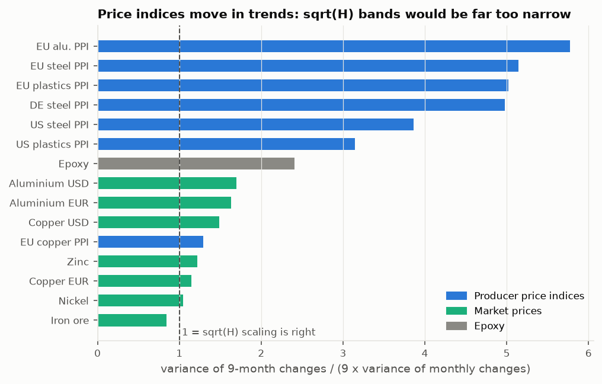
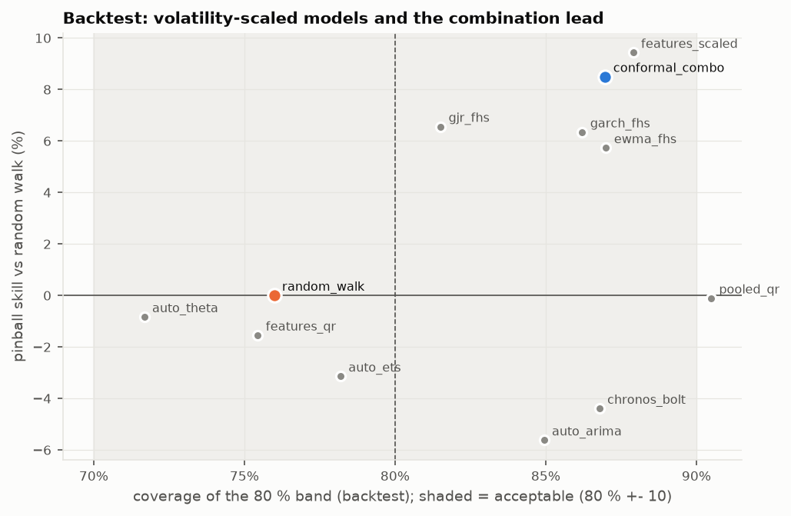
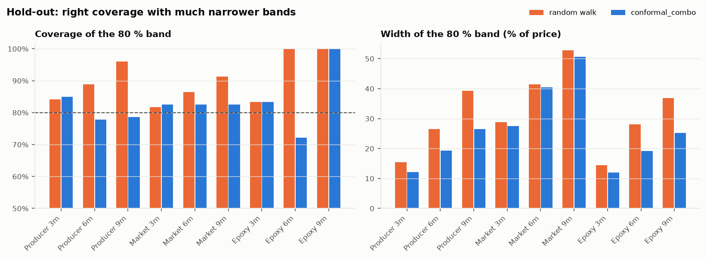
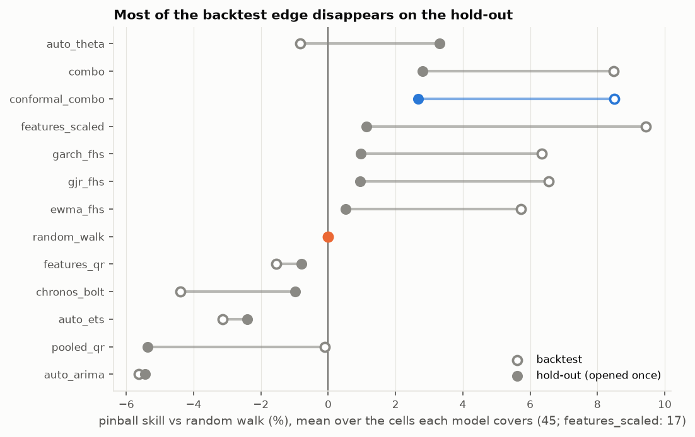
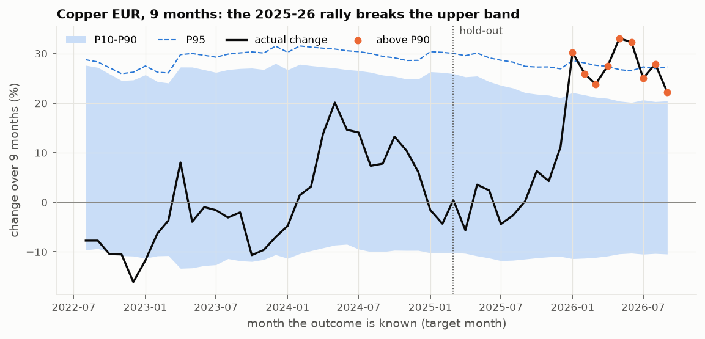
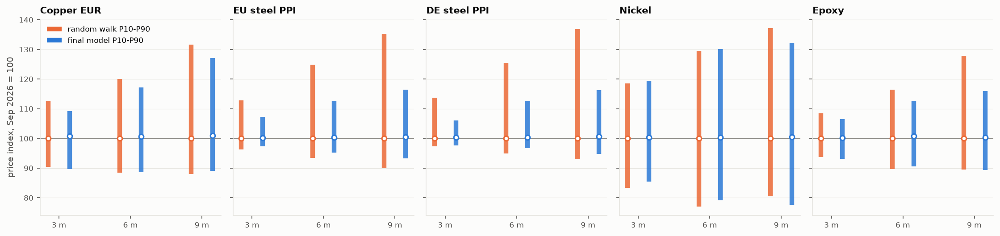

# Step 6 – Probabilistic forecasting models

*Owner: Kenza · Status: done; feeds Steps 7–9*

> **Run from the repo root, in this order** (the challenge files must be in `Data/`, see Step 1):
>
> ```bash
> uv sync --extra chronos                                  # dependencies; Chronos is an optional extra (torch)
> uv run python -m src.data_prep                           # Step 1: panel, publication lags
> uv run python -m src.external_data                       # Step 4: free external data (internet once, then cached)
> uv run python -m src.features                            # Step 4: feature tables
> uv run python -m src.baselines                           # Step 5: baselines (the random walk is the reference), ≈ 1.5 min
> uv run --extra chronos python -m src.models              # Step 6: base models, conformal, combination, Step 8 export, ≈ 3.5 min
> uv run python -m src.models --stage holdout              # Step 6: the single hold-out evaluation (frozen, section 6)
> uv run --extra chronos pytest tests/                     # leakage tests, ≈ 10 min
> ```
>
> The Step 4 feature *selection* (`src.feature_selection`) does not need to be re-run: the models read its result, `report/problem1/step4_tables/selected_features.csv`, which is committed.
>
> **Partial runs:**
> - one model, some targets: `uv run python -m src.models --model ewma_fhs --targets S09 D01 --horizons 3`
> - conformal and combination only: `--stage post`; Step 8 inputs only: `--stage export`
> - without Chronos: drop `--extra chronos` (Chronos is then skipped with a message)
>
> **Hold-out:** `--stage holdout` refuses to run if any saved prediction or setting has changed since the hold-out was first opened (`step6_tables/holdout_freeze.json`, committed). On another machine, a re-run can give predictions that differ in the last decimals, and the check will then refuse. The committed hold-out tables (`step6_tables/holdout_*.csv`) are the reference results.
>
> The notebook `analysis/06_models.ipynb` shows every table and chart. It reads the saved predictions, so run the commands above first.

| What | Where |
|---|---|
| Code | `src/models.py` (models, calibration, combination, export, hold-out, leakage checks), `src/model_plots.py` (charts) |
| Leakage tests | `tests/test_models.py` |
| Predictions of every model (one row per target, horizon, origin) | `Data/processed/models/predictions_<model>.csv` (not committed) |
| Inputs for Step 8 | `Data/processed/models/step8/` (not committed) |
| Tables used in this report | `report/problem1/step6_tables/` (incl. `residual_checks.csv`, `covariate_check.csv`) |
| Charts | `plots/step6/` |

---

## Summary

- We built **9 forecasting models** for the 15 materials at 3, 6 and 9 months, plus a **calibration layer** and an **equal-weight combination**. All give P10 / P50 / P90, and P95 for the pricing buffer.
- **Final model: `conformal_combo`.** It is the average of 4 models (`gjr_fhs`, `garch_fhs`, `ewma_fhs`, `auto_theta`), plus `features_scaled` in the 17 cells where Step 4 kept features, then calibrated.
- **Every choice was made on the backtest** (target months up to March 2025). The **hold-out** (April 2025 → September 2026) was **frozen and opened once**.
- **Hold-out result:**
  - **The median matches the random walk.** Pinball skill is +2.5 % / −0.5 % / +0.8 % at 3 / 6 / 9 months, and every 95 % confidence interval includes 0. At 3 months the median error (MAE) is lower by 1.6 % [0.4, 2.7]: small, but significant.
  - **The band is where the model wins.** Coverage of the 80 % band is **80–84 %**, while the bands are **20–33 % narrower** than the random walk's for producer price indices (PPIs) and epoxy. The random walk over-covered (89–96 %). In pricing terms, the buffer is smaller and gives the same protection.
- **PPI momentum is real but short.** Every method finds it, and it pays at 3 months (+9 % for the final model on PPIs). Extended to 6–9 months, it hurts.
- **The backtest was optimistic by about 6 points:** +8.5 % on the backtest vs +2.7 % on the hold-out.
- **Weak spot: copper's upside tail.** During the 2025–26 rally, copper ended above its 9-month P90 in 35–41 % of hold-out cases, against a 10 % target. For RM6, a P90 buffer alone would have been too small.
- **No model uses data published after the forecast date.** Every model is tested on all 57 origins, and the tests catch three deliberately leaky versions.

---

## 1. What we forecast and how models are compared

Same target and timing as Steps 4 and 5. For each target *P*, origin month *T* and horizon *H*:

```
y = log(P[T+H]) − log(P[T])     forecast as P10 / P50 / P90 (+ P95)
```

- **The forecast date is month *T* + 2**, when the slowest targets publish month *T*. Only data published by then is used (Step 4 rule, `info_set`).
- **Rolling origin, expanding window.** At test origin *T*, a model only trains on origins whose outcome was already known (*o* + *H* ≤ *T*). Models are refitted every month.
- **Same origins as Step 5:** 38 backtest origins (November 2021 onward), 18 hold-out origins, and the live September 2026 row.
- **Metrics** (the Step 5 `score`, on origins common to all models):
  - pinball loss over P10 / P50 / P90, and **skill vs random walk** = 1 − loss ÷ random-walk loss;
  - coverage of the P10–P90 band (target **80 %**), and one-sided P90 coverage (target **90 %**);
  - band width, MAE of the median.

### Design that prevents leakage

Models never see the data directly. Each model is a function that receives a `Context` holding **only what was known at the origin**:
- the target's known prices;
- the known panel;
- the training rows with *o* + *H* ≤ *T*;
- the Step 4 features at *T*.

Models that fit expensive things (GARCH, statsforecast, Chronos, the pooled model) cache each fit on the **exact content** of its input. The same input always gives the same answer, and different input can never reuse a cached fit.

## 2. The models

| Model | Median (P50) | Band | Approach | Package (licence) |
|---|---|---|---|---|
| `ewma_fhs` | 0 (random walk) | EWMA-scaled, from standardised H-month changes | direct | – |
| `garch_fhs` | 0 | GARCH(1,1)-t volatility over the horizon (EWMA fallback) | direct | `arch` (NCSA) |
| `gjr_fhs` | 0 | Same, GJR-GARCH (rises can raise volatility more than falls) | direct | `arch` |
| `features_scaled` | Quantile regression on the Step 4 features | Residuals of that median, volatility-scaled | direct | scikit-learn (BSD-3) |
| `pooled_qr` | One quantile regression on all 15 materials stacked | Same regression | direct | scikit-learn |
| `auto_ets` | AutoETS on log prices, no season | Own Gaussian intervals | recursive | `statsforecast` (Apache-2.0) |
| `auto_arima` | AutoARIMA, p, q ≤ 2, no season | Own Gaussian intervals | recursive | `statsforecast` |
| `auto_theta` | AutoTheta, no season | Own Gaussian intervals | recursive | `statsforecast` |
| `chronos_bolt` | Chronos-Bolt-small, zero-shot, revision pinned | Its own quantiles; P95 extrapolated | direct | `chronos-forecasting`, model weights (Apache-2.0), torch (BSD-3) |

Plus two layers on top of the models:
- **Adaptive conformal calibration** (section 3.2), applied to every model.
- **Equal-weight combination** (section 5).

## 3. Volatility-scaled models

### 3.1 `ewma_fhs`, and why √H scaling does not work here

The Step 5 random walk has the right median but a fixed band, which was too narrow in 2022 and too wide in 2025. The textbook fix, `σ_monthly × √H`, assumes months are independent. For the PPIs they are not.



*Variance of 9-month changes ÷ (9 × variance of monthly changes), backtest window. 1 = independent months. PPIs: 3 to 6. Market prices: 0.8 to 1.7.*

So `ewma_fhs` works on **H-month changes directly** (filtered historical simulation):

```
z_o = y_o / s_o           s_o = RMS of the monthly returns inside (o, o+H]   (known, since o + H ≤ T)
q_k = σ_T × (quantile_k(z) − median(z))         σ_T = EWMA volatility at the origin
```

The momentum stays inside *z*; only the volatility level is updated.

- **A rejected first version** divided each past change by the volatility *at its origin*, instead of *during its window*. The 2021 surge started from calm months, so it became an extreme *z*, which was then multiplied by the high 2022 volatility. 9-month PPI bands came out twice as wide as the random walk's, with 98 % coverage and −23 % skill.
- **λ** was compared on the backtest only: 0.97 gives +5.7 % skill and 87 % coverage, 0.94 gives +4.8 % and 89 %. We kept **0.97**, the plan's standard value; the difference is within noise.

### 3.2 Adaptive conformal calibration

This is a layer applied to any model, using only its saved predictions. Each tail is rescaled around the median by its own factor, learnt online from outcomes already known at the origin:

```
p_c' = p50 + s_c × (p_c − p50)          log s_c ← log s_c + γ × (miss_c − target_c)
```

- **Targets:** P10 and P90 are each missed 10 % of the time, P95 5 %.
- **P50 never moves.**
- **γ is chosen per model on the backtest**, from {0, 0.02, 0.05, 0.1, 0.2}. The chosen values are 0.1 for the volatility models and the pooled model, 0.02 for the combination, and 0 (off) for the others.
- **The gain is small** (about −0.5 % loss for `ewma_fhs`). Each cell has only 18–38 outcomes, and the volatility scaling had already fixed most of the band. We keep it as a cheap safety net.
- **What it learnt by September 2026** (median over cells): P10 factor **0.79**, P95 factor **1.13**. The downside band was too wide and the extreme upside slightly too narrow: risk is skewed up, as Step 3 found.

### 3.3 GARCH and GJR-GARCH

- **How they differ from EWMA.** The volatility for the next *H* months is the average of the GARCH forecasts for months 1…H. GARCH volatility **reverts to its long-run level**; EWMA stays flat at today's level.
- **When they fall back to EWMA.** If the history is shorter than 60 months, or the fit fails, does not converge or is not stationary. The reason is stored in a `note` column.
- **Backtest:** `garch_fhs` +6.3 % (86 % coverage), `gjr_fhs` +6.6 % (82 %).
- **GARCH rarely works for the steel and plastics PPIs.** At 3 months, it falls back to EWMA for 93–100 % of their origins (GJR: 14–72 %), because the fitted volatility is so persistent that it never settles. Most likely the smooth PPI trends look like one long volatility episode to a zero-mean GARCH. For these series GARCH ≈ EWMA; ARMA-GARCH would be the fix.

## 4. Models with a non-zero median

### 4.1 `features_scaled` (Step 4 features)

- **Median:** the median quantile regression on the Step 4 selected features (the same fit as Steps 4–5).
- **Band:** volatility-scaled, built from the **residuals** of that median. This beat shifting the `ewma_fhs` band (+9.4 % vs +8.5 %).
- **Where it runs:** all **17 cells where Step 4 kept features**. We deliberately did not restrict it to S08 / S09 / S10: those cells were singled out by the Step 5 *hold-out*, and choosing cells from the hold-out would contaminate it.

On its cells (backtest):

| | Skill vs random walk | Coverage |
|---|---|---|
| `features_qr` (Step 5) | +7.7 % | **73 %** |
| `features_scaled` | **+9.4 %** | **88 %** |

It keeps the skill and fixes the calibration. The gain is concentrated in PPIs at 3 months (S08, S09, S10, S11, S12: +18 to +25 %). These backtest scores are optimistic, because the features were chosen on the same window.

### 4.2 `pooled_qr` (one model for all materials)

- **What it is:** one quantile regression on all 15 materials stacked, about 800–1,300 rows instead of about 90 (Montero-Manso & Hyndman, 2021).
- **Target:** volatility-standardised changes.
- **Features:** 1- and 3-month momentum, divided by volatility; material group; momentum × PPI.
- **Coefficients:** momentum only enters through the **PPI interactions** (0.39 and 0.43 on the 3-month median). This independently confirms Step 4: momentum in PPIs, none in LME prices.
- **It does not help overall:** −0.1 % on the backtest. Three variants (no penalty, separate pools for PPIs and for market + epoxy, both) gave −3 % to 0 %. For market prices the best median is "no change", and a shared band shape is too wide for them. **Reported as tested, not used.**

### 4.3 Classical models (ETS, ARIMA, Theta)

- **ETS** picks **no trend** for every market price (a smoothed random walk) and a **damped trend** for 6 of 7 PPIs.
- **ARIMA** picks AR terms for the PPIs. Both detect the PPI momentum.
- **They extend that momentum too far:** ARIMA gains +5 % on PPIs at 3 months, but loses 7–16 % at 6–9 months, when the 2022–24 trends reversed.
- **Their Gaussian intervals are too narrow** for fat-tailed prices: Theta covers 72 %, ETS 78 %.
- **Backtest:** ETS −3.1 %, ARIMA −5.6 %, Theta −0.8 %.
- **Answer to the plan's question:** there is autocorrelation to exploit beyond the random walk, but only for about one quarter.

### 4.4 Chronos-Bolt (pretrained, zero-shot)

- **What it is:** Amazon's pretrained time-series model, used with no training on our data. Its context is the target's prices known at the origin, and it returns P10 / P50 / P90 directly.
- **P95:** Bolt is only trained up to P90, so P95 is extrapolated from the P50 → P90 distance with the normal ratio, then corrected by the conformal layer.
- **Speed and reproducibility:** about 14 ms per forecast on a laptop CPU. The revision is pinned and the model is deterministic.
- **Optional extra:** it is installed with `--extra chronos`, so the core pipeline does not need torch.
- **Backtest:** −4.4 % with good coverage (87 %). The years before 2025 may be in its pretraining data, so it is **judged on the hold-out** (section 6).

## 5. Backtest comparison and the combination



| Backtest, mean over cells | Skill vs random walk | 80 % coverage |
|---|---|---|
| random walk | 0 | 76 % |
| ewma_fhs / garch_fhs / gjr_fhs | +5.7 / +6.3 / +6.6 % | 87 / 86 / 82 % |
| features_scaled (17 cells) | +9.4 % | 88 % |
| pooled_qr | −0.1 % | 91 % |
| auto_ets / auto_arima / auto_theta | −3.1 / −5.6 / −0.8 % | 78 / 85 / 72 % |
| chronos_bolt | −4.4 % | 87 % |
| **conformal_combo** | **+8.5 %** | **87 %** |

**How the combination was built** (`build_combination`, backtest only, following the plan's Step 7 rule):

1. Only models that forecast **every** cell compete. First keep those with acceptable coverage (80 % ± 10), then rank by skill. We tried sizes 3 and 4:
   - best 3 (gjr, garch, ewma): +6.9 %;
   - **best 4 (+ auto_theta): +7.2 % → kept.**
2. `features_scaled` covers only 17 cells. It joins as an extra member in those cells if it beats the combination there: +9.4 % vs +9.2 % → **kept**. This is within noise, but the rule decides.
3. **Equal-weight average** of the quantiles (Lichtendahl et al., 2013), then the conformal layer (γ = 0.02). We use equal weights because of the *forecast combination puzzle*: with few outcomes, estimated weights or picking the best model per segment add noise and usually lose to a simple average. On our backtest, the best model per segment changed between the two halves in 8 of 8 segments, and picking by the first half scored +0.2 % in the second, against +7.4 % for the equal-weight combination.


On the backtest, the combination beats every single model. Its biggest gain is PPIs at 3 months (+10 %, 84 % coverage), where each individual model was at +1 to +2 %. **Caveat:** three of its four main members are variants of the same volatility-scaled random walk, and every choice was made on this window.

## 6. The single hold-out evaluation

**Freezing.** `holdout_evaluation` first writes `holdout_freeze.json`: a SHA-256 fingerprint of every prediction file and decision table, plus every setting. If anything changes afterwards, it **refuses to run** (tested). Re-running with nothing changed reproduces the same numbers.

**Confidence intervals** come from a block bootstrap over origins: blocks of *H* months, with all targets of an origin moving together. 18 origins per horizon means only **6 / 3 / 2 independent windows** at 3 / 6 / 9 months.

### 6.1 Does the final model beat the naive baseline?

| Horizon | Pinball skill [95 % CI] | MAE skill [95 % CI] | 80 % coverage [95 % CI] | One-sided P90 coverage (target 90 %) |
|---|---|---|---|---|
| 3 m | +2.5 % [−0.9, +5.3] | **+1.6 % [+0.4, +2.7]** | 84 % [75, 91] | 86 % |
| 6 m | −0.5 % [−5.8, +6.0] | +1.1 % [−1.9, +2.4] | 80 % [61, 94] | 82 % |
| 9 m | +0.8 % [−3.9, +8.5] | +1.1 % [−1.9, +2.2] | 82 % [68, 96] | 84 % |

**Answer for the jury:** the final model **honestly matches the naive baseline at every horizon**. It is slightly ahead at 3 and 9 months on pinball loss, and its median error is significantly lower at 3 months. Its intervals are correctly calibrated.

### 6.2 Where the value is: narrower bands with the right coverage



| Hold-out | Random walk coverage / width | Final model coverage / width | Final model skill |
|---|---|---|---|
| PPIs 3 / 6 / 9 m | 84 / 89 / 96 % — 15 / 26 / 39 % | 85 / 78 / 79 % — **12 / 19 / 27 %** | **+9.1** / +3.2 / +7.5 % |
| Market 3 / 6 / 9 m | 82 / 87 / 91 % — 29 / 42 / 53 % | 83 / 83 / 83 % — 28 / 40 / 51 % | +1.0 / −2.2 / −3.5 % |
| Epoxy 3 / 6 / 9 m | 83 / 100 / 100 % — 14 / 28 / 37 % | 83 / 72 / 100 % — **12 / 19 / 25 %** | −5.2 / +4.0 / +17.0 % |

For PPIs and epoxy, the final model's bands are **20–33 % narrower**, at about 80 % coverage instead of 89–100 %. For pricing, that means a smaller buffer with the protection it claims. Epoxy at 6 months is the exception: 72 % coverage, on 18 overlapping outcomes.

### 6.3 The backtest was optimistic



| Mean skill vs random walk | Backtest | Hold-out |
|---|---|---|
| conformal_combo | +8.5 % | +2.7 % |
| features_scaled (17 cells) | +9.4 % | +1.1 % |
| gjr_fhs | +6.6 % | +0.9 % |
| ewma_fhs | +5.7 % | +0.5 % |
| auto_theta | −0.8 % | +3.3 % |
| chronos_bolt | −4.4 % | −1.0 % |

Every model chosen on the backtest shrank on the hold-out. This is why the hold-out was frozen and opened once.

### 6.4 The upside tail: copper



The final model's one-sided P90 covered 82–86 % on the hold-out, against a 90 % target. The misses are mostly copper during the 2025–26 rally. At 9 months, the outcome ended **above P90** in this share of cases (target 10 %):

| Series | Above P90 |
|---|---|
| EU copper PPI (S07) | 41 % |
| copper in EUR (D01) | 39 % |
| LME copper (S01) | 35 % |

RM6 is mainly copper risk, so **a P90 buffer alone would have been too small for 6–9-month RM6 quotes**. Step 9 should combine the buffer with a copper indexation clause for long quotes.

### 6.5 Other observations on the hold-out (not acted on)

| Model | 3 m | 6 m | 9 m |
|---|---|---|---|
| chronos_bolt | **+6.0 %** [+2.4, +11.7] | −1.8 % | −9.0 % |
| auto_theta | +3.4 % [+0.9, +5.7] | +2.1 % | +0.9 % |
| features_qr (Step 5) | +4.7 % [+0.7, +11.0] | −2.4 % | −7.2 % |
| lme_forward (copper / aluminium only) | **+8.0 %** [+4.4, +10.8] | – | – |

- **Chronos** lost on the backtest but was the best model at 3 months on the hold-out (its fair test, after its pretraining). It collapses at 9 months.
- **The market's own 3-month forward** did well during the copper rally.
- **These are observations made on the hold-out.** Switching to them now would be a choice made with hold-out knowledge, which the freeze rejects.

**Strict hold-out** (origins from March 2025 only, so that no part of an outcome window was visible when anything was chosen):
- **3 months:** +2.4 % skill, 83 % coverage.
- **6 and 9 months:** 69–72 % coverage, but on 2 and 1 independent windows. Too few to conclude.

## 7. Proof that no model uses future data

| Check | What is replaced with random numbers | Coverage | Result |
|---|---|---|---|
| Every base model (8, + Chronos with the extra) | Every value not yet published at the forecast date, every later feature row, every unknown outcome, **inside the shared data itself** (so a model reading a global variable is caught too) | **All 57 origins** × 45 cells (2,565 forecasts per model) | all unchanged |
| Conformal layer | Every unknown outcome and every forecast issued after *T* | All 57 origins × all 4 values of γ (286,896 comparisons); every forecast issued at *T* or before must be unchanged | all unchanged |
| Combination and its calibration | Member forecasts issued after *T*, unknown outcomes | Every 4th origin, plus the full conformal check | all unchanged |
| GARCH fallback decision | The `note` column is compared too | – | unchanged |

**Power checks.** The same tests are run on deliberately leaky code, which must fail. All three are caught:
- a model reading future rows of the feature table;
- a model reading unpublished panel data;
- a calibrator learning from outcomes one month too early.

**Rules on choices:**
- `backtest_only()` and `select_members()` raise an error if given hold-out rows.
- The hold-out freeze refuses to run after any change.
- Tests: `uv run --extra chronos pytest tests/` (22 tests including Step 4's, about 10 minutes).

**What the tests cannot prove:**
- that the publication-lag rule itself is right (the tests use the same rule as the code);
- that the PPIs used are the first releases: they are today's revised values (Step 1);
- that Chronos never saw pre-2025 prices in pretraining.

## 8. Forecasts at the September 2026 origin



*Final model vs random walk, price index (September 2026 = 100), P10–P90 range and P50.*

- **PPI bands are much narrower** than the random walk's. For the EU steel PPI at 9 months: 93–116 vs 90–135.
- **Copper's band is only slightly narrower** at 9 months (89–127 vs 88–132). Given section 6.4, the upper end should not be read as a firm limit.
- **The full table** is in `Data/processed/models/step8/marginals_202609.csv`.

## 9. For the next steps

- **Step 7:** the "beats naive" table with confidence intervals is `step6_tables/holdout_beats_naive.csv`. Still possible to add: MASE / WAPE, results by sub-period, and compute / CO₂ per model.
- **Step 8:** run `uv run python -m src.models --stage export`. It produces, in `Data/processed/models/step8/`:
  - `marginals_202609.csv`: the final model's live P10 / P50 / P90 / P95, as log changes and as ratios for `bom_index`, plus σ at the origin;
  - `residuals_monthly.csv`: standardised monthly residuals, one column per material, for a block bootstrap (blocks of 3–6 months to keep PPI momentum);
  - `joint_z_h3/6/9.csv`: historical joint H-month scenarios, for an empirical copula.

  Open points: nickel is forecast in USD (S03), while Step 2's stainless check uses nickel in EUR; MEPS/CRU steel is not forecast.
- **Step 9:** use the final model's P90 / P95 for the buffer, but **not alone for copper at 6–9 months** (section 6.4).
- **Submission CSV:** the final model's live rows are already fitted on all data up to the origin. To change the model used, edit `FINAL_MODEL` / `STEP8_MODEL` in `src/models.py`.

## 10. Limits

- **Small samples.** 38 backtest and 18 hold-out origins per cell, overlapping: about 6 / 3 / 2 independent hold-out windows. Most differences are within noise.
- **Choices with hindsight on the backtest** (λ, γ, members, combination size). Backtest scores are optimistic; the hold-out is the clean estimate.
- **The hold-out is one regime:** a copper rally and calm steel. The 6- and 9-month hold-out windows partly overlap the selection period. The strict hold-out removes that, but has 1–2 independent windows.
- **Little variety in the combination:** three members share the same median (0) and differ only in volatility.
- **Revised data:** PPIs are current values, not first releases.

## 11. Diagnostics: residual checks and covariates

### 11.1 Ljung–Box tests on residuals

Run on the data known at the end of the backtest, per target, at lag 12 (`residual_checks`, table `step6_tables/residual_checks.csv`). Each cell is the share of targets where autocorrelation is **left** (p < 0.05):

| Series | Residuals: market / PPIs | Squared residuals: market / PPIs | What it tests |
|---|---|---|---|
| Raw monthly returns | 86 % / 100 % | 29 % / 86 % | The starting point: momentum and volatility clustering |
| EWMA-standardised (`ewma_fhs`, combination) | 71 % / 86 % | **0 %** / **71 %** | Did the volatility model absorb the clustering? |
| GARCH-standardised (`garch_fhs`, where it fits) | 86 % / 67 % | **0 % / 0 %** | Same, for GARCH |
| AutoARIMA in-sample | 29 % / 14 % | 29 % / 43 % | Is structure left in the median? |
| AutoETS in-sample | 86 % / 86 % | 29 % / 71 % | Same |

Epoxy (one series): its returns are autocorrelated, every standardised series is clean, and ARIMA leaves autocorrelation.

- **GARCH absorbs the volatility clustering wherever it can be fitted.**
- **EWMA does not, for 71 % of the PPIs.** These are the same series where GARCH falls back to EWMA (section 3.3), so for steel and plastics the volatility model is the weak link. The bands still reached the right coverage on the hold-out, but this is where ARMA-GARCH would help.
- **Linear autocorrelation stays in the volatility models' monthly residuals for the PPIs.** That is expected and handled: these models forecast H-month changes directly, so the PPI momentum is inside the standardised H-month changes *z* (section 3.1), not assumed away.
- **ARIMA absorbs most of the PPI momentum** (14 % left); **ETS leaves it**, which is consistent with its weaker scores.
- **Low power:** about 100 monthly points per series, so "not rejected" does not prove there is no autocorrelation.

### 11.2 Covariates used, and their direction

`features_scaled` is the only final-model member that uses covariates. Their fitted effect on the median was checked against the sign the Step 4 cause → effect chain predicts (`covariate_check`, table `step6_tables/covariate_check.csv`). Each was fitted on the backtest window and again at the live origin.

| Covariate (target, horizon) | Expected | Fitted, live (per 1 sd) | Agrees |
|---|---|---|---|
| LME aluminium last month → EU aluminium PPI (3 m, 9 m) | + | +0.016, +0.033 | ✅ |
| Brent last month → EU plastics PPI (3 m, 9 m) | + | +0.018, +0.015 | ✅ |
| Brent last month → epoxy (6 m) | + | +0.017 | ✅ |
| Iron ore 3-month change → US steel PPI (3 m) | + | +0.037 | ✅ |
| WTI last month → US plastics PPI (6 m) | + | +0.019 | ✅ |
| Own last-month change (momentum): EU/DE steel, EU aluminium, EU plastics, nickel, US plastics, aluminium EUR; own 3-month change: EU plastics (3 m), zinc (6 m) | + | +0.012 to +0.061 | ✅ |
| Own 3-month change: nickel (3 m), iron ore (6 m) | + | −0.075, −0.074 | ❌ reversal |
| Copper EUR position in 12-month range (3 m) | − | ≈ 0 | ❌ affects the band only |
| US plastics vs 12-month average (6 m) | − | +0.009 | ❌ acts as a trend |

- **All 8 market drivers have the expected sign, in both fits.**
- **The 4 disagreements are own-price features.** Step 4 only enforced a sign for drivers, and it had already documented these effects (its section 6.3):
  - a large 3-month move in nickel or iron ore partly reverses;
  - copper's range position only widens the downside band;
  - the US plastics level carries a trend, not a reversal.
- **Wording:** these features *help predict*; the evidence does not show that they cause the move.
- **Chronos and the pooled model:** neither uses external covariates. Chronos-2 with covariates was not built.

## Appendix: settings

All in `SETTINGS` in `src/models.py`:

| Setting | Value | Meaning |
|---|---|---|
| `ewma_lambda` | 0.97 | EWMA decay (half-life ≈ 23 months), compared with 0.94 on the backtest |
| `garch_min_obs` | 60 | Below this, GARCH falls back to EWMA |
| `garch_dist` | t | Student-t innovations |
| `ets_max_order` | 2 | Cap on ARIMA p, q |
| `feature_median_cells` | all Step 4 cells | Not restricted using the hold-out |
| `features_band` | residual | Band from the residuals of the feature median |
| `pooled_alpha_rel` | 0.02 | L1 penalty of the pooled regression |
| `chronos_model` / `chronos_revision` | `amazon/chronos-bolt-small` / `772f3d2…` | Pinned |
| `conformal_gammas` | 0, 0.02, 0.05, 0.1, 0.2 | γ grid, chosen per model on the backtest |
| `combo_sizes` | 3, 4 | Combination size, chosen on the backtest |
| `combo_coverage_tol` | 0.10 | Acceptable coverage: 80 % ± 10 |

New packages for this step: `arch` 9.0.0 (NCSA), `statsforecast` 2.0.1 (Apache-2.0). Optional extra `chronos`: `chronos-forecasting` 2.3.2 (Apache-2.0), torch (BSD-3).
