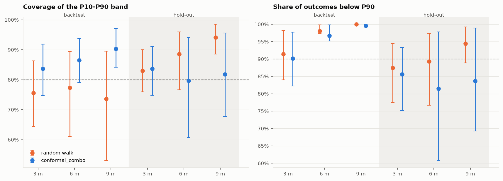
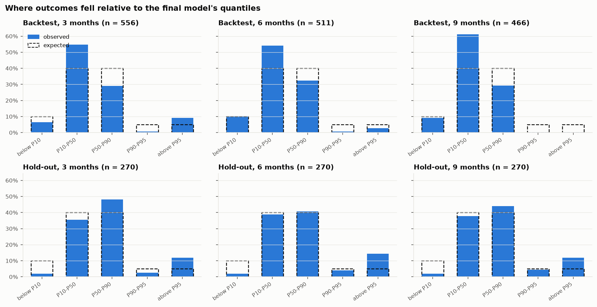
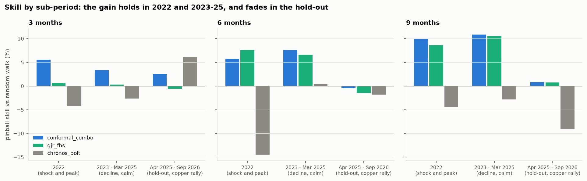
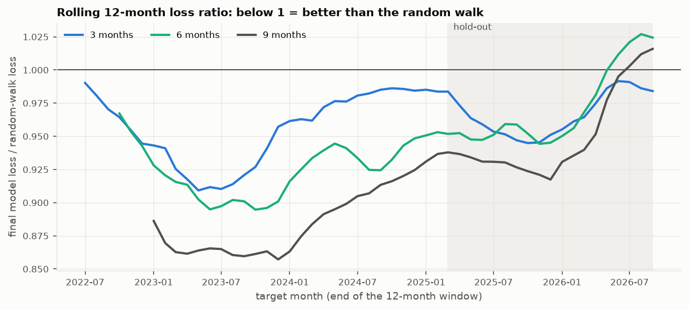
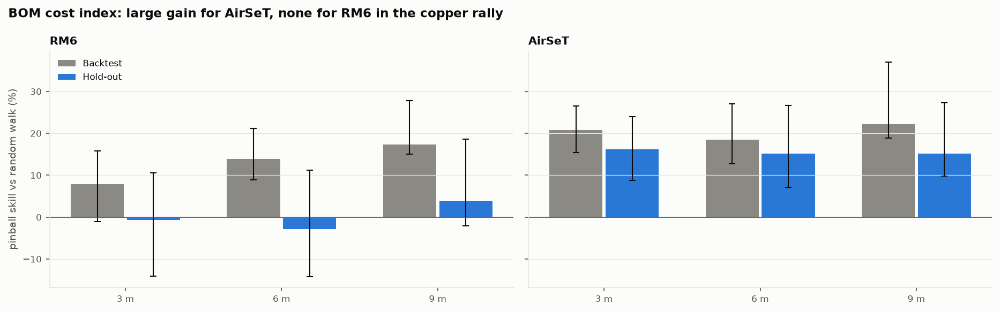
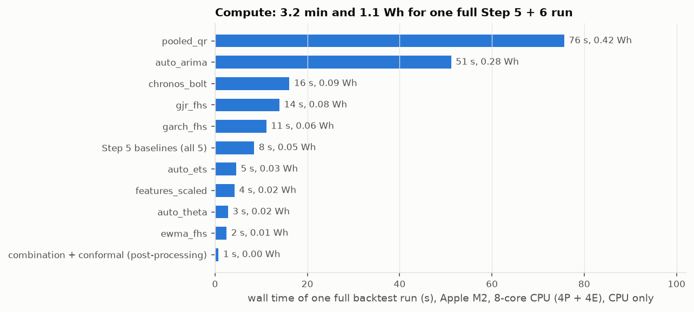
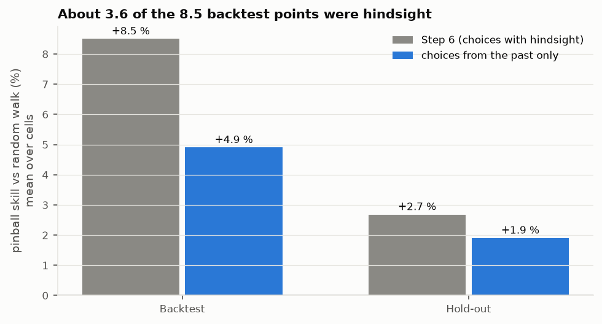

# Step 7 – Backtesting and evaluation

*Owner: Kenza · Status: done; feeds Steps 8–12*

> **Run from the repo root, in this order** (the Step 6 pipeline must have run first; see `step6_models.md`):
>
> ```bash
> uv run python -m src.evaluation                              # metric, jury, calibration, sub-period and BOM tables + charts, ≈ 4 min (after Step 8's inputs: src.models --stage export)
> uv run python -m src.evaluation --sensitivity                # + sliding window and tuning without hindsight, ≈ 5 min (mostly leakage checks)
> uv run --extra chronos python -m src.evaluation --compute    # + run time and CO₂ of every model, ≈ 4 min
> uv run pytest tests/test_evaluation.py                       # 16 tests: formulas (synthetic data) + leakage
> ```
>
> The notebook `analysis/07_evaluation.ipynb` shows every table and chart. It reads the saved tables, so run the commands above first.

| What | Where |
|---|---|
| Code | `src/evaluation.py`, `src/evaluation_plots.py` |
| Tests | `tests/test_evaluation.py` |
| Tables used in this report | `report/problem1/step7_tables/` |
| Charts | `plots/step7/` |
| BOM-index, sliding-window, λ-variant and causal predictions | `Data/processed/evaluation/` (not committed) |

**Step 7 evaluates; it chooses nothing.** The final model (`conformal_combo`) was fixed in Step 6 and the hold-out is frozen. Step 7 reads the Step 6 predictions and never writes into `Data/processed/models/`, nor changes the Step 6 settings: both are fingerprinted by the hold-out freeze, which still accepts after every Step 7 run.

---

## Summary

- **Does the final model beat the naive baseline?**
  - **Backtest (Feb 2022 → Mar 2025): yes, at every horizon**, on pinball loss: +4.3 / +7.0 / +10.7 % at 3 / 6 / 9 months. Each is significant (Diebold–Mariano p ≤ 0.025, confidence intervals above 0).
  - **Hold-out (Apr 2025 → Sep 2026): it honestly matches**: +2.5 / −0.5 / +0.8 %, no difference significant.
- **The honest backtest estimate is +4.9 %, not +8.5 %.** Step 6's choices re-made at every origin from the past only score +4.9 % (mean over cells), so about 3.6 points of Step 6's figure were hindsight. Without hindsight, the procedure converges on the same choices.
- **The value is in the band, not the median.** The median is no better than "no change" (MAE skill −4 % to +2 %). The gain comes from bands with the right coverage that are narrower than the random walk's.
- **The band's width is right, but its centre follows the wrong regime.** In the 2023–24 decline the upside was too wide; in the 2025–26 rally it was too short (14–18 % of hold-out outcomes above P90, target 10 %).
- **BOM cost index (client BOM v1):**
  - **AirSeT:** better forecast than by the random walk (+15 to +16 % on the hold-out). But BOM v1 puts copper at 38 % of its cost, so the copper rally also hit it: its index ended above P90 in 17–28 % of hold-out cases.
  - **RM6:** no gain during the copper rally. Its index ended above P90 in 22–33 % of hold-out cases, so RM6 needs a copper indexation clause.
  - **The Step 8 joint simulation**, which gives the CSV's BOM rows, is as good as the direct forecast (hold-out skill +14 to +22 % for AirSeT). For RM6 its P90 was exceeded as often as the direct forecast's (22–33 %); for AirSeT less often (6–17 %).
- **Stable over time:** the gain holds in both the 2022 shock and 2023–25, then fades in the hold-out.
- **Compute is negligible:** one full Step 5 + 6 run takes 3.2 minutes and about 1.1 Wh (0.05 g CO₂ on the French grid).
- **Sensitivity checks confirm Step 6:** the expanding window beats a 60-month sliding window, and λ = 0.97 is chosen at 53 of 57 origins.

---

## 1. What Step 7 adds to Step 6

Step 6 already did part of the plan's Step 7:
- the rolling-origin backtest (expanding window, publication lags respected);
- the hold-out, frozen and opened once;
- model selection with the plan's rule;
- the jury table on the hold-out.

Step 7 completes it:

| Plan Step 7 item | Section |
|---|---|
| MAPE, MASE, WAPE weighted by BOM € share, CRPS; MAE / RMSE / pinball on both windows | 2, 3 |
| "Beats naive" table on both windows, with block-bootstrap CIs and Diebold–Mariano (HLN) | 2 |
| Coverage with CIs, Kupiec / Christoffersen tests, PIT histogram | 4 |
| Sub-periods, stress windows, rolling loss plot | 5 |
| Backtest on the **BOM cost index** | 6 |
| Compute and CO₂ per model | 7 |
| Sliding vs expanding window; hyperparameter tuning without hindsight | 8 |
| Model selection and final refit | 9 |

**Windows** (by target month, as in Steps 5–6):
- **Backtest:** Feb 2022 → Mar 2025. Every choice was made here.
- **Hold-out:** Apr 2025 → Sep 2026, opened once.
- **Strict hold-out:** hold-out rows whose origin is from March 2025 on, so that no part of the outcome window was visible when choosing.

**Matching.** Every forecast is paired with the random walk issued for the same target, horizon and origin, so each comparison uses exactly the same outcomes.

## 2. Does the final model beat the naive baseline?

**Definitions:**
- **Skill** = 1 − Σ loss ÷ Σ loss of the random walk.
- **95 % confidence intervals:** moving-block bootstrap over origins, with blocks of *H* months and all targets of an origin resampled together.
- **Diebold–Mariano:** with the Harvey–Leybourne–Newbold small-sample correction. One-sided p-value: "the model is better".

| Window | H | Pinball skill [95 % CI] | DM p | MAE skill | MASE (random walk) | Coverage 80 % / P90 |
|---|---|---|---|---|---|---|
| Backtest | 3 | **+4.3 % [+1.3, +7.7]** | 0.025 | +0.9 % | 0.67 (0.67) | 84 / 90 % |
| | 6 | **+7.0 % [+4.9, +10.8]** | 0.009 | −1.7 % | 0.78 (0.76) | 87 / 97 % |
| | 9 | **+10.7 % [+7.8, +13.9]** | 0.006 | −3.7 % | 0.90 (0.87) | 90 / 100 % |
| Hold-out | 3 | +2.5 % [−0.9, +5.3] | 0.10 | +1.6 % | 0.97 (0.99) | 84 / 86 % |
| | 6 | −0.5 % [−5.8, +6.0] | 0.54 | +1.1 % | 1.11 (1.12) | 80 / 82 % |
| | 9 | +0.8 % [−3.9, +8.5] | 0.45 | +1.1 % | 1.16 (1.17) | 82 / 84 % |

**Jury answer:**
- **Backtest:** the model beats the naive baseline at every horizon on pinball loss, and the gain is significant.
- **Hold-out:** it honestly matches the naive baseline (Level 2 of the brief), slightly ahead at 3 months. With only 6 / 3 / 2 independent windows, differences below about 5 % cannot be told apart from noise.

**The gain is in the band, not the median.** On the backtest the median is slightly worse than "no change" at 6–9 months, yet pinball loss is significantly better.

**How to read MASE.** The plan states that "MASE < 1 means the model beats the naive baseline". That only holds against the naive forecast's *usual historical* error. On the hold-out, the random walk's own MASE is 1.12–1.17: the 2025–26 copper rally moved prices more than history did, so every model's MASE rises. "Beats the naive on these months" is the MAE skill, which equals model MASE vs random-walk MASE on the same rows.

**Other metrics** are in the tables at three levels (by target, by material group, by horizon):
- MAPE: error on the price itself, e.g. the final model is off by 5.4 % on average at 3 months on the hold-out;
- RMSE;
- a CRPS approximation, close to the pinball results.

## 3. Errors weighted by each product's recipe (WAPE)

Each material's error is weighted by its € share in the Step 2 recipe:

| Product | Main weights |
|---|---|
| RM6 | copper (with brass) 56 %, steel and stainless (S09) 29 %, epoxy 12 % |
| AirSeT | steel and stainless (S09) 52 %, copper 38 %, epoxy 8 % |

The random walk forecasts "no change", so its WAPE is 1 by construction, and the WAPE skill is 1 − WAPE.

| WAPE skill, final model | Backtest 3 / 6 / 9 m | Hold-out 3 / 6 / 9 m |
|---|---|---|
| RM6 | +2 / −3 / −5 % | **+3 / +1 / +2 %** |
| AirSeT | +2 / −4 / −6 % | +4 / +1 / +1 % |

This is the **median** error, weighted by € share. It confirms section 2: the median is close to the random walk, so the gain has to come from the band.

## 4. Calibration



**Kupiec** (is the miss rate right?) and **Christoffersen** (do misses cluster?):
- They are run on non-overlapping origins: every *H*-th one, with the median p-value over the *H* possible starting points.
- Two kinds of miss are tested: outside the P10–P90 band (target 20 %) and above P90 (target 10 %), which is the pricing-buffer side.

| Final model | Above P90: backtest 3 / 6 / 9 m | Kupiec p | Above P90: hold-out 3 / 6 / 9 m | Kupiec p |
|---|---|---|---|---|
| Miss rate (target 10 %) | 9.9 / 3.3 / 0.4 % | 0.81 / 0.002 / 0.002 | **14.4 / 18.5 / 16.3 %** | 0.10 / 0.11 / 0.26 |

**Christoffersen:** no sign that misses cluster (p ≥ 0.19 everywhere), but there are few misses.

**Correlation caveat:** misses of different materials at the same origin are correlated (common shocks), so these p-values are optimistic. They describe; they do not prove.



*Where outcomes fell relative to the final model's quantiles. Expected: 10 / 40 / 40 / 5 / 5 %.*

**What the calibration shows:**
1. **The band's width is right on average, but its centre follows the wrong regime.**
   - **Backtest:** prices mostly fell in 2023–24. 55–61 % of outcomes fell between P10 and P50, and almost none above P90 at 6–9 months, so the upside band was too wide (Kupiec p = 0.002).
   - **Hold-out:** prices rose. Only 2 % fell below P10 and 12–14 % above P95, so the downside was too wide and the upside too short.
2. **On the hold-out, 14–18 % of outcomes ended above P90.** Kupiec can't reject it with 2–6 independent windows; that's low power, not proof of good calibration. For pricing, a P90 buffer would have been exceeded more often than promised, mostly on copper (Step 6, section 6.4).
3. **Direction is not forecastable; width is.** This is why the conformal factors learnt to shrink the downside (P10 × 0.79) and stretch the extreme upside (P95 × 1.13) by September 2026.

## 5. Over time: sub-periods, stress windows, rolling loss

The sub-periods are defined by target month. The first outcome is in February 2022, so there is no pre-2020 period. As the plan says: describe, don't test.

| Final model, pinball skill vs random walk | 3 m | 6 m | 9 m | Independent windows (3 / 6 / 9 m) |
|---|---|---|---|---|
| 2022 (shock and peak) | +5.6 % | +5.7 % | +10.0 % | 3.7 / 1.3 / 0.6 |
| 2023 – Mar 2025 (decline, calm) | +3.3 % | +7.6 % | +10.8 % | 9 / 4.5 / 3 |
| Apr 2025 – Sep 2026 (hold-out, copper rally) | +2.5 % | −0.5 % | +0.8 % | 6 / 3 / 2 |



- **The gain holds in both backtest periods.** It is not a one-off from the 2022 shock. It fades in the hold-out.
- **Stress, 2022 shock:** bands were too narrow for every model. The final model covered 66–74 %, the random walk only 49–63 %.
- **Stress, 2025–26 rally:** the final model's coverage was right (80–84 %), but its upper tail was too short.
- **Chronos is the clearest example of instability:** −14 % at 6 months in 2022, then the best model at 3 months on the hold-out.



*Rolling 12-month ratio of the final model's pinball loss to the random walk's (in the spirit of Rossi, 2013). Below 1 = better.*

The final model beat the random walk on every 12-month window until about April 2026. In the last months of the hold-out, the 6- and 9-month ratios rose to about 1.02–1.03: the copper rally. A model can win on average and lose in the period that matters, which is the point of this chart.

## 6. BOM cost index backtest

**Why a separate check.** The CSV has BOM rows for RM6 and AirSeT. Their final values come from the Step 8 joint simulation (backtested in section 6.1); here we first forecast the same target directly, as one series.

**How:**
- **Building the index.** The historical index of each product is built exactly as in Step 2: `cost_breakdown` (fixed recipe, € weights at September 2026 prices) + `driver_ratios` + `bom_index`. It runs from January 2018, when the epoxy series starts.
- **Publication timing.** Each index is added to the panel with a **2-month publication lag**, that of its slowest drivers (S09, S10, D01, D02). So it goes through the same information sets, Step 6 model code and leakage check as the materials.
- **Models:**
  - Step 5's baselines;
  - the final model's own recipe: the four main members, equal weights, conformal γ = 0.02 frozen in Step 6. **Nothing is re-chosen.**
- **Sample:** 18–24 backtest origins and 18 hold-out origins per horizon.

| Final model recipe, pinball skill vs random walk | Backtest 3 / 6 / 9 m | Hold-out 3 / 6 / 9 m | Hold-out: share below P90 |
|---|---|---|---|
| RM6 | +8 / +14 / +17 % | **−1 / −3 / +4 %** | 78 / 67 / 72 % |
| AirSeT | +21 / +18 / +22 % | **+16 / +15 / +15 %** | 83 / 78 / 72 % |



- **AirSeT: a clear gain, but not in the upper tail.** The random walk's band was built from history that includes the 2021 surge, so it was far too wide for 2025–26 (100 % coverage). The final model's volatility-scaled bands are narrower (+15 % skill). With BOM v1, copper is 38 % of AirSeT's cost, so the 2025–26 copper rally pushed 17–28 % of hold-out outcomes above its P90. In pricing terms: **a smaller buffer than the random walk's, but long AirSeT quotes also need a copper clause.**
- **RM6: no gain in the copper rally.** The index ended above P90 in 22–33 % of hold-out cases. RM6 is mainly copper risk, so **a buffer alone is not enough: long RM6 quotes need a copper indexation clause** (Step 9).

**Live forecast at September 2026,** as an index (September 2026 = 100), 9 months:

| Product | P10 / P50 / P90 |
|---|---|
| RM6 | 88.8 / 100.7 / 117.0 |
| AirSeT | 89.8 / 100.6 / 114.4 |

**Leakage check:** 1,548 of 1,548 forecasts unchanged when the future is poisoned, across 43 origins (a permanent test).

**Index weights.** The recipe (kg) is fixed; the September 2026 prices only set the scale. The change from any origin is the same as with that origin's prices.

### 6.1 The Step 8 joint simulation, backtested

The CSV's BOM rows come from the **Step 8 joint simulation**, not from the direct forecast above, so the simulation is backtested too (`step8_backtest`). At each past origin it is re-run as it is at September 2026:
- it bootstraps the residuals known at that origin (Step 8: blocks of 3 months, 10,000 paths, seed 42);
- it rescales each material to the final model's forecast made at that origin;
- it values the paths with the same weights as the target above, so forecast and outcome are the same quantity, and the random walk and the direct forecast are scored on the same rows.

**Nothing is re-chosen.** Step 8's settings and the final model are used as they are, and the CSV uses Step 8 whatever this shows: it is a check, not a choice. At September 2026 it reproduces Step 8's numbers exactly (a test). Origins are the same as the direct forecast's, from January 2023 (when epoxy forecasts start).

Pinball skill vs the random walk, %, and share of outcomes below P90 (target 90 %):

| Product | Backtest 3 / 6 / 9 m: direct → Step 8 | Hold-out 3 / 6 / 9 m: direct → Step 8 | Hold-out below P90: direct → Step 8 |
|---|---|---|---|
| RM6 | +8 / +14 / +17 → +3 / +15 / +19 | −1 / −3 / +4 → −6 / 0 / +10 | 78 / 67 / 72 → 78 / 67 / 72 |
| AirSeT | +21 / +18 / +22 → +17 / +12 / +17 | +16 / +15 / +15 → +14 / +18 / +22 | 83 / 78 / 72 → 83 / 94 / 94 |

- **The simulation is as good as the direct forecast.** Its skills are within a few points of the direct forecast's, inside the confidence intervals (e.g. RM6 at 9 months on the hold-out: +10 % [+10, +23] vs +4 % [−2, +19]). AirSeT keeps its gain over the random walk.
- **RM6's upper tail is too short with both.** At 6 and 9 months, 33 % and 28 % of hold-out outcomes ended above P90 (target 10 %). Copper's upside was underestimated in the 2025–26 rally (section 4), and copper is most of RM6's cost. With 18 overlapping origins (2–3 independent windows) the 95 % interval is wide.
- **AirSeT's tail is better covered by Step 8** (6 % above P90 at 6–9 months, against 22–28 % for the direct forecast): the simulation spreads the risk over copper, steel and nickel, which did not all rally together.
- **For Step 9:** RM6's Step 8 P90 is a floor, so 6–9-month RM6 quotes need a copper clause, not a buffer alone. AirSeT's clause also follows copper (BOM v1).

## 7. Compute and CO₂

Each model's full backtest (all 15 targets × 3 horizons × every origin) was timed from scratch, with caches cleared, on a computer with 8-core CPU, 10-core GPU, 8 GB unified memory. Every model runs on the CPU only (Chronos included, `chronos_device = "cpu"`); the GPU is not used.

| | Run time | Energy | CO₂, France / EU grid |
|---|---|---|---|
| Step 5 baselines (5 models) | 8 s | 0.05 Wh | ≈ 0 / 0.01 g |
| ewma_fhs / garch_fhs / gjr_fhs | 2 / 11 / 14 s | ≤ 0.08 Wh each | ≤ 0.02 g |
| auto_ets / auto_arima / auto_theta | 5 / 51 / 3 s | ≤ 0.28 Wh | ≤ 0.07 g |
| chronos_bolt (includes loading the model) | 16 s | 0.09 Wh | 0.02 g |
| pooled_qr | 76 s | 0.42 Wh | 0.11 g |
| features_scaled | 4 s | 0.02 Wh | 0.01 g |
| Combination + conformal | 1 s | ≈ 0 | ≈ 0 |
| **One full Step 5 + 6 run** | **3.2 min** | **1.1 Wh** | **0.05 g / 0.27 g** |



**How it's estimated:**
- **Energy** = run time × 20 W, the average power of a laptop CPU under load.
- **CO₂** = energy × grid intensity: France ≈ 50 g/kWh, EU average ≈ 250 g/kWh.

It is an estimate, and the assumptions are parameters of `compute_footprint`. We did not use `codecarbon`: on a laptop without a readable power sensor it also falls back on a constant power, and it would contact an outside service to locate the machine.

**Context:** the two slowest models (`pooled_qr`, `auto_arima`) are not in the final combination. The full leakage test suite (about 11 minutes) is about 3.7 Wh.

## 8. Sensitivity checks (reported, not acted on)

These are run as checks: if either had pointed to a better procedure, it would have been reported as a post-hoc finding, not adopted.

### 8.1 Sliding (last 60 months) vs expanding window

The plan says 60 months is too short for GARCH and quantile regression, so only `ewma_fhs` and the historical quantiles are tested.

| Pinball skill vs random walk | Backtest 3 / 6 / 9 m | Hold-out 3 / 6 / 9 m |
|---|---|---|
| ewma_fhs, expanding (Step 6) | **+0.3 / +5.3 / +8.5 %** | −0.5 / −1.9 / −0.5 % |
| ewma_fhs, last 60 months | −1.4 / +3.9 / +7.9 % | −1.3 / −5.9 / −7.8 % |
| Historical quantiles, expanding | −3.0 / −7.1 / −8.6 % | +1.5 / −1.6 / −5.6 % |
| Historical quantiles, last 60 months | −3.7 / −7.8 / −8.6 % | +0.7 / −7.1 / −11.1 % |

- **The expanding window wins on the backtest,** where the plan says to choose, so Step 6's choice is confirmed.
- **The hold-out agrees:** forgetting the 2021–22 shock made the bands too narrow for the 2025–26 rally.
- **The two only differ from about November 2022;** before that, the history is shorter than 60 months anyway.
- **Leakage:** the sliding variants passed the poisoned-future check on every origin.

### 8.2 Tuning without hindsight

**What it tests.** In Step 6, λ, the combination members and the conformal γ were chosen on the whole backtest, then scored on the same backtest. Here the same procedure is re-run at **every origin**, using only the outcomes known at that origin:
1. λ per volatility model (0.94 / 0.97);
2. members: coverage within 80 % ± 10 first, then skill; sizes 3 and 4;
3. the `features_scaled` yes/no rule;
4. the conformal γ.

Before 6 months of outcomes are known, a neutral default is used: all models, λ = 0.97, no calibration.

| | Backtest, mean over cells | Backtest 3 / 6 / 9 m | Hold-out, mean over cells | Hold-out 3 / 6 / 9 m |
|---|---|---|---|---|
| Step 6 (choices with hindsight) | +8.5 % | +4.3 / +7.0 / +10.7 % | +2.7 % | +2.5 / −0.5 / +0.8 % |
| **Choices from the past only** | **+4.9 %** | +2.0 / +2.6 / +6.0 % | +1.9 % | +2.2 / −1.2 / 0.0 % |



- **About 3.6 of the 8.5 points of backtest skill were hindsight.** The honest backtest estimate of the method is **+4.9 %**, still clearly better than the random walk. The +8.5 % in the Step 6 report should be read as optimistic.
- **On the hold-out the two versions are close** (+1.9 % vs +2.7 %). The hold-out already gave the clean answer, and this confirms it from a second angle.
- **The procedure converges on Step 6's choices:**
  - λ = 0.97 at 53 of 57 origins for the volatility models; 0.94 only in mid-2022, right after the shock;
  - members unstable during the 2022 shock (13 different sets in total), then from 2025 exactly Step 6's four;
  - γ = 0 at 30 origins and small values (0.02–0.05) at most of the rest.
- **Leakage:** poisoning every later outcome and forecast leaves the causal forecast unchanged (tested at origins from 2022 to 2026).

## 9. Model selection and final fit

**The rule (plan Step 7):** first keep the models whose coverage is acceptable, then pick the lowest pinball loss.

**How Step 6 applied it** (`build_combination`, backtest only):
1. Only models forecasting every cell compete.
2. Keep those with coverage within 80 % ± 10, ranked by pinball skill vs the random walk. Sizes 3 and 4 were tried.
3. Apply the `features_scaled` yes/no rule in its 17 cells.
4. Apply the conformal calibration.

**Result: `conformal_combo`** = `gjr_fhs` + `garch_fhs` + `ewma_fhs` + `auto_theta`, plus `features_scaled` in its 17 cells; equal weights; conformal γ = 0.02. Equal weights because of the forecast combination puzzle (Step 6, section 5).

**Step 7 confirms the choice from two angles:**
- re-made without hindsight at every origin, the same rule converges on the same members (section 8.2);
- the main alternative procedure, a sliding window, is worse (section 8.1).

**Final fit for the CSV.** The submission forecasts are the final model's rows at the **September 2026 origin**. They are already fitted on **all data known up to September 2026, including the hold-out months**:
- every model trains on all outcomes known at the origin;
- the conformal factors have learnt from every outcome up to September 2026.

The hold-out was used for evaluation only, never left out of the final fit. These rows are exported for Step 8 (`uv run python -m src.models --stage export`) and will be written to the CSV in Step 12.

## 10. Proof that the new analyses use no future data

| Check | Coverage | Result |
|---|---|---|
| BOM-index models (4 base models) | Every origin (43), all three products and horizons: 1,548 forecasts | all unchanged |
| Step 8 joint simulation at past origins (later residuals, forecasts made at other origins and all outcomes poisoned) | 6 origins from 2023 to 2026, all three products and horizons | all unchanged |
| Sliding-window variants | Every origin (57), every target and horizon | all unchanged |
| Tuning without hindsight (every choice + calibration) | Origins from 2022 to 2026 | all unchanged |
| MASE scale (uses past outcomes only) | Unit test on synthetic data | ✓ |
| Step 6 hold-out freeze after every Step 7 run | `--stage holdout` | still accepts |

**Formula tests:** pinball, CRPS, Diebold–Mariano, Kupiec, Christoffersen, non-overlapping origins, sub-periods and windows are tested on synthetic data. They don't need the confidential data, so they can run in CI (Step 12).

## 11. For the next steps

- **Step 8:** the joint simulation is backtested (section 6.1) and matches the direct forecast; its RM6 P90 should be read as a floor.
- **Step 9 (pricing):**
  - **AirSeT:** the final model's P90 gives a smaller buffer than the random walk. With BOM v1 it carries copper too, so its clause should follow copper as well as steel and stainless.
  - **RM6:** the P90 was exceeded in 22–33 % of hold-out cases (copper), with both the direct forecast and the Step 8 simulation, so pair the buffer with a **copper indexation clause** for 6–9-month quotes.
  - **Materials:** where the forecasts failed on the hold-out, it was the upside tail, mainly copper. This affects RM6 most, and AirSeT through its 28 kg of copper (section 6.1).
- **Step 12 (README):**
  - Compute and CO₂ (section 7);
  - the "beats naive" table (section 2);
  - formula tests runnable in CI without data (section 10).

## 12. Limits

- **Small samples:** 18–38 origins per cell, overlapping: about 6 / 3 / 2 independent hold-out windows at 3 / 6 / 9 months. Tests have low power; most differences are within noise.
- **Correlated materials:** misses at the same origin are not independent, so calibration p-values are optimistic.
- **One regime per window:** the backtest is a shock then a decline; the hold-out is one copper rally.
- **CRPS** is approximated from P10 / P50 / P90 (levels 5–95 %); the exact CRPS of the BOM index needs the Step 8 paths.
- **BOM index:** fixed recipe; history from 2018 only (18–24 backtest origins).
- **Compute:** an estimate with a constant 20 W, not a power measurement.
- **Sensitivity checks** come after the hold-out was opened: they confirm the choices, but would not have been adopted had they disagreed.
