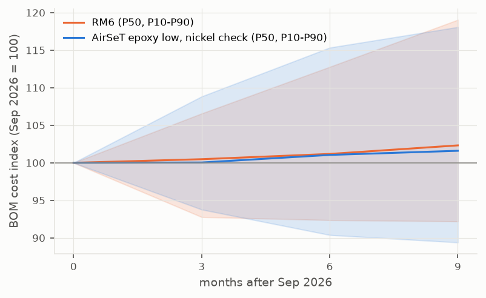
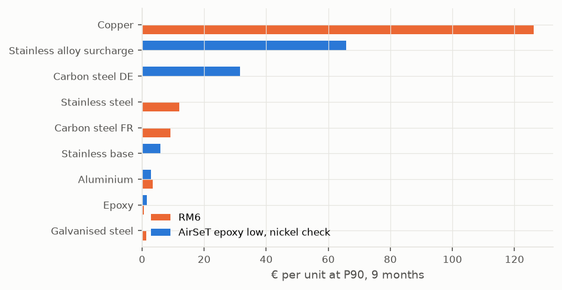
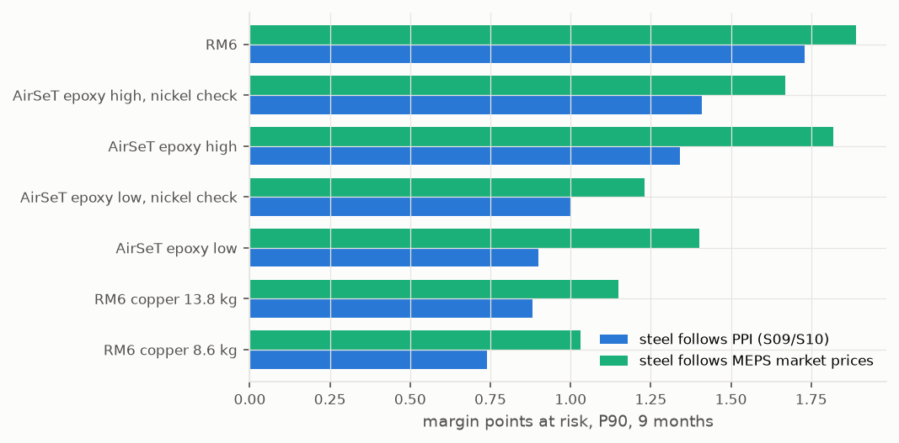
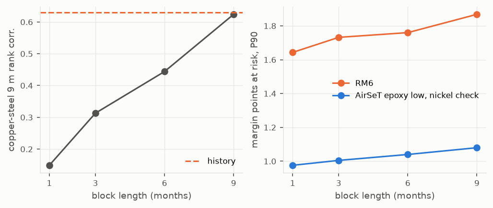

# Step 8 – From material forecasts to BOM cost index and margin at risk

*Owner: Ion · Status: done · Feeds Steps 9, 11, 12 and Problem 2*

> **Run from the repo root**, after the Step 6 export:
>
> ```bash
> uv run python -m src.models --stage export     # Step 6: writes the Step 8 inputs
> uv run python -m src.simulation                # Step 8: tables
> uv run python -m src.simulation_plots          # Step 8: charts
> uv run pytest tests/test_simulation.py         # Step 8: checks (section 8)
> ```

| What | Where |
|---|---|
| Code | `src/simulation.py`, `src/simulation_plots.py` |
| Inputs (from Step 6) | `Data/processed/models/step8/residuals_monthly.csv`, `marginals_202609.csv` |
| Tables | `report/problem1/step8_tables/` |
| Charts | `plots/step8/` |

---

## Summary

- **One cost distribution per product and horizon**, 10,000 joint price paths are made per product and horizon, with each material matching the P10/P50/P90/P95. Materials move together as they did historically.
- **Margin at risk is small in % of price but grows with the quote's validity.** For RM6, raw-material cost at P90 takes away **0.6 / 1.2 / 1.7 margin points** at 3 / 6 / 9 months (P95: 0.8 / 1.4 / 2.1).
- **RM6 is a copper bet:** copper is **€126 of the €151** P90 cost increase at 9 months.
- **AirSeT is a steel + stainless (+ nickel) bet:** about 0.9–1.4 points at 9 months, depending on the epoxy and nickel cases.
- **Pricing stainless through nickel widens AirSeT's band.** The 9-month P95 rises from 118.7 to 124.5 (epoxy low). The default case understates AirSeT's risk.
- **With steel at market prices (MEPS), AirSeT's 9-month risk rises** from 0.9–1.4 to 1.2–1.8 points. RM6 barely moves (1.73 → 1.89).
- **RM6's risk depends on its copper mass:** 1.73 points at 9 months with the BOM's 38.8 kg, 0.74–0.88 with the teardown's 8.6–13.8 kg.
- **Backtested in Step 7 (§6.1):** as good as the direct forecast of the BOM index. For RM6, 28–33 % of 6–9-month hold-out outcomes ended above P90, so **RM6's P90 is a floor**.

## 1. What Step 8 does

The chain asked by the client:

**RM forecast → BOM exposure → product-cost evolution → margin-at-risk** → pricing decision (Step 9)

- **RM forecast:** the Step 6 final model gives each material's P10 / P50 / P90 / P95 at 3, 6 and 9 months, but each material on its own.
- **BOM exposure:** the Step 2 cost model (`cost_breakdown`) gives the € of each material in one unit today. Materials are weighted by **€ exposure, not mass**.
- **Product cost:** we need the distribution of the **whole unit's** raw-material cost. Adding up material P90s would assume every material hits its bad case at the same time, which overstates the risk. So we simulate the materials **jointly**.

## 2. Method

1. **Joint bootstrap of standardised residuals.**
   - Step 6 exports monthly returns divided by the EWMA volatility known the month before (`residuals_monthly.csv`).
   - We resample **blocks of 3 consecutive months**, taking every material from the same months. This keeps how materials move together (e.g. copper / aluminium 0.70, steel / galvanised 0.98) and the short-term momentum of the PPIs.
   - 10,000 paths of 9 months, seed 42. Window: **Feb 2019 → Sep 2026 (92 months)**, where all six drivers have residuals. It includes the 2021–22 shock.
2. **Back to returns:** residual × today's volatility (`sigma_T`), summed over the months → each driver's ratio vs Sep 2026.
3. **Rescaling to the Step 6 forecast.**
   - At 3, 6 and 9 months, each driver is stretched so its simulated P10 / P50 / P90 / P95 equal the final model's. Straight lines between those four points, and the end slopes beyond them.
   - The stretch keeps each path's **rank**, so the joint behaviour from step 1 survives.
   - Checked: every driver matches the forecast at all four percentiles.
4. **Cost model:** each driver ratio is applied to the materials it drives (S09 moves both carbon steel and stainless), and the Step 2 `bom_index` gives the unit's index per path (Sep 2026 = 100).
5. **Percentiles across the 10,000 paths**, then conversion to € and to margin points.

**Drivers:** copper D01, aluminium D02, EU steel S09, galvanised S10, epoxy, nickel S03 (nickel-check cases only). Plastics have no €/t level in Step 2 and stay unpriced.

## 3. BOM cost index (Sep 2026 = 100)

| Case | 3 months P10 / P50 / P90 / P95 | 6 months | 9 months |
|---|---|---|---|
| RM6 | 92.8 / 100.5 / 106.6 / 108.7 | 92.4 / 101.2 / 112.8 / 115.8 | 92.2 / 102.3 / 119.0 / 122.9 |
| AirSeT epoxy low | 97.3 / 99.9 / 106.8 / 108.1 | 95.2 / 100.2 / 112.2 / 114.0 | 93.2 / 100.6 / 116.2 / 118.7 |
| AirSeT epoxy high | 95.8 / 99.7 / 105.5 / 107.5 | 93.7 / 100.4 / 111.2 / 113.4 | 92.3 / 101.1 / 114.3 / 117.7 |
| AirSeT epoxy low, nickel check | 93.8 / 100.0 / 108.8 / 112.5 | 90.4 / 101.0 / 115.3 / 119.5 | 89.4 / 101.6 / 118.1 / 124.5 |
| AirSeT epoxy high, nickel check | 94.2 / 99.5 / 108.0 / 109.2 | 91.8 / 101.2 / 112.7 / 115.2 | 90.7 / 101.6 / 115.1 / 119.5 |

Raw-material cost today: RM6 €795, AirSeT €583 (epoxy low) / €981 (epoxy high).



## 4. Margin points at risk

1 point = 1 % of the selling price. Raw-material cost only; labour and overhead are held constant.

- **Price adjustment** = (P50 cost − cost today) ÷ selling price: the drift the forecast already expects.
- **Risk buffer** = (P90 or P95 cost − P50 cost) ÷ selling price: protection against a worse-than-expected rise.
- **Total** = adjustment + buffer.

**Selling price:** RM6 **€8,740**, Schneider P50 2025 in the price benchmark ("legacy product pricing", as the client advised). AirSeT: **€10,488, an assumption** (RM6 + 20 %); the benchmark has no AirSeT price.

| Case | Total at P90: 3 / 6 / 9 m | Total at P95: 3 / 6 / 9 m | Of which adjustment at 9 m |
|---|---|---|---|
| **RM6** | **0.60 / 1.16 / 1.73** | **0.79 / 1.44 / 2.08** | 0.21 |
| AirSeT epoxy low | 0.38 / 0.68 / 0.90 | 0.45 / 0.78 / 1.04 | 0.04 |
| AirSeT epoxy high | 0.52 / 1.04 / 1.34 | 0.70 / 1.25 / 1.65 | 0.10 |
| AirSeT epoxy low, nickel check | 0.49 / 0.85 / 1.00 | 0.69 / 1.08 / 1.36 | 0.09 |
| AirSeT epoxy high, nickel check | 0.75 / 1.19 / 1.41 | 0.86 / 1.42 / 1.82 | 0.15 |

**How to read it:** *"For a 9-month RM6 quote, raw-material cost increases will not take away more than 1.7 points of margin, with 90 % probability (2.1 points at 95 %)."*

- **The adjustment is small (≤ 0.2 points).** The forecast median is close to "no change" (Step 7), so almost all the risk is in the buffer. That is the part an indexation clause or a hedge can replace.
- **Risk grows with validity**, roughly 3× from 3 to 9 months for RM6.
- **Why smaller than Step 3's 4–8.5 points at 9 months:** Step 3 priced the unit at €4,299 (teardown cost + 30 % margin), half of €8,740, and measured the whole history, including the 2021 steel surge. Here we start from today's forecasts.
- **No target margin is needed.** The client gives none, so margin points are expressed against the selling price, and Step 9 treats the acceptable erosion as a decision variable.

## 5. Which material drives the bad case (€ near P90, 9 months)

Average € increase per material over the paths between the 85th and 95th percentile of the unit cost:

| Material | RM6 | AirSeT low | AirSeT high | AirSeT low, nickel | AirSeT high, nickel |
|---|---|---|---|---|---|
| Copper | **126** | – | – | – | – |
| Carbon steel | 9 | 44 | 40 | 31 | 35 |
| Stainless (total) | 12 | 45 | 42 | 72 | 61 |
|  of which nickel surcharge | – | – | – | **66** | 54 |
| Epoxy | 1 | 2 | **57** | 2 | 54 |
| Aluminium, galvanised | 4 | 2 | 3 | 3 | 3 |

- **RM6:** copper is about 84 % of the bad case. → Step 9: copper indexation or a hedge.
- **AirSeT:** steel and stainless. With nickel-driven stainless, the **nickel surcharge becomes the largest single item**. → an AirSeT clause must follow stainless including the surcharge, not just carbon steel.
- **Epoxy matters only in the "high" case** (85.6 kg). AirSeT's epoxy content is unknown; we keep both cases as an assumption.



## 6. Comparison with Step 7's direct forecast of the BOM index

9 months, P10 / P50 / P90:

| Case | Step 8 joint simulation | Step 7 direct forecast |
|---|---|---|
| RM6 | 92.2 / 102.3 / 119.0 | 88.8 / 100.7 / 118.2 |
| AirSeT epoxy low | 93.2 / 100.6 / 116.2 | 94.2 / 100.5 / 117.7 |
| AirSeT epoxy high | 92.3 / 101.1 / 114.3 | 92.1 / 100.4 / 117.8 |

- **Close for AirSeT.**
- **RM6: same P90, higher P10 and P50** (P10 92 vs 89, P50 102 vs 101), from copper's slightly positive forecast median.
- **The two are built differently:** Step 7 forecasts the index as one series; Step 8 builds it from each material's forecast and their joint behaviour.

**Backtest (Step 7, §6.1):** the simulation was re-run at every past origin and scored like the direct forecast. It is as good, but for RM6, 28–33 % of 6–9-month hold-out outcomes ended above its P90 (target 10 %; 2–3 independent windows).

## 7. Sensitivity

9 months, total at P90, in margin points (`bom_index_and_margin_points.csv`, `block_sensitivity.csv`).

**Steel at market prices.** The steel PPIs (S09, S10) are calmer than the MEPS prices Schneider pays (Step 3). This case keeps their forecast median but widens their spread to MEPS's volatility (`steel_market`).

| Case | Steel PPI | Steel market |
|---|---|---|
| RM6 | 1.73 | 1.89 |
| AirSeT epoxy low / high | 0.90 / 1.34 | 1.40 / 1.82 |
| AirSeT epoxy low / high, nickel check | 1.00 / 1.41 | 1.23 / 1.67 |

**RM6 copper mass.** The BOM gives 38.8 kg; the teardown gives 8.6–13.8 kg.

| Copper | Cost today | Steel PPI | Steel market |
|---|---|---|---|
| 38.8 kg (BOM) | €795 | 1.73 | 1.89 |
| 13.8 kg | €481 | 0.88 | 1.15 |
| 8.6 kg | €415 | 0.74 | 1.03 |



**Block length.** Short blocks weaken how copper and steel move together over 9 months. 9-month blocks recover it, and the risk rises a little.

| Block (months) | Copper / steel correlation | RM6 | AirSeT main case |
|---|---|---|---|
| History | 0.63 | – | – |
| 1 | 0.15 | 1.64 | 0.98 |
| **3 (used)** | 0.31 | 1.73 | 1.01 |
| 6 | 0.44 | 1.76 | 1.04 |
| 9 | 0.62 | 1.87 | 1.08 |



## 8. Checks (`tests/test_simulation.py`)

| Test | Checks that |
|---|---|
| `test_percentiles_match_the_forecast` | each driver's simulated P10 / P50 / P90 / P95 equal the Step 6 forecast |
| `test_no_future_data` | scrambling every price and residual after the origin leaves the result unchanged |
| `test_reproducible` | the same seed gives the same paths; another seed does not |
| `test_blocks_keep_materials_on_the_same_months` | every simulated month is a real month for all materials together |

## 9. Assumptions

| Assumption | Why | Effect |
|---|---|---|
| AirSeT selling price = RM6 + 20 % | No AirSeT price in the benchmark | Scales every AirSeT margin point; ±10 % on price = ∓10 % on the points |
| Nickel ratio in EUR = in USD (EUR/USD flat) | Step 6 forecasts nickel in USD (S03) | Small: EUR/USD moves far less than nickel |
| Raw materials only; labour, overhead, components constant | Out of scope of the forecast | Margin at risk understated if those also rise |
| Material bought at the end of the validity period | Purchase timing not given | Overstates exposure if bought earlier; a purchase lag is planned |
| Recipe fixed, weighted at Sep 2026 prices (Step 2) | Same as Steps 2 and 7 | – |
| Uncertain BOM lines kept as labelled cases (AirSeT epoxy low / high, RM6 unlabelled slice) | Client: don't invent compositions | Shown as a range, not one answer |
| Plastics unpriced | No €/t level (Step 2) | ≤ 4 % of mass |

## 10. Limits

- **Copper's upside tail was underestimated on the hold-out** (Step 6: copper above its 9-month P90 in 35–41 % of cases; Step 7: this simulation's RM6 index above P90 in 28–33 % at 6–9 months). **RM6's P90 should be read as a floor**. Step 9 should pair the buffer with a copper clause for 6–9-month quotes.
- **Short window:** 92 months of residuals; the bootstrap can only replay co-movements seen since 2019.
- **Months between 3, 6 and 9 are not rescaled**; only the three horizons are used here.
- **Synthetic selling prices**, and no AirSeT price.
- **Corrected BOM (`a_v1`) pending** from the client: the results will be rerun when it arrives.

## 11. For the next steps

- **Step 9:** quote rule per product and horizon from section 4. The buffer vs breach curve, with the tolerated erosion as the decision variable (the client gives no margin target), and the strategy comparison (buffer, indexation, copper hedge, shorter validity).
- **Problem 2:** RM6 vs AirSeT cost outlook to mid-2027 (section 3) for the price-convergence argument; AirSeT's margin room (section 4) for the "temporary margin investment" scenario.
- **Step 12:** BOM index rows of the submission CSV from section 3 (P10 / P50 / P90).