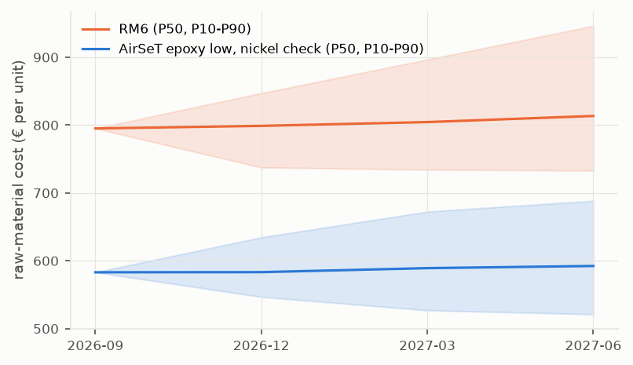

# Step 9 – Pricing rule and strategy comparison

**Question (slide 15, question 2):** how should Schneider set the price adjustment, risk buffer, quote validity and indexation clause for RM6 and RM AirSeT, given the raw-material forecasts?

| What | Where |
|---|---|
| Code | `src/pricing.py`, `src/pricing_plots.py` |
| Tests | `tests/test_pricing.py` (synthetic data, runs in CI) |
| Tables | `report/problem1/step9_tables/` |
| Charts | `plots/step9/` |

Run after Step 8:

```bash
uv run python -m src.pricing
uv run python -m src.pricing_plots
uv run pytest tests/test_pricing.py
```

---

## Summary

- **Quotes of up to 6 months:** a fixed price plus a small uplift is enough for both products. That is at most **0.9 margin points** for RM6 and **0.6** for AirSeT, at 90 % confidence.
- **9-month quotes need a price-adjustment (indexation) clause:**
  - **RM6 on copper:** a fixed price would need **+1.23 points** to limit the loss to 0.5 points. With a copper clause (±15 % band), **+0.74 points** is enough.
  - **AirSeT on steel and stainless:** the simulation alone says a buffer is enough. On real past prices, however, the buffer was breached on **10 %** of 9-month quotes, with losses up to **2.45 points** (2021–22). With a steel clause, the worst loss was **0.36 points**.
- **Today's practice (fixed price, no protection)** cost **2.4 margin points** in 2022. Selling prices rose 14 % while RM6's raw-material cost rose 58 %.
- **For Problem 2:** RM6's raw-material cost rises more than AirSeT's in only **57 %** of simulated paths to June 2027. This gives **weak support** for the "price convergence" argument.

1 margin point = 1 % of the selling price (RM6 €8,740; AirSeT €10,488, assumed). Raw materials only: labour and overhead are held constant.

---

## 1. Method

### 1.1 Margin points lost on a quote

`margin points lost = 100 × (raw-material cost at delivery − cost at quote) ÷ selling price`

These use the 10,000 joint price paths from Step 8, pushed through the Step 2 recipe. Positive = margin lost.

### 1.2 Scenarios

Downside, baseline and upside are the P10, P50 and P90 of the cost change (`scenarios.csv`). Steel PPI, main cases:

| | Downside | Baseline | Upside |
|---|---|---|---|
| RM6, 3 / 6 / 9 months | −0.66 / −0.69 / −0.71 pts | +0.04 / +0.11 / +0.21 | +0.60 / +1.16 / +1.73 |
| AirSeT, 3 / 6 / 9 months | −0.35 / −0.53 / −0.59 pts | +0.00 / +0.06 / +0.09 | +0.49 / +0.85 / +1.00 |

### 1.3 Strategies compared

Each strategy faces the **same quote, on the same date, with the same price path**. Only the pricing mechanism changes. This is a counterfactual: margin = price − cost is an accounting identity, so once the price path is fixed, the effect of a strategy is mechanical and no causal effect has to be estimated.

| Strategy | What it does |
|---|---|
| Fixed price | Today's practice, no protection (the reference) |
| Fixed + buffer (P75 / P90 / P95) | The price is raised up front by that percentile of the simulated loss |
| Indexation clause (±5 %) | The price follows copper (RM6) or steel + stainless (AirSeT) beyond the band. The clause is symmetric: the customer also gets the falls |
| Copper hedge (RM6) | Copper is bought forward at the quote, at the LME 3-month − cash spread |
| Re-quote every 3 months | Only the first 3 months' change is lost |

Each strategy is measured on simulated paths (`strategies_simulated.csv`) and on every past quote month since 2018 (`strategies_historical.csv`). The measures are:
- the mean loss;
- the P95 and worst loss;
- how often the loss exceeds 0.25, 0.5, 1 and 2 points;
- the gain versus a fixed price.

### 1.4 The quote rule

The client gives no target margin, so **the loss the business accepts** (0.25, 0.5, 1 or 2 points) is a decision variable. For each product, horizon and accepted loss, the rule (`quote_rule.csv`) tries the options in this order and keeps the first that works:

1. **Fixed price + price adjustment + buffer**, if the total uplift is ≤ 1 point (assumption: the largest uplift sales can add and stay competitive).
2. **Indexation clause** (the widest band that works) **+ a smaller buffer**.
3. **Shorter validity**, or a copper hedge for RM6.

- **Price adjustment** = the P50 loss: the drift the forecast expects.
- **Buffer** = the extra needed to keep the loss within the accepted level, with 90 % or 95 % confidence.

---

## 2. Results

### 2.1 Quote rule (90 % confidence, steel PPI)

Uplift to charge, in margin points:

| Accepted loss | RM6 3 m | RM6 6 m | RM6 9 m | AirSeT 3 m | AirSeT 6 m | AirSeT 9 m |
|---|---|---|---|---|---|---|
| 0.25 pts | 0.35 | 0.91 | **0.99 + copper clause ±15 %** | 0.24 | 0.60 | 0.76 |
| 0.5 pts | 0.10 | 0.66 | **0.74 + copper clause ±15 %** | 0.00 | 0.35 | 0.50 |
| 1 pt | 0.04 | 0.16 | 0.73 | 0.00 | 0.06 | 0.09 |
| 2 pts | 0.04 | 0.11 | 0.21 | 0.00 | 0.06 | 0.09 |

**Longest fixed price without a clause:** RM6 **6 months** (if the accepted loss is ≤ 0.5 points); AirSeT **9 months** in the simulation.

With **steel at market prices** (MEPS), RM6 needs a clause sooner (6 months if the accepted loss is 0.25 points), and AirSeT's uplifts rise by 30–60 %.


**Buffer vs breach** (`buffer_curve.csv`): the competitiveness trade-off. For a 9-month RM6 quote, a 1-point buffer is still exceeded **24 %** of the time; for AirSeT, **10 %**.

### 2.2 Strategy comparison, 9-month quotes

P95 loss in margin points. The gain versus a fixed price is in brackets: the average extra the customer pays.

| Strategy | RM6 simulated | RM6 historical | AirSeT simulated | AirSeT historical |
|---|---|---|---|---|
| Fixed price | 2.08 | 1.99 | 1.36 | 1.95 |
| Fixed + buffer P90 | 0.35 | 0.26 (+1.73) | 0.36 | **0.95** (+1.00) |
| Fixed + buffer P95 | 0.00 | −0.09 (+2.08) | 0.00 | **0.59** (+1.36) |
| Indexation ±5 % | 0.91 | 1.28 (+0.22) | 0.34 | **0.33** (+0.16) |
| Copper hedge | 0.61 | 1.13 (+0.22) | – | – |
| Re-quote every 3 months | 0.79 | 0.86 (+0.23) | 0.69 | 0.84 (+0.08) |


How to read it:

- **Buffers always look best on the simulated paths.** That is by construction: they are sized on those same paths. Their cost is that the customer pays the buffer on **every** quote: +1.73 points (≈ €150) for RM6 at P90.
- **AirSeT: the indexation clause is best on both counts.** It has the lowest historical loss (0.33, worst 0.36) and the customer pays the least (+0.16). A P95 buffer still lost 0.59, and up to 2.09 points, on past paths.
- **RM6: no single strategy is cheap and safe.** The copper clause and the hedge cut the loss by about 40 % for +0.22 points, but still lose about 1.1–1.3 points in a bad case. Hence the rule's **clause + smaller buffer** for 9-month quotes.

### 2.3 What today's practice cost (margin backtest, 2018–2025)

| Year | Selling price | RM6 raw-material cost | Margin vs 2018 |
|---|---|---|---|
| 2020 | €7,261 | €414 | +0.4 pts |
| 2021 | €7,748 (+6.7 %) | €594 (+43 %) | −1.6 pts |
| 2022 | €8,311 (+7.3 %) | €704 (+19 %) | **−2.4 pts** |
| 2025 | €8,740 | €626 | −1.1 pts |


**Selling prices are sticky:** they rise about 7 % a year at most and are never cut. So a cost shock squeezes the margin for years. 2026 is excluded (SF6-ban price jump). This is an illustration (8 yearly points, synthetic prices), not a test.

### 2.4 Outlook to mid-2027 (for Problem 2)

| | Today | Jun 2027 P10 | P50 | P90 |
|---|---|---|---|---|
| RM6 raw-material cost | €795 | €733 | €814 | €946 |
| AirSeT raw-material cost | €583 | €521 | €592 | €689 |
| Change in the RM6 − AirSeT gap | – | −€66 | +€10 | +€105 |



RM6's cost rises more than AirSeT's in **57 %** of paths. The forecast **does not clearly support** the idea that AirSeT becomes relatively cheaper while copper rallies: the gap is as likely to narrow as to widen.

---

## 3. Recommendation

| | Up to 6 months | 9 months |
|---|---|---|
| **RM6** | Fixed price + uplift (≤ 0.9 pts) | **Copper indexation clause (±15 %)** + uplift of about 0.75 pts; or a copper hedge |
| **AirSeT** | Fixed price + uplift (≤ 0.6 pts) | **Steel and stainless indexation clause** + a small uplift |

- **AirSeT:** the 9-month recommendation **overrides `quote_rule.csv`**, which uses the simulated paths only. The historical replay shows a buffer alone was not enough, and Kenza's Step 7 found that the upside tail is the one the forecasts miss. The clause mirrors how Schneider already buys steel (MEPS / CRU indexation, Step 0), so it passes on a risk Schneider already carries contractually.
- **RM6:** this matches Steps 6 and 7. RM6's 9-month P90 was exceeded in 22 % of hold-out cases during the copper rally, so a buffer alone is not enough.

---

## 4. Assumptions

| Assumption | Why | Effect |
|---|---|---|
| Max uplift sales can add = 1 point (`MAX_BUFFER_PTS`) | No competitiveness data | Decides when the rule switches to a clause. **To agree with the team** |
| AirSeT main case = epoxy low, nickel check | Stainless surcharge follows nickel (Step 2) | **To confirm with Karin** |
| AirSeT selling price = RM6 + 20 % (€10,488) | The benchmark has no AirSeT price | ±10 % on price = ∓10 % on AirSeT's points |
| Indexation band ±5 % in the comparison; ±2–15 % tested in the rule | Typical contract triggers | Wider band = more risk left with Schneider |
| Hedge cost = LME 3-month − cash spread, scaled linearly; no broker fees | Only the 3-month spread is in the data | The hedge is slightly too cheap |
| Same deal won under every strategy | No contract-level data | Buffers and clauses can lose deals; the buffer vs breach curve shows the trade-off |
| Schneider is a price-taker on LME / steel markets | True for its volumes | Strategies do not move prices |

## 5. Limits

- **The historical replay uses today's recipe and today's buffer** at every past date. It shows how the strategies behave on real paths; it is not a backtest of the buffer the model would have given at the time.
- **The quote rule uses simulated paths only.** The forecasts under-cover the upside tail (Step 7), so the uplifts are a floor.
- **Not modelled:**
  - the purchase lag between quote and material purchase (a Step 11 input);
  - tiered validity beyond re-quoting every 3 months.
- **Raw materials only.** No labour, energy or electronics. One configuration (the 3-function unit).
- **Synthetic selling prices**, with no AirSeT price. The margin backtest has 8 yearly points.

## 6. For the next steps

- **Step 10 (story):** lead with section 3. Use the margin backtest (2.3) to show why fixed prices are costly, and the strategy comparison (2.2) to show what fixes it.
- **Step 11 (app):** inputs and defaults:
  - **inputs:** accepted loss, confidence, product, horizon, steel scenario;
  - **defaults:** `quote_rule.csv` as the lookup table and `buffer_curve.csv` for the trade-off chart.
- **Problem 2:** hand over `outlook_2027.csv` and the 57 % finding.
- **Rerun** when the corrected BOM (`a_v1`) arrives:

  ```bash
  uv run python -m src.simulation && uv run python -m src.pricing
  ```