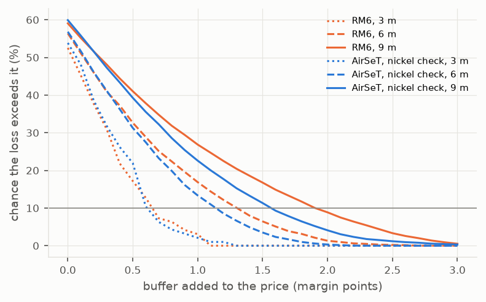
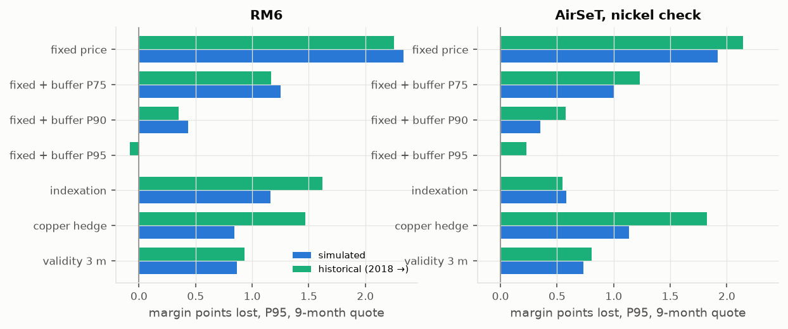
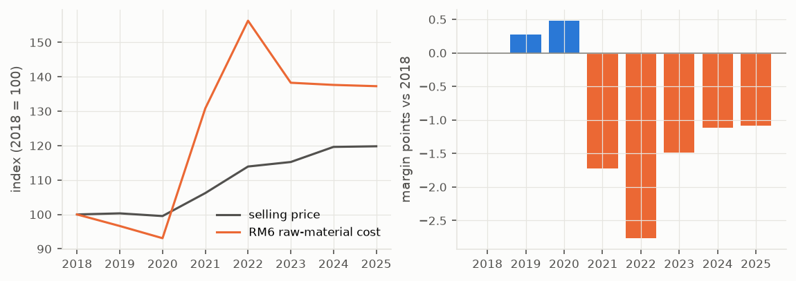

# Step 9 – Pricing rule and strategy comparison

**Question (slide 15, question 2):** how should Schneider set the price adjustment, risk buffer, quote validity and indexation clause for RM6 and RM AirSeT, given the raw-material forecasts?

| What | Where |
|---|---|
| Code | `src/pricing.py`, `src/pricing_plots.py` |
| Tests | `tests/test_pricing.py` (synthetic data, runs in CI) |
| Tables | `report/problem1/step9_tables/` |
| Charts | `plots/step9/` |

Run after Step 8:

```bash
uv run python -m src.pricing
uv run python -m src.pricing_plots
uv run pytest tests/test_pricing.py
```

---

## Summary

- **Quotes of up to 6 months:** a fixed price plus a small uplift is enough for both products if the business accepts a 0.5-point loss. That is at most **0.8–1.0 margin points** for RM6 and **0.6–0.85** for AirSeT (PPI or market steel), at 90 % confidence. With the strictest accepted loss (0.25 points), RM6 needs its copper clause from 6 months, and so does AirSeT with market steel.
- **9-month quotes need a price-adjustment (indexation) clause for both products:**
  - **RM6 on copper:** a fixed price would need **+1.40 points** to limit the loss to 0.5 points, above the 1-point cap. With a copper clause (±15 % band), **+0.93 points** is enough.
  - **AirSeT on copper, steel and stainless:** BOM v1 puts 28.5 kg of copper in AirSeT (38 % of its raw-material cost), so its clause now follows copper too. A fixed price would need **+1.07 points** (PPI steel) to **+1.28** (market steel); with the clause (±15 %), **+0.80–0.82** is enough. On past 9-month quotes the clause's worst loss is **0.58 points**, against 3.30 for a fixed price.
- **Today's practice (fixed price, no protection)** cost **2.8 margin points** in 2022. Selling prices rose 14 % while RM6's raw-material cost rose 56 %.
- **For Problem 2:** RM6's raw-material cost rises more than AirSeT's in only **59 %** of simulated paths to June 2027. This gives **weak support** for the "price convergence" argument.

1 margin point = 1 % of the selling price (RM6 €8,740; AirSeT €10,488, assumed). Raw materials only: labour and overhead are held constant.

---

## 1. Method

### 1.1 Margin points lost on a quote

`margin points lost = 100 × (raw-material cost at delivery − cost at quote) ÷ selling price`

These use the 10,000 joint price paths from Step 8, pushed through the Step 2 recipe. Positive = margin lost.

### 1.2 Scenarios

Downside, baseline and upside are the P10, P50 and P90 of the cost change (`scenarios.csv`). Steel PPI, main cases:

| | Downside | Baseline | Upside |
|---|---|---|---|
| RM6, 3 / 6 / 9 months | −0.68 / −0.79 / −0.81 pts | +0.02 / +0.13 / +0.25 | +0.63 / +1.30 / +1.90 |
| AirSeT, 3 / 6 / 9 months | −0.52 / −0.72 / −0.77 pts | +0.02 / +0.13 / +0.24 | +0.62 / +1.13 / +1.57 |

### 1.3 Strategies compared

Each strategy faces the **same quote, on the same date, with the same price path**. Only the pricing mechanism changes. This is a counterfactual: margin = price − cost is an accounting identity, so once the price path is fixed, the effect of a strategy is mechanical and no causal effect has to be estimated.

| Strategy | What it does |
|---|---|
| Fixed price | Today's practice, no protection (the reference) |
| Fixed + buffer (P75 / P90 / P95) | The price is raised up front by that percentile of the simulated loss |
| Indexation clause (±5 %) | The price follows copper (RM6) or copper + steel + stainless (AirSeT) beyond the band. The clause is symmetric: the customer also gets the falls |
| Copper hedge | Copper is bought forward at the quote, at the LME 3-month − cash spread |
| Re-quote every 3 months | Only the first 3 months' change is lost |

Each strategy is measured on simulated paths (`strategies_simulated.csv`) and on every past quote month since 2018 (`strategies_historical.csv`). The measures are:
- the mean loss;
- the P95 and worst loss;
- how often the loss exceeds 0.25, 0.5, 1 and 2 points;
- the gain versus a fixed price.

### 1.4 The quote rule

The client gives no target margin, so **the loss the business accepts** (0.25, 0.5, 1 or 2 points) is a decision variable. For each product, horizon and accepted loss, the rule (`quote_rule.csv`) tries the options in this order and keeps the first that works:

1. **Fixed price + price adjustment + buffer**, if the total uplift is ≤ 1 point (assumption: the largest uplift sales can add and stay competitive).
2. **Indexation clause** (the widest band that works) **+ a smaller buffer**.
3. **Shorter validity**, or a copper hedge.

- **Price adjustment** = the P50 loss: the drift the forecast expects.
- **Buffer** = the extra needed to keep the loss within the accepted level, with 90 % or 95 % confidence.

---

## 2. Results

### 2.1 Quote rule (90 % confidence)

Uplift to charge, in margin points. AirSeT is the main case (BOM v1, stainless priced through nickel). The clause follows copper for RM6 and copper + steel + stainless for AirSeT.

**Steel at producer prices (PPI):**

| Accepted loss | RM6 3 m | RM6 6 m | RM6 9 m | AirSeT 3 m | AirSeT 6 m | AirSeT 9 m |
|---|---|---|---|---|---|---|
| 0.25 pts | 0.38 | **0.92 + clause ±15 %** | **0.95 + clause ±10 %** | 0.37 | 0.88 | **0.68 + clause ±10 %** |
| 0.5 pts | 0.13 | 0.80 | **0.93 + clause ±15 %** | 0.12 | 0.63 | **0.80 + clause ±15 %** |
| 1 pt | 0.02 | 0.30 | 0.90 | 0.02 | 0.13 | 0.57 |
| 2 pts | 0.02 | 0.13 | 0.25 | 0.02 | 0.13 | 0.24 |

**Steel at market prices (MEPS / CRU),** closer to what Schneider pays (Step 3):

| Accepted loss | RM6 3 m | RM6 6 m | RM6 9 m | AirSeT 3 m | AirSeT 6 m | AirSeT 9 m |
|---|---|---|---|---|---|---|
| 0.25 pts | 0.52 | **0.85 + clause ±5 %** | **1.00 + clause ±5 %** | 0.57 | **0.65 + clause ±10 %** | **0.69 + clause ±10 %** |
| 0.5 pts | 0.27 | 0.99 | **0.97 + clause ±10 %** | 0.32 | 0.85 | **0.82 + clause ±15 %** |
| 1 pt | 0.00 | 0.49 | 0.67 + clause ±15 % | 0.04 | 0.35 | 0.78 |
| 2 pts | 0.00 | 0.15 | 0.30 | 0.04 | 0.14 | 0.27 |

**Longest fixed price without a clause** (accepted loss 0.5 points): **6 months** for both products, with either steel. With the strictest accepted loss (0.25 points): 3 months for RM6, and 6 months (PPI) or 3 months (market) for AirSeT.



**Buffer vs breach** (`buffer_curve.csv`): the competitiveness trade-off. For a 9-month RM6 quote, a 1-point buffer is still exceeded **27 %** of the time; for AirSeT, **23 %** (it was 10 % with the old BOM, which had no copper for AirSeT).

### 2.2 Strategy comparison, 9-month quotes

P95 loss in margin points. The gain versus a fixed price is in brackets: the average extra the customer pays.

| Strategy | RM6 simulated | RM6 historical | AirSeT simulated | AirSeT historical |
|---|---|---|---|---|
| Fixed price | 2.34 | 2.26 | 1.92 | 2.14 |
| Fixed + buffer P90 | 0.43 | 0.35 (+1.90) | 0.35 | 0.58 (+1.57) |
| Fixed + buffer P95 | 0.00 | −0.08 (+2.34) | 0.00 | 0.23 (+1.92) |
| Indexation ±5 % | 1.16 | 1.62 (+0.22) | 0.58 | **0.55** (+0.27) |
| Copper hedge | 0.85 | 1.47 (+0.22) | 1.14 | 1.83 (+0.13) |
| Re-quote every 3 months | 0.87 | 0.93 (+0.25) | 0.73 | 0.81 (+0.19) |



How to read it:

- **Buffers always look best on the simulated paths.** That is by construction: they are sized on those same paths. Their cost is that the customer pays the buffer on **every** quote: +1.90 points (≈ €166) for RM6 at P90.
- **AirSeT: the indexation clause is best on both counts.** It has a low historical loss (0.55, worst 0.58) for a small cost to the customer (+0.27). A P95 buffer costs 7× more (+1.92) and still lost up to 1.38 points on past paths. A copper hedge alone is not enough for AirSeT: steel and stainless are half of its risk.
- **RM6: no single strategy is cheap and safe.** The copper clause and the hedge cut the P95 loss by about 30–35 % for +0.22 points, but still lose about 1.5–1.6 points in a bad case. Hence the rule's **clause + smaller buffer** for 9-month quotes.

### 2.3 What today's practice cost (margin backtest, 2018–2025)

| Year | Selling price | RM6 raw-material cost | Margin vs 2018 |
|---|---|---|---|
| 2020 | €7,261 | €505 | +0.5 pts |
| 2021 | €7,748 (+6.7 %) | €709 (+41 %) | −1.7 pts |
| 2022 | €8,311 (+7.3 %) | €847 (+19 %) | **−2.8 pts** |
| 2025 | €8,740 | €744 | −1.1 pts |



**Selling prices are sticky:** they rise about 7 % a year at most and are rarely cut (−0.5 % from 2018 to 2020). So a cost shock squeezes the margin for years. 2026 is excluded (SF6-ban price jump). This is an illustration (8 yearly points, synthetic prices), not a test.

### 2.4 Outlook to mid-2027 (for Problem 2)

| | Today | Jun 2027 P10 | P50 | P90 |
|---|---|---|---|---|
| RM6 raw-material cost | €931 | €860 | €953 | €1,098 |
| AirSeT raw-material cost | €941 | €859 | €966 | €1,105 |
| Change in the RM6 − AirSeT gap | – | −€45 | +€7 | +€41 |


RM6's cost rises more than AirSeT's in **59 %** of paths. With BOM v1 both products carry copper, so their costs move together and the gap barely moves (±€45 at most, under 0.5 % of the price). The forecast **does not clearly support** the idea that AirSeT becomes relatively cheaper while copper rallies.

---

## 3. Recommendation

| | Up to 6 months | 9 months |
|---|---|---|
| **RM6** | Fixed price + uplift (≤ 1.0 pt) | **Copper indexation clause (±15 %)** + uplift of about 0.9 pts (accepted loss 0.5 pts); or a copper hedge |
| **AirSeT** | Fixed price + uplift (≤ 0.85 pts) | **Copper, steel and stainless indexation clause (±15 %)** + uplift of about 0.8 pts |

- **AirSeT:** with BOM v1, copper is AirSeT's largest single risk (≈ 50 % of the 9-month bad case, Step 8), and steel and stainless make up most of the rest. A fixed price would need 1.07–1.28 points at 9 months, above the 1-point cap, so the rule picks the clause with either steel. Schneider already buys steel on MEPS / CRU indices (Step 0), so the steel part passes on a risk it already carries.
- **RM6:** this matches Steps 6 and 7. During the copper rally, many of RM6's 6–9-month hold-out outcomes ended above the forecast's P90 (Step 7, §6.1). A buffer alone is not enough. The clause covers copper: copper and brass are €131 of the €169 bad case (Step 8), €123 of €185 with market steel. Steel and stainless can be added to the clause.

---

## 4. Assumptions

| Assumption | Why | Effect |
|---|---|---|
| Max uplift sales can add = 1 point (`MAX_BUFFER_PTS`) | No competitiveness data | Decides when the rule switches to a clause. **To agree with the team** |
| AirSeT main case = AirSeT (BOM v1), nickel check | Stainless surcharge follows nickel (Step 2) | Conservative: Step 3 calls it an upper bound |
| AirSeT selling price = RM6 + 20 % (€10,488) | The benchmark has no AirSeT price | ±10 % on price = ∓10 % on AirSeT's points |
| Indexation band ±5 % in the comparison; ±2–15 % tested in the rule | Typical contract triggers | Wider band = more risk left with Schneider |
| Hedge cost = LME 3-month − cash spread, scaled linearly; no broker fees | Only the 3-month spread is in the data | The hedge is slightly too cheap |
| Same deal won under every strategy | No contract-level data | Buffers and clauses can lose deals; the buffer vs breach curve shows the trade-off |
| Schneider is a price-taker on LME / steel markets | True for its volumes | Strategies do not move prices |

## 5. Limits

- **The historical replay uses today's recipe and today's buffer** at every past date. It shows how the strategies behave on real paths; it is not a backtest of the buffer the model would have given at the time.
- **The quote rule uses simulated paths only.** The forecasts under-cover copper's upside tail (Step 7), so RM6's uplifts are a floor, and AirSeT's too now that it carries copper.
- **Not modelled:**
  - the purchase lag between quote and material purchase (a Step 11 input);
  - tiered validity beyond re-quoting every 3 months.
- **Raw materials only.** No labour, energy or electronics. One configuration (the 3-function unit).
- **Synthetic selling prices**, with no AirSeT price. The margin backtest has 8 yearly points.

## 6. For the next steps

- **Step 10 (story):** lead with section 3. Use the margin backtest (2.3) to show why fixed prices are costly, and the strategy comparison (2.2) to show what fixes it.
- **Step 11 (app):** inputs and defaults:
  - **inputs:** accepted loss, confidence, product, horizon, steel scenario;
  - **defaults:** `quote_rule.csv` as the lookup table and `buffer_curve.csv` for the trade-off chart.
- **Problem 2:** hand over `outlook_2027.csv` and the 59 % finding.
- **Rerun** after any BOM change (BOM v1 is in since 25 Nov):

  ```bash
  uv run python -m src.simulation && uv run python -m src.pricing
  ```