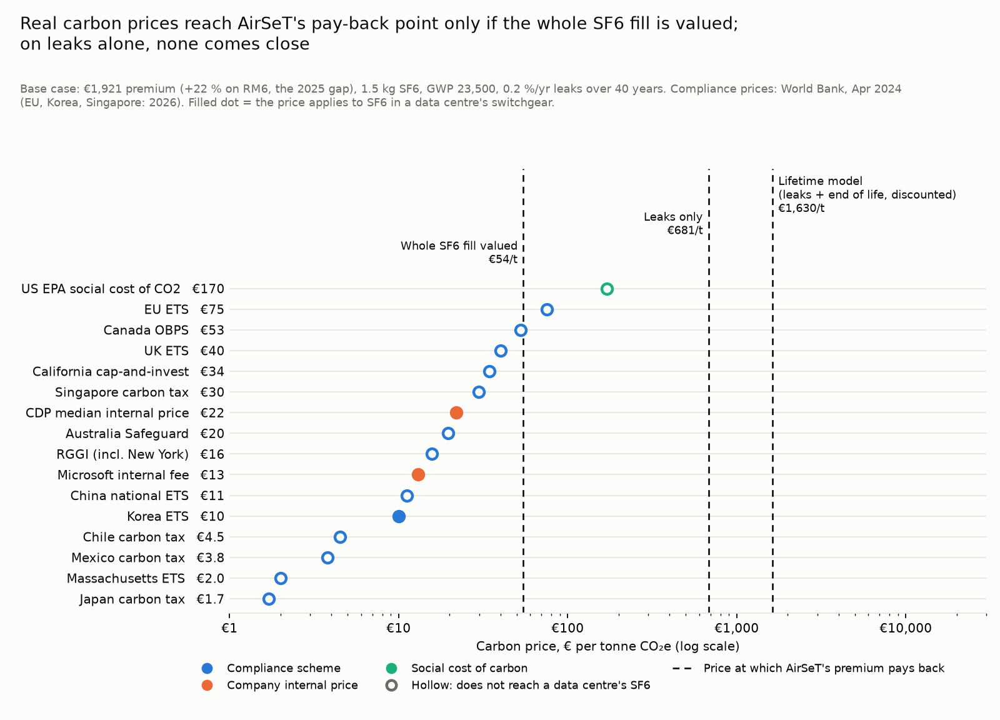
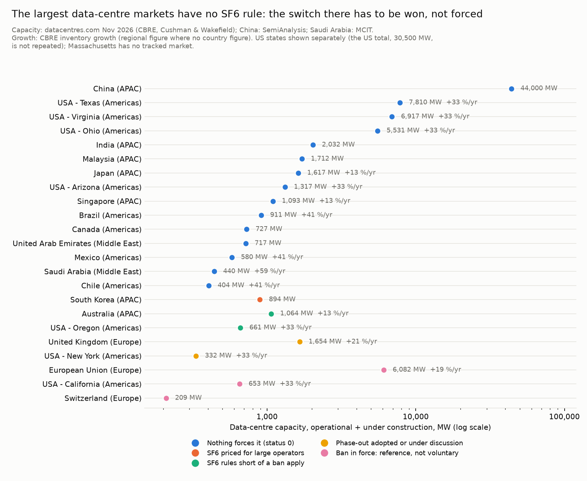
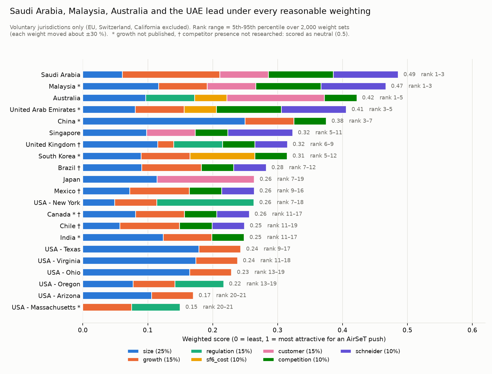

# Problem 2 – Market & Regulation (Steps 1–3)

*Owners: Kenza, Chloe · Status: Steps 1–3 done*

> **Sources:** E-numbers (e.g. E20) refer to rows of [`market_evidence/evidence.csv`](../../market_evidence/evidence.csv), where each fact has its source, link, date and reliability. "E63 +5" means E63 is the main source and 5 more rows back the same entry.
>
> **Hypotheses:** H1, H2, … refer to the hypotheses in the [problem framing](00_problem_framing.md) (§6, "Hypotheses to test").

---

# Step 1 – Evidence inventory

**Goal:** collect every fact the strategy rests on, each with a source and a date. **Result:** 163 sourced facts, including 34 first-pass competitor links in [`market_evidence/`](../../market_evidence/) (guide: [`market_evidence.md`](market_evidence.md)), covering 25 jurisdictions, 25 data-centre markets, 16 customers, 17 competitors and the lifetime-cost inputs. All rows are verified.

## 1. Summary of findings

1. **SF6 costs a data centre almost nothing today.** Leaks are small (0.2 %/yr of a 1.5 kg fill) and no adopted rule forces replacement of installed units. In the base case, AirSeT saves the customer about **€31 per unit** over its life, against a **€1,921** premium.
2. **The carbon argument works only if the whole SF6 fill is valued.** AirSeT pays back at **€54/t CO₂e** if the whole fill counts, **€681/t** for leaks only. Prices that actually reach a data centre are **€10–22/t**.
3. **H1 not supported:** 9 of 11 data-centre operators never mention SF6, and Google declares it out of scope. All 11 have hard Scope 1 targets for 2030–2050, so the lever is to **get SF6 into their Scope 1 accounting**. AirTrunk (APAC) already counts SF6: a natural lead customer. Outside the EU, only **utilities** are switching (SCE, ElectraNet, Chubu, Kansai, SEC).
4. **H2 partly supported:**
   - **Bans on new MV equipment:** only the EU, Switzerland and California.
   - **Phase-out adopted:** New York (from 2027).
   - **SF6 rules short of a ban:** the UK, Australia, Massachusetts, Oregon.
   - **No SF6 rule:** the other 17, including every Asian and Middle East hotspot.
5. **Where to play:**
   - **Largest voluntary markets:** the US states (Virginia, Texas, Ohio), India, Malaysia/Johor and Japan.
   - **Fastest growing:** Saudi Arabia (≈ 59 % a year) and Latin America (≈ 41 %).
6. **Who competes:**
   - **Outside Japan:** Eaton is the visible SF6-free rival.
   - **In the US:** the incumbents S&C and G&W sell gas-free solid-dielectric gear.
   - **Price threat:** Chinese dry-air RMUs (CHINT, Rockwill).
   - **The premium AirSeT must justify depends on the rival:** +3 % vs Siemens, +22 % vs RM6, ≈ +50 % vs low-cost SF6 brands.
7. **No industry standard asks for SF6-free switchgear** (iMasons, the Climate Neutral Data Centre Pact, LEED, BREEAM). But iMasons already makes members ask suppliers for environmental declarations, where an SF6 disclosure would fit.

## 2. Method

- **One source table:** every fact is a row of `evidence.csv` (source, link, dates, reliability), and the other tables cite those rows by id. The loader refuses a value without a source.
- **Reliability:**
  - **High:** an official or primary source read directly, including Schneider's own pages and the data Schneider provided for the challenge.
  - **Medium:** a reputable secondary source, or an official source read through a search summary.
  - **Low:** a vendor blog or an unconfirmed estimate.
- **Primary sources first:** laws, regulators, IPCC tables and company reports, downloaded and searched where possible. The first research pass (20 Nov) was fact-checked on 22 Nov (§10).
- **AI use:** Claude helped in searching and reading sources, building the data files and coding, and drafting this report. Every figure was checked against its cited source.
- **Confidential material** (procurement deck, BOM, price benchmark) stays out of the repo, cited as "Schneider internal".

## 3. Internal data

| Source | What it gives Problem 2 |
|---|---|
| Price benchmark (synthetic) | SF6-free premium (Eaton vs Schneider): +38 % (2017), +22 % or €1,921 (2025), −5 % (2026, after the EU ban) |
| Teardown benchmark | SF6 fill per unit (inferred): RM6 1.5 kg, Ormazabal 1.2, Siemens 8DJH 2.5, ABB SafePlus 3.24, Eaton Xiria 0. |
| BOM and Problem 1 cost model | Raw-material cost per unit: RM6 €795 vs AirSeT €583–981; copper-heavy RM6, steel-heavy AirSeT |
| Problem 1 EDA | AirSeT's raw-material risk is ≈ 95 % steel and stainless, so a steel indexation clause covers most of it |
| Schneider raw-materials update, Oct 2026 (internal) | Copper easing from record highs with an upward bias; steel prices driven by trade policy |
| Supplier balance sheets (PitchBook, 9 suppliers) | Supplier health, for "can the supply base scale AirSeT?" |
| Client slides | Data-centre market $584B in 2026, $1.32T by 2030. The slide's "25.7 % CAGR" is the 2025→26 growth; the rate to 2030 is 22.7 % (E38) |

## 4. SF6 lifecycle facts

Inputs of the lifetime-cost (TCO) model. Pessimistic / base / optimistic are from AirSeT's point of view.

| Input | Pessimistic / base / optimistic | Sources |
|---|---|---|
| GWP of SF6 | 22,800 / 23,500 / 24,300 (IPCC AR4 / AR5 / AR6) | E05, E06 |
| SF6 fill of an RM6 | 0.72 / 1.5 / 2.5 kg (RM6's own mass is not published; range = comparable RMUs) | E02, E11, E37, E106 |
| Leak rate | 0.1 / 0.2 / 0.7 %/yr (IEC design value / IPCC Europe / IPCC Japan) | E08, E09 |
| Asset life | 60 / 40 / 30 years (a longer life lowers AirSeT's value) | E09, E10, E11 |
| SF6 released at end of life | 1.5 / 10 / 40 % of the fill | E10 |
| End-of-life recovery cost | €35 / €80 / €1,000 per unit | E11, E12 |
| Cost of a rule on an installed RM6 | €0: adopted rules target new equipment; repairs and extensions stay allowed | E61, E19, E21 |
| Customer's discount rate | 10.7 / 7.0 / 5.3 % (Damodaran, Jan 2026) | E60 |
| Internal carbon price | €13 / €22 / €170 per t (Microsoft / CDP median / US EPA social cost of carbon) | E56, E58, E75 |
| AirSeT price premium | 27 / 22 / 3 % of the RM6 price | E01, E36 |

**Emissions accounting** (E13, E14): an operator's switchgear leaks count in its **Scope 1**, but SF6 released when a contractor disposes of the unit is **Scope 3**. So most of a unit's 35 t CO₂e is Scope 3 or an end-of-life liability, not Scope 1.

## 5. Regulation

Full country table in Step 2 (§2.1).

| Status | Jurisdictions |
|---|---|
| **3** Ban in force for new MV equipment | EU (≤ 24 kV from 2026, 24–52 kV 2030), Switzerland (same), California (≤ 38 kV from 2025) |
| **2** Phase-out adopted | New York (from 2027, any owner of SF6 equipment) |
| **1** Rules short of a ban, or under discussion | UK (under discussion), Australia (import licence and levy), Massachusetts (leak cap), Oregon (utility reporting) |
| **0** No SF6 rule | US federal and other states, Canada, Japan, Korea, China, Singapore, Malaysia, India, UAE, Saudi Arabia, Brazil, Mexico, Chile |

**Carbon prices that reach a data centre's SF6:**
- **Korea:** large operators are in its carbon market, ≈ €8–11/t.
- **UAE:** reporting only.
- **Everywhere else:** none. Singapore's tax and Japan's reporting have thresholds far above a data centre.

**Saudi Arabia:** the state utility's RMU specification still requires SF6, a barrier for utility sales, not for private data centres.

## 6. Carbon prices against the break-even

**Prices collected:**
- **13 compliance schemes:** World Bank data, Apr 2024; 2026 values for the EU, Korea and Singapore (E73, E74).
- **Internal prices:** Microsoft (US$15/t on operations, the only data-centre operator that discloses one) and the CDP median (US$25/t) (E75, E56).
- **Upper reference:** the US EPA social cost of CO₂ (US$190/t, E58).

| What the customer counts | Break-even | Real prices that reach it |
|---|---|---|
| The whole SF6 fill | **€54/t** | EU ETS (€75) and the social cost of carbon (€170), neither applying to a non-EU data centre |
| Leaks only (0.2 %/yr over 40 years) | **€681/t** | None |
| Lifetime model (leaks + end of life, discounted at 7 %) | **€1,630/t** | None |

> **Updated in Step 4** ([02 §4.4](02_cost_and_tco.md)): the full TCO model gives €54 / €653 / **€1,657/t** for these three rows (leaks-only now includes the end-of-life recovery fee; the end-of-life release applies to the gas left after leaks). Step 4 is the reference for these figures.

## 7. Customer commitments (H1) and industry standards

Each operator's latest sustainability report was searched in full for "SF6", "sulfur hexafluoride", "switchgear" and "F-gas" (E77–E85, E110–E111).

| Operator | Scope 1 (and 2) target | SF6 mentioned? |
|---|---|---|
| Microsoft | Carbon negative by 2030 | No |
| Google | Net zero by 2030 | **Only to exclude it** ("isn't emitted as a result of our operations") |
| AWS / Amazon | Net zero by 2040 | No |
| Meta | −42 % by 2031 | No |
| Oracle | Halved by 2030, net zero 2050 | No |
| Equinix | −50 % by 2030, −90 % by 2040 | No |
| Digital Realty | −42 % by 2030 (−68 % already) | No |
| NTT GDC | −90 % by 2030, net zero 2040 | F-gases tracked; SF6 not named |
| STACK Infrastructure | Net zero by 2050 | No |
| Iron Mountain Data Centers | Net-zero operations by 2030 | No |
| **AirTrunk** (APAC only) | Net zero by 2030 | **Yes**: counts SF6 in Scope 1, exploring SF6-free equipment |

**H1 verdict: not supported.** No operator applies an SF6-free standard worldwide. No supplier code requires it, and no SF6-free data-centre project exists outside Europe.

**Utilities lead outside the EU** (E126): SCE (California, MV from 2027, because of the ban); ElectraNet (Australia), Chubu and Kansai (Japan) and SEC (Saudi Arabia) voluntarily, at high voltage first. No SF6-free MV project at an industrial or infrastructure site outside Europe was found.

**Industry standards** (E113–E116): the iMasons Climate Accord (embodied carbon, supplier declarations), the Climate Neutral Data Centre Pact (energy, water, heat), LEED v5 (HVAC refrigerants) and BREEAM (cooling refrigerants) contain **no SF6 requirement**.

**What it means:**
- **The lever is to get SF6 into operators' Scope 1 accounting.** Once leaks count against a 2030 target, an SF6-free unit removes a line nobody wants to manage.
- **The channel already exists:** iMasons' supplier-disclosure process, with which Schneider already shares product profiles.
- **Lead customer:** AirTrunk.

## 8. Data-centre markets

MW = operational + under construction ([`markets.csv`](../../market_evidence/markets.csv)). Massachusetts is not a tracked market.

| Market | MW | Growth (% / yr) |
|---|---|---|
| China | ~44,000 (estimates vary 15×) | – |
| USA (all tracked markets) | 30,500 | +33 |
| – Texas / Virginia / Ohio | 7,800 / 6,900 / 5,500 | +33 |
| India | 2,000 | – |
| Malaysia (Johor) | 1,700 | – |
| UK | 1,650 | +21 |
| Japan | 1,600 | +13 |
| Arizona | 1,300 | +33 |
| Singapore | 1,100 | +13 |
| Australia | 1,060 (+2,018 planned in Sydney) | +13 |
| Brazil / Korea / Canada | 910 / 890 / 730 | +41 / – / – |
| UAE | 720 | – |
| Oregon / California | 660 / 650 | +33 |
| Mexico | 580 | +41 |
| Saudi Arabia | 440 (1.8 GW targeted by 2030) | ≈ +59 |
| Chile / New York / Switzerland | 400 / 330 / 210 | +41 / +33 / – |

**Sources:** datacentres.com Nov 2026, from CBRE and Cushman & Wakefield (E54); CBRE growth (E87, E88); Saudi telecom ministry (E89); SemiAnalysis for China (E90).

**Not available:** the Colliers 2026 report (blocks download) and the $584B split by region (paid; North America is the largest, E93).

## 9. Competitors

Full table in Step 2 (§2.2).
- **Direct RM AirSeT rivals:** Eaton Xiria (dry air), ABB SafeRing/SafePlus Air, Siemens 8DJH Blue GIS (clean air), Lucy EcoTec (synthetic air), Ormazabal (EU utilities).
- **US incumbents:**
  - **S&C Electric:** sells its Vista switchgear in SF6, in an F-gas mix (Vista Green) and in solid dielectric (Vista SD).
  - **G&W Electric:** solid-dielectric Trident (E124, E125).
- **Asia:**
  - **Meidensha:** a 24 kV dry-air unit.
  - **Mitsubishi:** dry air only as an option.
  - **CHINT and Rockwill:** SF6-free RMUs sold next to their SF6 ones.
  - **Toshiba, Hyundai:** none at MV.
  - **LS Electric:** a 25.8 kV dry-air switchgear panel (DAIS), but its ring main unit is still SF6 (E162, E163).

| Hotspot | SF6-free MV sold | Still sells SF6 | Local plant |
|---|---|---|---|
| USA | S&C, G&W; Schneider in California (from 2027) | S&C | Eaton (2027, Low) |
| Japan | Meidensha, Mitsubishi (option) | Mitsubishi | – |
| India | Eaton | – | Lucy |
| Malaysia | Schneider | – | – |
| Singapore | Schneider, Eaton | – | – |
| Australia | Eaton | – | – |
| UAE | Schneider | – | Lucy |
| Saudi Arabia | Schneider | – | Lucy |

*Vendors' own country pages. "–" means nothing found, not absent.*

**Schneider:**
- **SF6:** still sells the RM6 outside the EU (South Africa, Vietnam).
- **In the US:** a 38 kV AirSeT piloted with Equinix and an SCE contract (E94, E121, E122).
- **Public AirSeT claims:** pure air plus vacuum, sealed for life, "maintenance-free", digital monitoring.
- **Not published:** any lifetime-cost, footprint or rating figure (E117).

## 10. Corrections to the first research pass

The team's first pass (20 Nov) was checked against primary sources on 22 Nov:

| Item | First pass | Corrected |
|---|---|---|
| EU ban date | "By 2032" | ≤ 24 kV from **2026**, 24–52 kV 2030 (2032 is > 145 kV) (E63) |
| US federal | "Reporting" | Only utilities report; nothing applies to a data centre (E62) |
| US states | Not researched | California, New York, Massachusetts, Oregon have rules; Virginia, Texas, Arizona, Ohio none (E21, E43) |
| Canada, Singapore, China, India, Saudi Arabia, Brazil, UAE, Mexico | 0–1, some "priced" | No SF6 rule; Singapore's tax does not reach data centres → 0 |
| UK / Australia / Japan / Korea | 1–2 / 0 / reporting / priced, no price | 1 (under discussion) / 1 (levy) / none for data centres / ≈ €8–11/t |
| Eaton technology | Solid epoxy | Dry air + vacuum (E31) |
| Schneider | Up to 36 kV; "15–20 % premium"; no SF6 sold | Up to **24 kV**; premium unsourced; RM6 still sold outside the EU (E30, E94) |
| Siemens | MV panels only | 8DJH 12/24 RMUs are the direct rivals (E33) |
| Price premium | ≈ +20 % | +22 % vs Schneider, +3 % vs Siemens, ≈ +50 % vs low-cost SF6 brands (E36) |
| GWP (optimistic) | 25,200 | A draft value; final AR6 is 24,300 (E05, E07) |

---

# Step 2 – Regulation and market landscape

**Goal:** a picture per region of where SF6 is regulated, how big each data-centre market is, who competes and who the customers are, as the input to Step 3.

| Group | Rule | Jurisdictions | Pitch it calls for |
|---|---|---|---|
| Nothing forces it | Status 0, no SF6 price | 16, incl. Texas, Virginia, Ohio, China, India, Malaysia, Japan, Singapore, UAE, Saudi Arabia | Customer ESG and risk |
| SF6 priced | A carbon price reaches a data centre's SF6 | Korea | Lifetime cost |
| SF6 rules apply | Rules short of a ban in force | Australia, Massachusetts, Oregon | No SF6 paperwork |
| Regulation coming | Phase-out adopted or under discussion | New York, UK | Future-proof |
| Reference | Ban in force for new MV equipment | EU, Switzerland, California | Not voluntary: shows what happens once SF6 is banned |

## 2.1 SF6 regulation by country

**Status scale:**
- **0:** no SF6 rule.
- **1:** under discussion, or SF6 rules short of a ban (reporting, levies, leak caps).
- **2:** phase-out adopted.
- **3:** ban in force for new MV equipment.

"SF6 priced for a data centre?" is from the customer's side. Short version of [`regulation.csv`](../../market_evidence/regulation.csv), which has the full notes.

| Country | Status | MV ban | SF6 priced for a data centre? | Summary | Source | Reliability |
|---|---|---|---|---|---|---|
| European Union | **3** | 2026 | No | Ban on new F-gas MV gear: ≤ 24 kV from 2026, 24–52 kV from 2030 | E63 +5 | High |
| USA - California | **3** | 2025 | No | New SF6 gear ≤ 38 kV banned from 2025, sealed units included | E19 +2 | High |
| USA - federal | **0** | – | No | No rule; reporting only for large utilities | E62 +1 | High |
| USA - Virginia | **0** | – | No | No SF6 rule | E21 +1 | Medium |
| USA - Texas | **0** | – | No | No SF6 rule | E21 +1 | Medium |
| USA - Arizona | **0** | – | No | No SF6 rule | E21 +1 | Medium |
| USA - Ohio | **0** | – | No | No SF6 rule | E21 +1 | Medium |
| Canada | **0** | – | No | No switchgear rule; SF6 only listed under CEPA | E39 +2 | High |
| United Kingdom | **1** | – | No | Phase-out under study; no proposal yet | E71 +4 | High |
| Japan | **0** | – | No | No rule; voluntary industry action since 1998 | E65 +4 | High |
| South Korea | **0** | – | Yes | No rule; carbon market prices SF6 for large operators (≈ €8–11/t) | E24 +3 | High |
| China | **0** | – | No | No rule; national carbon market excludes SF6 | E66 +4 | High |
| Australia | **1** | – | Reporting | Import licence and levy on SF6 equipment | E25 +3 | High |
| Singapore | **0** | – | No | No rule; carbon tax does not reach data centres | E26 +4 | High |
| Malaysia | **0** | – | No | No SF6 rule found; carbon tax deferred in Oct 2026, no new date | E164 +2 | Medium |
| India | **0** | – | No | No MV rule; SF6-free plan for ≥ 132 kV only | E27 +2 | Medium |
| United Arab Emirates | **0** | – | Reporting | No rule; every entity must report its emissions | E69 +2 | Medium |
| Saudi Arabia | **0** | – | No | No rule; utility's RMU spec still requires SF6 | E28 +1 | Medium |
| Brazil | **0** | – | No | No rule; carbon-market thresholds far above a data centre | E67 +2 | Medium |
| Mexico | **0** | – | No | No rule; ETS pilot covered CO₂ only | E42 +4 | High |
| Chile | **0** | – | No | No rule; green tax excludes SF6 | E68 +2 | High |
| USA - New York | **2** | – | No | Phase-out adopted, from 2027, any owner | E64 +3 | High |
| USA - Massachusetts | **1** | – | No | Leak cap of 1 %/yr for SF6 switchgear | E21 +2 | High |
| USA - Oregon | **1** | – | No | SF6 reporting for utilities only | E43 | Medium |
| Switzerland | **3** | 2026 | – | Mirrors the EU: ≤ 24 kV from 2026, 24–52 kV from 2030 | E112 | High |

**Where regulation is likely to come (H2):**

| Where | Signal |
|---|---|
| **US states** | Spreading: California (ban 2025) → New York (from 2027); Massachusetts, Oregon and Colorado already act on SF6 (E19, E64, E43) |
| **UK** | A government-commissioned study recommends a phase-out; no proposal yet (E71) |
| **India** | Phased SF6-free plan, ≥ 132 kV only (E27) |
| **Saudi Arabia** | Utility-led SF6-free pilots; its RMU specification still requires SF6 (E28) |
| **Japan, Korea, China** | Local makers building SF6-free high-voltage lines; no MV rule (E99, E100, E40) |

**H2 verdict: partly supported.** "Regulation is coming" is credible in US states and the UK. In Asia and the Middle East, regulators move at high voltage and through utilities first, with no MV rule for data centres before 2030 on current evidence.

## 2.2 Competition: SF6-free medium-voltage offers

Short version of [`competitors.csv`](../../market_evidence/competitors.csv), which has the full notes.

| Competitor | SF6-free MV offer | Max kV | RM AirSeT rival? | Summary | Source | Reliability |
|---|---|---|---|---|---|---|
| **Schneider Electric** | RM AirSeT (pure air) | 24 | Yes | Still sells the SF6 RM6 outside the EU | E30 +8 | High |
| **Eaton** | Xiria (dry air) | 24 | Yes | Most direct data-centre rival; > 100,000 Xiria sold; in Singapore, India, Australia, Brazil | E133 +9 | High |
| **ABB** | SafeRing / SafePlus Air (dry air) | 24 | Yes | Same footprint as its SF6 units; sells SF6 in parallel | E143 +8 | High |
| **Siemens Smart Infrastructure** | 8DJH 12 / 8DJH 24 Blue GIS RMU (clean air) | 24 | Yes | 8DJH 12/24 clean-air RMUs: direct rivals | E144 +3 | High |
| **Siemens Energy** | 8VN1 Blue GIS 145 kV (clean air) | 145 | No (HV) | High voltage only | E146 +4 | High |
| **Hitachi Energy** | EconiQ (72.5–550 kV GIS and breakers) | 550 | No (HV) | High voltage only | E153 +6 | High |
| **Ormazabal (Velatia)** | cgm.zero24, sbp.zero24 (natural air) | 24 | Yes | EU utility focus | E157 +6 | High |
| **Lucy Electric** | Sabre EcoTec (synthetic air) | 24 | Yes | Plants in the UAE, Saudi Arabia, India, UK and others | E35 +3 | Medium |
| **Mitsubishi Electric** | HS-X 24 kV (dry-air option, 630 A only) (dry air) | 24 | Yes | SF6 by default; dry air only as an option | E98 | Medium |
| **Toshiba** | AEROXIA natural-origin gas GIS (high voltage, launch FY2028) | 300 | No (HV) | High voltage only; launch FY2028 | E99 | Medium |
| **Meidensha** | 24 kV Eco C-GIS (dry air) | 24 | Yes | 24 kV dry-air unit, Japan | E97 | Medium |
| **LS Electric** | DAIS dry-air switchgear (25.8 kV panels) | 25.8 | Yes | No SF6-free RMU: its Susol RMU is still SF6 | E162 +2 | High |
| **Hyundai Electric** | GREENTRIC SF6-free GIS 72.5-420 kV (dry air) | 420 | Yes | Mostly high voltage | E100 | Medium |
| **CHINT** | NGH7-24 2.0 RMU (dry air, 24 kV) | 40 | Yes | Low-cost; sells an SF6 RMU in parallel | E101 | Medium |
| **Rockwill** | 12/24/36 kV pure-air / nitrogen RMU (air or nitrogen) | 36 | Yes | Low-cost; sells SF6 RMUs in parallel | E102 | Medium |
| **S&C Electric** | Vista SD (solid dielectric) | 38 | Yes | US incumbent: SF6, F-gas mix and solid dielectric | E124 | Medium |
| **G&W Electric** | Trident-S solid-dielectric switchgear (up to 38 kV) (solid dielectric) | 38 | Yes | US incumbent: solid dielectric | E125 | Medium |

*"Still sells SF6" is sourced only for Schneider, Mitsubishi and S&C; most makers sell SF6 RMUs everywhere outside the EU.*

## 2.3 Market attractiveness by region

| Region | Data-centre MW | Growth | Grid investment 2026 (IEA, E120) | MV switchgear demand (E119) |
|---|---|---|---|---|
| **Asia-Pacific** | ≈ 52,000 (China 44,000) | +13 % (core markets) | China ≈ USD 140bn, India 26bn, Southeast Asia 15bn | Largest region, 35–46 % of the world |
| **Americas** | ≈ 33,000 (US 30,500) | US +33 %, Latin America +41 % | Latin America ≈ USD 25bn (US: chart only) | North America ≈ 23 % |
| **Europe** (reference) | ≈ 7,900 | +19–21 % | Chart only | – |
| **Middle East** | ≈ 1,200 | Saudi Arabia ≈ +59 % | USD 10bn (+35 % since 2020) | Fastest-growing (with Africa) |

World grid investment is about USD 550bn in 2026 (E118).

## 2.4 Customer landscape

See Step 1 §7 for the evidence.
- **Hyperscalers and colocation:** no SF6 policy, except **AirTrunk** (APAC), which counts SF6 and is exploring SF6-free. Reachable through iMasons' supplier disclosures.
- **Utilities:** the only buyers already switching outside the EU. SCE is forced by California's ban; ElectraNet, Chubu, Kansai and SEC switch voluntarily at high voltage. They are credibility references in their countries.
- **Industry and infrastructure:** no SF6-free MV project found outside Europe.

## 2.5 Regional overview

| Region | Regulation | Market | Competition | Takeaway |
|---|---|---|---|---|
| **Americas** | Spreading state by state | Largest voluntary pool | S&C, G&W (solid dielectric) | Big, but incumbents already gas-free |
| **Asia-Pacific** | None, except Australia and Korea | Largest overall | Eaton, Japanese and Chinese makers | Largest demand, price pressure; lead customer AirTrunk |
| **Middle East** | None; UAE emissions reporting | Small, fastest-growing | Schneider present | Early mover: AI campuses, utility pilots |
| **Europe** (reference) | Ban in force | – | All rivals SF6-free | Proof point: SF6-free becomes cheaper once banned |

---

# Step 3 – Segmentation and target markets

**Goal:** 2–3 priority targets and 1–2 later ones, with explicit weights and a check that the ranking does not flip.

## 3.1 Scope

- **Scored:** hyperscale and colocation data centres (the framing's "data centres first"), in the 21 voluntary jurisdictions. Utilities enter as a criterion.
- **Excluded:**
  - the reference markets (EU, Switzerland, California), where the switch is forced;
  - the US total, which double-counts the states.
- **Not scored:** industry and infrastructure, because Step 2 found no evidence to score them on.

## 3.2 Criteria and weights

Computed from the sourced CSVs by [`src/market_scoring.py`](../../src/market_scoring.py), each scaled 0–1 (1 = more attractive).

| Criterion | Measure | Weight |
|---|---|---|
| Market size | Data-centre MW (log scale) | 25 % |
| Growth | Inventory growth, % per year | 15 % |
| Regulatory trajectory | Status 0 / 1 / 2 → 0 / 0.5 / 1 | 15 % |
| ESG pressure (customer pull) | An operator counts SF6 there (0.5) + a utility switching voluntarily (0.5) | 15 % |
| Carbon price | SF6 cost reaching a data centre: priced 1, reporting 0.5, none 0 | 10 % |
| Competitive intensity | Fewer SF6-free rivals present = higher | 10 % |
| Schneider presence | Schneider already sells SF6-free there | 10 % |

**Notes:**
- **Price sensitivity** (in the plan) is dropped: there is no country-level price data.
- **Missing data** (growth not published, competitors not researched) scores neutral (0.5), never best or worst.

## 3.3 Results

| Rank | Jurisdiction | Score | Rank range | Top-5 share |
|---|---|---|---|---|
| 1 | Saudi Arabia | **0.49** | 1–3 | 100% |
| 2 | Malaysia | **0.47** | 1–3 | 100% |
| 3 | China | **0.42** | 1–6 | 93% |
| 4 | Australia | **0.42** | 1–6 | 88% |
| 5 | United Arab Emirates | **0.41** | 3–6 | 93% |
| 6 | South Korea | **0.36** | 5–8 | 23% |
| 7 | Singapore | **0.32** | 6–11 | 2% |
| 8 | United Kingdom | **0.32** | 6–9 | 0% |
| 9 | Brazil | **0.28** | 8–12 | 0% |
| 10 | Japan | **0.26** | 7–19 | 1% |

*Rank range and top-5 share: over 2,000 weight sets with each weight moved about ±30 %. All 21 jurisdictions and criterion scores: [`01_tables/scoring_matrix.csv`](01_tables/scoring_matrix.csv).*

**Robustness:**
- **Stable top 5:** Saudi Arabia, Malaysia, China, Australia and the UAE stay in the top 5 in 88–100 % of weight sets. Saudi Arabia and Malaysia are always in the top 3.
- **China is the fragile one:** it ranks on size alone (largest market, no customer pull, neutral on growth, competition and Schneider presence, which were not researched there). It falls to 6th under equal weights and to 12th–13th if size is dropped.
- **Dropping any one criterion:** Saudi Arabia, Malaysia, Australia and the UAE never fall below 8th.
- **US states:** Texas, Virginia and Ohio rank 16th–18th (no customer pull, entrenched incumbents, no Schneider SF6-free sales yet). Texas enters the top 6 only if size gets 60 % of the weight.

## 3.4 Target markets

**Priority targets:**
1. **Johor–Singapore data-centre corridor (Malaysia #2, Singapore #7).**
   - **Market:** 2.8 GW.
   - **Customer pull:** AirTrunk counts SF6 and operates in both.
   - **Position:** Schneider already sells AirSeT in both. No SF6-free rival was found in Malaysia; Eaton is present in Singapore.
   - **Lead customer:** AirTrunk.
2. **The Gulf: Saudi Arabia (#1) and UAE (#5), data-centre and AI campuses.**
   - **Market:** the fastest growth.
   - **Utility reference:** SEC's SF6-free pilots.
   - **Position:** Schneider present in both; UAE emissions reporting.
   - **Barrier:** lead with data centres, because SEC's RMU specification still requires SF6.
3. **Australia (#4): colocation and utilities.**
   - **Customers:** AirTrunk's home market; ElectraNet switching voluntarily.
   - **Pitch:** SF6 rules (licence, levy) already apply, so "no SF6 paperwork".
   - **Competition:** Eaton.

**Later targets:**
- **US data-centre states:**
  - **Why not now:** the largest market, but gas-free incumbents, no customer pull yet, and Schneider's SF6-free offer arriving in 2027–28.
  - **Triggers to move up:** another state adopting a phase-out, or a US operator counting SF6.
- **China (#3 on score):** ranks on size alone, but is dominated by local makers, has no customer pull and a highly uncertain size. Opportunistic only.

**Second segment in the priority countries:** utilities, which already switch voluntarily at high voltage (Australia, Saudi Arabia, Japan).

## 3.5 Limits

- **Partial presence data:** competitor and Schneider presence come from vendors' public country pages. Schneider's presence was researched only in the US, Japan, India, Malaysia, Singapore, Australia, the UAE and Saudi Arabia; elsewhere it scores neutral (0.5).
- **Saudi Arabia's lead** rests on growth and presence from a small 440 MW base; the UAE's growth is not published.
- **Capacity** comes mostly from one compiler (datacentres.com).

**Rebuild everything:**
- `uv run python src/market_evidence.py` (checks the data and prints the pricing tables)
- `uv run python src/market_evidence_plots.py` (charts 01–02)
- `uv run python src/market_scoring.py` (scores, chart 03)
- `uv run pytest tests/test_market_evidence.py tests/test_market_scoring.py`
