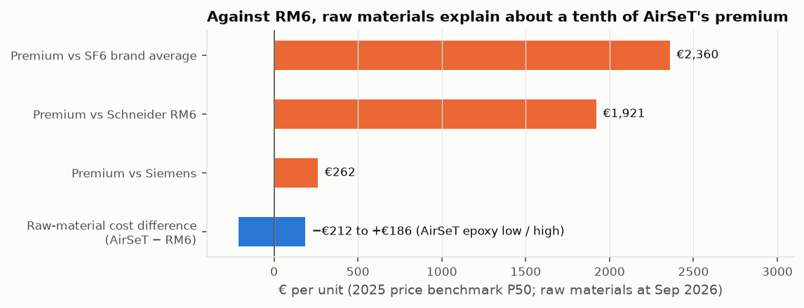
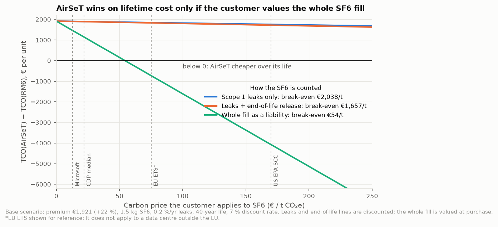
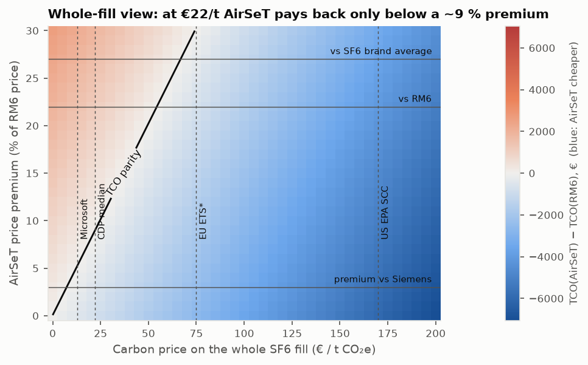
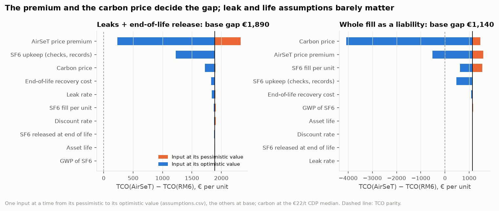
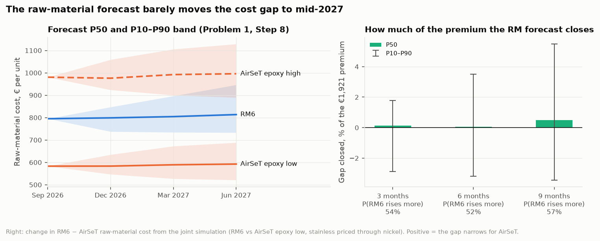
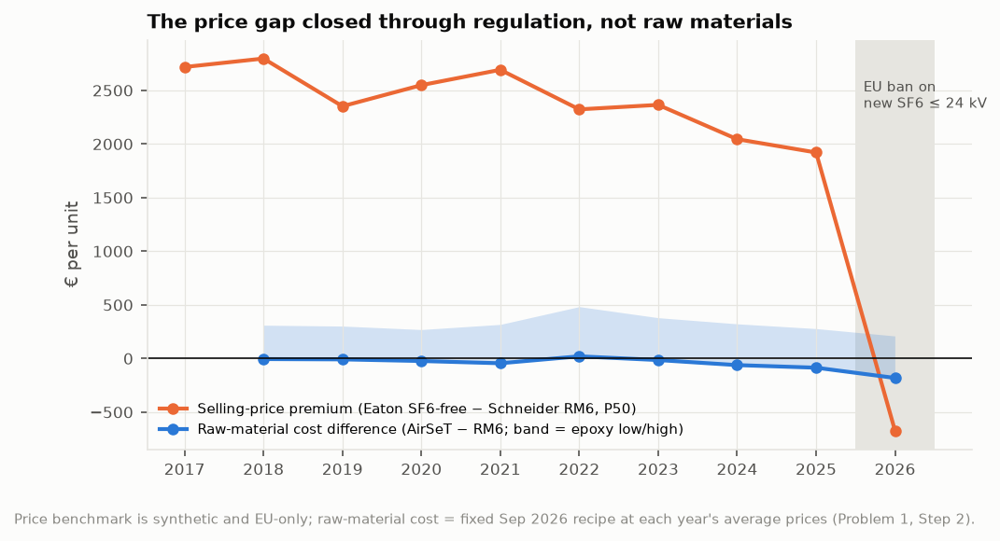

# Problem 2 – Cost gap, TCO and raw-material outlook (Steps 4–5)

*Owners: Hitaishi · Status: done*

> **Sources:** E-numbers refer to rows of [`market_evidence/evidence.csv`](../../market_evidence/evidence.csv); every model input is a row of [`assumptions.csv`](../../market_evidence/assumptions.csv) with three scenarios (pessimistic / base / optimistic, named from AirSeT's point of view). New in this step: E166–E174 and three assumption rows (installation, maintenance, SF6 upkeep).
>
> **Hypotheses:** H3, H4, H6 refer to the [problem framing](00_problem_framing.md) (§6).

> **Run from the repo root:**
>
> ```bash
> uv run python -m src.cost_model    # first: Problem 1 Step 2 outputs in Data/processed/ (local)
> uv run python -m src.tco           # validates the evidence, writes 02_tables/
> uv run python -m src.tco_plots     # charts 04–09
> uv run pytest tests/test_tco.py    # 2 tests are skipped without the Step 2 outputs
> ```

| What | Where |
|---|---|
| Code | [`src/tco.py`](../../src/tco.py) (model), [`src/tco_plots.py`](../../src/tco_plots.py) (charts) |
| Tests | [`tests/test_tco.py`](../../tests/test_tco.py) |
| Tables | [`02_tables/`](02_tables/) |
| Charts | `plots/problem2/04_*` to `09_*` |
| Inputs from Problem 1 | Step 2 cost model (`Data/processed/`), Step 8 BOM outlook and Step 9 gap outlook (`report/problem1/step8_tables`, `step9_tables`) |

---

## Summary

1. **On lifetime cost alone, AirSeT does not win today.** In the base case, AirSeT saves a data centre **≈ €31 per unit** over 40 years (leaks, end-of-life gas, recovery fee, discounted at 7 %), against a **€1,921** premium. The gap closes only at a carbon price of **€1,657/t** (€2,038/t for leaks alone).
2. **It wins only if the customer counts the whole SF6 fill.** Valuing the unit's 35 t CO₂e as a liability on day one, the break-even is **€54/t**. At the €22/t median internal carbon price, that view justifies a premium of **≈ 9 % (≈ €780)**, not 22 %.
3. **The premium is the lever, not the lifecycle inputs.** Leak rate, asset life, GWP and the discount rate each move the gap by less than €75. The premium moves it by up to €2,100. The next lever is **SF6 upkeep** (leak checks, inventory, records): €50 a year is worth **€666** over the life, more than every carbon term at internal prices. It only exists where a rule or the customer's own policy demands it.
4. **Raw materials explain almost none of the upfront gap.** With the client's corrected BOM (v1), AirSeT's raw materials cost **€9 more** than RM6's (€941 vs €931), against a €1,921 premium. More than 99 % of the premium sits in components, process and volume.
5. **The raw-material forecast barely narrows that gap (H4: right direction, negligible size).** To June 2027, RM6's raw-material cost rises more than AirSeT's in **59 %** of simulated paths. The gap narrows by **€7 at P50 (0.3 % of the premium)** and **€41 at P90 (2.1 %)**. Both BOMs now carry copper (RM6 38.75 kg, AirSeT 28.46 kg), so a copper rally lifts both, and closing the premium through copper alone would need copper to rise about **16-fold**.
6. **Prices converged through regulation, not raw materials (H6).** From 2018 to 2025 the SF6-free premium fell by €876, while the raw-material gap moved by €11. In 2026 the premium fell another €2,594 when the EU ban hit SF6 prices; raw materials moved €29. Outside the EU, the path to convergence is **volume** (UK evidence: clean-air premium 15–30 % now, 5–10 % at scale, E166) and **pricing**, not raw materials.

**What this means for Steps 6–7.**
- **Don't sell AirSeT on leak-based TCO.** At internal carbon prices it supports a premium of only 0.4 % of the price.
- **Sell it on "the whole fill is your liability"** (end-of-life Scope 3, stranded-asset risk, reporting), plus "no SF6 upkeep" where rules apply (New York, Australia).
- **Price it at roughly 9 % or less above RM6 in ESG-driven segments.** The Problem 1 forecast's contribution is margin protection on that sharper price (copper, steel and stainless clause), not cost convergence.

---

# Step 4 – Cost gap and TCO model

## 4.1 What is compared

**Differential TCO** per unit, from the customer's point of view, in present value at the customer's discount rate. Cost lines that are the same for both products (cables, civil works, relays, energy) cancel out, so only the lines that differ are modelled.

| Line | RM6 | RM AirSeT | Base value | Source |
|---|---|---|---|---|
| Purchase | €8,740 | + premium 3 / **22** / 27 % | €8,740 vs €10,661 | E01, E36, E45 |
| Installation | – | difference **€0** | Same footprint and installation practice (vendor claim) | E171, E132 (risk: E168) |
| Routine maintenance | – | difference **€0** | Both sealed for life; equivalent OPEX | E167, E170, E117 |
| SF6 upkeep (leak checks, readings, records) | 0 / **0** / €50 per year | – | No rule requires it in the target markets | E169, E64, E12 |
| End-of-life SF6 recovery | €35 / **€80** / €1,000 | – (no gas) | €5 PV after 40 years | E11, E12, E167 |
| Regulation on the installed unit | €0 | – | Adopted rules target new equipment | E61 |
| SF6 carbon | see §4.3 | – | 1.5 kg × GWP 23,500 = **35.25 t CO₂e** fill | E02, E05, E37 |

Lifecycle inputs (leak rate 0.1 / 0.2 / 0.7 %/yr, life 60 / 40 / 30 years, discount rate 10.7 / 7.0 / 5.3 %, end-of-life release 1.5 / 10 / 40 %, internal carbon price €13 / 22 / 170) are unchanged from Step 1 ([01 §4](01_market_and_regulation.md)).

**New evidence (E166–E174)**
- **UK DESNZ, Oct 2026 (E166–E169):** the most recent government review of SF6-free distribution switchgear.
  - At 11 kV, the clean/dry-air premium is 15–30 %, expected to fall to 5–10 % at scale. Solid insulation / vacuum carries 0–15 %.
  - Manufacturers agree that sealed-for-life SF6 and clean-air units have **equal OPEX**.
  - SF6-free 11 kV RMUs are about 20–30 % larger by volume.
  - The EU exempts sealed units from periodic leak checks only if tested below 0.1 %/yr.
- **Schneider RM6 FAQ (E170):** RM6 is sealed for life, with a manometer/densimeter.
- **Schneider footprint claims (E171):** RM AirSeT replaces SF6 RMUs "without impact on installation time and footprint". We take Schneider's claim and record the UK figure as a risk, not a cost.
- **Fraunhofer / Grenoble EM survey (E173):** 443 EU buyers stated a willingness to pay **+20 %** for certified F-gas-free switchgear (feeds Steps 6–7).
- **Teardown copper (E174):** RM6 8.6 kg, Eaton Xiria 26.4 kg (Step 5).
- **SF6 training (E172, Low):** a certified handler course costs £795. It sits in the contractor's rate, so it is not counted separately.

The installation, maintenance and upkeep lines are 0 in the base case because the sources show no difference, not because they were left out.

## 4.2 Upfront gap: raw materials explain almost nothing



| Premium vs | € | Raw-material gap (AirSeT − RM6) | Share of premium | Rest (components, process, volume) |
|---|---|---|---|---|
| SF6 brand average (pessimistic) | 2,360 | +€9 | 0.4 % | €2,350 |
| **Schneider RM6 (base)** | **1,921** | +€9 | **0.5 %** | **€1,912** |
| Siemens (optimistic) | 262 | +€9 | 3.6 % | €253 |

- Raw materials are about 11 % of RM6's price (€931 of €8,740), so they cannot account for a 22 % premium. With BOM v1 the two products cost almost the same in raw materials (RM6 €931, AirSeT €941).
- Even against Siemens, where AirSeT is closest to parity, raw materials explain under 4 % of the premium.
- **Cross-check:** the UK review's 15–30 % for clean-air RMUs (E166) brackets our 22 %, which supports the synthetic benchmark's order of magnitude.

## 4.3 The TCO lines (base scenario)

PV € per unit ([`tco_lines_base.csv`](02_tables/tco_lines_base.csv)):

| Line | RM6 | AirSeT | Gap |
|---|---|---|---|
| Purchase | 8,740 | 10,661 | +1,921 |
| End-of-life recovery | 5 | 0 | −5 |
| Carbon: leaks only | 21 | 0 | −21 |
| Carbon: leaks + end-of-life release | 25 | 0 | −25 |
| Carbon: whole fill as a liability | 776 | 0 | −776 |
| **Total gap, by view** | | | **+1,895 / +1,890 / +1,140** |

**Why the carbon terms are so small in the discounted views:**
- **Leaks:** 0.2 %/yr of 35 t is 0.07 t a year. Over 40 years that is 2.8 t, worth 13.3 years of value at 7 %.
- **End of life:** the release (10 % of the 32.4 t left after leaks) comes in year 40, where €1 is worth €0.07 today.
- **Whole fill:** this view counts the full 35 t, undiscounted, at purchase. That is how an operator who books the unit's embodied SF6 as a liability (end-of-life Scope 3, E14) would see it.

## 4.4 Three ways to count the SF6: break-even carbon prices

Break-even carbon price, € / t CO₂e ([`tco_views.csv`](02_tables/tco_views.csv)):

| How the SF6 is counted | Pessimistic | **Base** | Optimistic | Base, undiscounted | Max premium at €22/t (base) |
|---|---|---|---|---|---|
| Scope 1 leaks only | 15,415 | **2,038** | 0 | 653 | 0.3 % |
| Leaks + end-of-life release | 15,363 | **1,657** | 0 | 304 | 0.4 % |
| Whole fill as a liability | 144 | **54** | 0 | 52 | **8.9 %** |

- **The optimistic break-even is 0** because AirSeT's lifetime cost is already lower at a zero carbon price. With the €262 Siemens premium and €50/yr of SF6 upkeep (€743 PV at 5.3 % over 30 years), the upkeep alone pays for the premium.
- **Reconciliation with Step 1** ([01 §6](01_market_and_regulation.md)): there, the figures were €54 / €681 / €1,630.
  - **€54:** unchanged.
  - **€681 → €653:** the leaks-only undiscounted figure now includes the €80 recovery fee.
  - **€1,630 → €1,657:** the end-of-life release now applies to the gas left after 40 years of leaks (92 % of the fill), not the full fill.
- **Real carbon prices that reach a non-EU data centre** are €10–22/t (01 §6). Only the whole-fill view is in range.





**Reading the map (whole-fill view):**
- At €22/t, AirSeT has the lower TCO up to a **≈ 9 %** premium.
- At the EU ETS level (€75/t), it does so up to a **≈ 30 %** premium, above every SF6 rival's gap.
- Against Siemens (3 %), AirSeT wins from about **€7/t**, so at any internal price in use today.

## 4.5 Sensitivity



Each input is moved from its pessimistic to its optimistic value, with the others at base ([`tornado_lifecycle.csv`](02_tables/tornado_lifecycle.csv), [`tornado_whole_fill.csv`](02_tables/tornado_whole_fill.csv)):

| Input | Swing of the gap, lifecycle view | Whole-fill view |
|---|---|---|
| AirSeT price premium | **€2,098** | €2,098 |
| SF6 upkeep (0 → €50/yr) | **€666** | €666 |
| Carbon price (€13 → €170) | €182 | **€5,534** |
| SF6 fill (0.72 → 2.5 kg) | €30 | €920 |
| End-of-life recovery cost (€35 → €1,000) | €64 | €64 |
| Leak rate, discount rate, life, GWP, release share | ≤ €61 each | < €50 each |

- **In the lifecycle view, only the price and SF6 upkeep matter.** The physical uncertainties (leak rate, life, GWP) that dominate the public SF6 debate barely move a single unit's TCO.
- **In the whole-fill view, the carbon price the customer applies decides the case**, then the fill mass. That favours SF6-heavy rivals' installed base: an 8DJH (2.5 kg) or SafePlus (3.24 kg) customer gains 1.7–2.2× more from switching than an RM6 customer.
- **SF6 upkeep is a real argument where rules exist.** New York Part 495 requires inventories and annual reports from any SF6 owner (E64), and the EU requires leak checks on most units (E169). Even 1 hour a year at €50 is worth more than all the carbon at internal prices.

## 4.6 Limits

- **Synthetic, EU-only price benchmark.** Eaton stands in for AirSeT, and 2025 EU prices stand in for non-EU prices.
- **Footprint not priced.** Schneider claims parity (E171). If an AirSeT lineup were larger, the space in a data-centre electrical room would count against it (generic SF6-free 11 kV RMUs are +20–30 %, E168).
- **SF6 upkeep cost is a derived estimate** (1 h/yr × Eaton's €50/h, E12), used only in the optimistic case.
- **One unit, no portfolio effects.** A customer moving its whole fleet off SF6 also saves gas-handling kit, training and procedures (E167 DNO view). We leave this out, so the TCO is conservative for AirSeT.
- **Stated, not revealed, willingness to pay** (E173: EU buyers in 2019–20).

---

# Step 5 – Raw-material outlook and price convergence

**Question (slide 15):** does the raw-material cost gap between RM6 (copper-heavy) and AirSeT (copper, steel and stainless) narrow, and does that support the switch?

## 5.1 Outlook to mid-2027 (Problem 1 forecast)



BOM cost index, Sep 2026 = 100, 9 months ahead (Problem 1 Step 8, steel PPI):

| Case | P10 | P50 | P90 |
|---|---|---|---|
| RM6 | 92.4 | **102.3** | 117.9 |
| AirSeT (nickel check) | 91.4 | **102.7** | 117.5 |

Change in RM6 − AirSeT raw-material cost, from the joint simulation (RM6 vs AirSeT, BOM v1, stainless priced through nickel; [`gap_outlook_2027.csv`](02_tables/gap_outlook_2027.csv)). Positive values mean the gap narrows for AirSeT.

| Horizon | P(RM6 rises more) | P10 | **P50** | P90 | P50 as % of the €1,921 premium | P90 as % |
|---|---|---|---|---|---|---|
| Dec 2026 (3 m) | 42 % | −€28 | **−€1** | +€20 | −0.1 % | 1.1 % |
| Mar 2027 (6 m) | 54 % | −€41 | **+€3** | +€33 | 0.1 % | 1.7 % |
| Jun 2027 (9 m) | 59 % | −€45 | **+€7** | +€41 | **0.3 %** | **2.1 %** |

- **The direction is right but the size is negligible.** RM6 has 10 kg more copper than AirSeT, so copper's slightly positive forecast median lifts RM6 a little more. At P50 that closes 0.3 % of the premium.
- **It's close to a coin flip.** Both products carry copper, and stainless priced through nickel gives AirSeT a fat upper tail too (P90 117.5 vs 117.9), so in 41 % of paths the gap widens.

## 5.2 Copper scenarios: what it would take

Gap change for a copper move, other materials flat (copper €12,570/t; [`copper_scenarios.csv`](02_tables/copper_scenarios.csv)):

| RM6 copper | AirSeT copper | Net copper in RM6 | Copper +30 % | Copper +100 % | Copper rise to close the €1,921 premium |
|---|---|---|---|---|---|
| **BOM v1, 38.75 kg** | **BOM v1, 28.46 kg** | €129 | +€39 (2.0 %) | +€129 (6.7 %) | **+1,485 %** |
| BOM v1, 38.75 kg | like Eaton Xiria, 26.4 kg | €155 | +€47 | +€155 | +1,237 % |
| Teardown 8.6 kg | BOM v1, 28.46 kg | **−€249** | −€75 | −€249 | never: a copper rally **widens** the gap |
| Teardown 8.6 kg | like Xiria, 26.4 kg | −€223 | −€67 | −€223 | never |

- **With the client's BOM, copper would have to rise about 16-fold to close the premium.** BOM v1 confirms that AirSeT has copper (28.46 kg, close to the Eaton Xiria teardown's 26.4 kg), so the earlier best case (AirSeT with no copper, +394 %) is gone.
- **If RM6's copper is nearer the teardown's 8.6 kg, AirSeT is the copper bet**, and a copper rally widens the gap. The convergence argument through copper should not be made.

## 5.3 History: what actually closed the price gap



([`price_vs_rm_gap.csv`](02_tables/price_vs_rm_gap.csv); raw-material cost = fixed Sep 2026 recipe at each year's average prices)

| Period | SF6-free premium (Eaton − Schneider P50) | RM6 − AirSeT raw-material gap |
|---|---|---|
| 2018 → 2025 | €2,797 → €1,921 (**−€876**) | −€57 → −€46 (**+€11**) |
| 2025 → 2026 (EU ban ≤ 24 kV) | €1,921 → −€673 (**−€2,594**) | −€46 → −€17 (**+€29**) |

- **Before the ban, raw materials account for about 1 % of the convergence.** The rest came from AirSeT-side volume and learning, and from SF6-side price increases. The 2021–22 copper rally hardly moved the raw-material gap, because both products carry copper and AirSeT's steel and stainless rose too.
- **The 2026 convergence was regulatory:** SF6 brands raised prices by 32–40 % when the ban came in ([framing §4](00_problem_framing.md)). Raw materials explain about 1 % of that step.
- **H6 (the EU convergence repeats elsewhere):** not through raw materials. Outside the EU it needs either regulation (New York 2027, a future UK rule) or **volume**: the UK review expects the clean-air premium to fall from 15–30 % to 5–10 % at scale (E166). That falls within the ≈ 9 % premium the whole-fill TCO supports (§4.4).

## 5.4 Finding for the story

> *Our raw-material forecast points the right way but closes only 0.3 % of AirSeT's premium by mid-2027 (2.1 % at P90). In the EU the gap closed through regulation, not raw materials. The forecast's role in the SF6-free case is to **protect the margin on a sharper AirSeT price**: AirSeT's 9-month raw-material risk is 1.4–1.8 margin points at P90, driven by copper, steel and stainless, and an indexation clause on those three covers most of it (Problem 1 Step 9).*

- **H4: not supported in size.** The direction holds, but with copper in both BOMs (v1) the effect is negligible (§5.2).
- **"One engine, two outcomes":** the same forecast that sets RM6 quote buffers tells Schneider how far it can cut the AirSeT premium without taking a raw-material gamble. That number belongs to Step 7.

---

**Environment note:** in a sandbox where `import pandas` crashes on pyarrow (a known conflict with some OpenSSL builds), remove pyarrow (`uv pip uninstall pyarrow`) and run with `uv run --no-sync`. pyarrow is only pulled in by `statsforecast`; set `PYTEST_DISABLE_PLUGIN_AUTOLOAD=1` for pytest. None of the Step 4–5 code needs pyarrow.

**AI use:** Claude helped search and read sources, write the model, tests and charts, and draft this report. Every figure was checked against its source or recomputed by the code.
