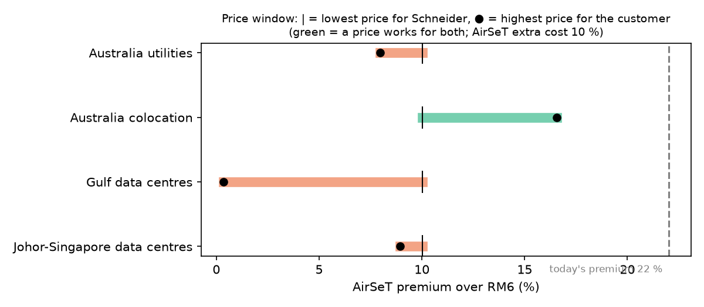
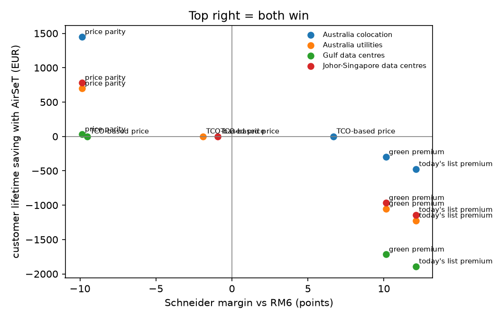

# Problem 2 – Value proposition, pricing and adoption levers (Steps 6–8)

*Owner: Ion · Status: draft*

> **Run from the repo root:**
>
> ```bash
> uv run python -m src.value_pricing
> uv run python -m src.value_pricing_plots
> uv run pytest tests/test_value_pricing.py
> ```

| What | Where |
|---|---|
| Code | `src/value_pricing.py`, `src/value_pricing_plots.py` |
| Tests | `tests/test_value_pricing.py` |
| Tables | `report/problem2/03_tables/` |
| Charts | `plots/problem2/10_price_window.png`, `11_pricing_options.png` |
| Inputs | TCO model (`src/tco.py`), Problem 1 quote rule (`report/problem1/step9_tables/quote_rule.csv`) |

---
# Step 6 – Value proposition

**Question:** in markets where nothing forces the switch, why should a customer pay more for RM AirSeT than for RM6?

## Summary

- **Don't sell AirSeT on leaks.** Over a unit's life, SF6 leaks are worth about **€21** at a €22/t carbon price, against a **€1,921** premium (02 4.3).
- **Sell it on three things, in this order:**
  1. **"The whole SF6 fill is your liability."** One RM6 holds 1.5 kg of SF6 = **35 t CO₂e** (E02, E05). Valued at €22/t, that is **€776 per unit**: enough to justify a premium of about **9 %** (02 4.4).
  2. **"No SF6 paperwork."** Where a rule requires SF6 owners to keep inventories or records (New York), the upkeep AirSeT avoids is worth up to about **€666 per unit** over its life (02 4.5).
  3. **"Future-proof."** No adopted rule touches an installed RM6 (E61), but every new rule so far targets **new** equipment (EU, California, New York). Equipment bought today will be in service until about 2065.
- **One message per target segment**, because who decides and what they care about differ (table below).

## 6.1 The core message, for every segment

> **RM AirSeT does what RM6 does, in the same footprint, without SF6: no greenhouse gas to account for, no gas to manage, no end-of-life liability.**

| Claim | Proof | Source |
|---|---|---|
| Same job, same space | Replaces SF6 ring main units "without impact on installation time and footprint" (Schneider claim) | E171, E132 |
| No upkeep | Pure air and vacuum, sealed for life, "maintenance-free" | E117 |
| Proven | Over 150,000 SF6-free medium-voltage functions installed | E117 |
| Avoids a liability | 35 t CO₂e per RM6. Leaks count in the operator's Scope 1; the gas released at disposal counts in Scope 3 | E13, E14 |
| Digital | Sensors, 24/7 monitoring, partial-discharge detection | E117 |
| Clean exit for old units | Schneider take-back recovers ≥ 99 % of the SF6 | E17 |

## 6.2 One value proposition per target segment

### 1. Johor–Singapore data centres (priority 1)

| | |
|---|---|
| **Who decides** | The operator's sustainability team sets the target; design and procurement teams write the specification. Lead customer: **AirTrunk** |
| **What they care about** | Net-zero Scope 1 and 2 by 2030 (AirTrunk); reporting to the ISSB-based standards being phased in from 2025 to 2027 (E165); speed of build |
| **Message** | "You already count SF6 in your Scope 1 and say you are exploring SF6-free equipment. RM AirSeT removes the gas from your switchgear in the same footprint." |
| **Proof** | AirTrunk counts SF6 leaks in Scope 1 and lists SF6-free equipment as a next step (E85). Whole fill = 35 t CO₂e per unit, about €776 at €22/t |
| **Why we can win** | Schneider already sells AirSeT in Malaysia and Singapore (E95). No SF6-free rival found in Malaysia; Eaton in Singapore (E96) |
| **Price it supports** | Up to 8.9 % above RM6 (€781), if the customer counts the whole fill (Step 7) |

### 2. Gulf data centres: Saudi Arabia and UAE (priority 2)

| | |
|---|---|
| **Who decides** | Developers of AI and data-centre campuses, consulting engineers, procurement |
| **What they care about** | Speed and scale of build; the UAE's new emissions reporting law; reputation of flagship "green" campuses |
| **Message** | "Build once for 40 years. Your new campus will not carry a gas that regulators elsewhere are banning, and you will have one less emission line to report." |
| **Proof** | UAE Federal Decree-Law 11/2024: all companies must measure and report their greenhouse-gas emissions (E69). The local utility (SEC) has started buying SF6-free equipment (MoU with Hitachi, first SF6-free substation in Jeddah, 2025: E28) |
| **Why we can win** | The fastest-growing market (Saudi Arabia ≈ +59 % a year); Schneider sells SF6-free equipment in both countries (E95) |
| **Watch out** | SEC's ring main unit specification still requires SF6 (E28), so lead with private data centres, not the utility. The cost argument is weak here (customers count leaks, not the whole fill), so **don't lead with price**: lead with future-proofing and reporting |
| **Price it supports** | 0.4 % on cost alone (€31). Needs bundles, volume or a customer's own SF6 policy (Step 7) |

### 3. Australia: colocation data centres (priority 3)

| | |
|---|---|
| **Who decides** | Colocation operators (AirTrunk's home market), their design teams, tenants with their own ESG targets |
| **What they care about** | Compliance cost; tenant requirements; reporting |
| **Message** | "In Australia, SF6 already costs you money and paperwork: an import licence, a levy and reporting. RM AirSeT takes all of that away." |
| **Proof** | SF6 equipment needs an import licence and pays the synthetic greenhouse gas levy; GE Grid was fined AUD 450,000 for unreported SF6 imports (E25). Avoided upkeep up to ≈ €666 per unit if an owner rule applies (02 §4.5; unconfirmed in Australia) |
| **Why we can win** | AirTrunk is based here; Eaton is the rival (E96), so the premium is compared with Eaton, not only with RM6 |
| **Price it supports** | Up to 16.6 % above RM6 (€1,447): the whole fill plus the avoided SF6 upkeep (Step 7) |

### 4. Utilities in Australia, Saudi Arabia and Japan (second segment)

| | |
|---|---|
| **Who decides** | Network engineering and asset management; the specification writers |
| **What they care about** | Asset life, reliability, safety of field staff, regulator relations |
| **Message** | "You are already going SF6-free at high voltage. Extend it to your distribution network with one sealed, maintenance-free unit." |
| **Proof** | ElectraNet, SEC, Chubu and Kansai have bought or are buying SF6-free equipment, mostly at high voltage (E126, E28) |
| **Watch out** | Utilities count leaks, not the whole fill, so the cost case is weak. Sell on staff safety, no gas handling, and alignment with their high-voltage choice |
| **Price it supports** | About 8 % in Australia, thanks to the avoided SF6 upkeep; close to 0 % in Saudi Arabia and Japan (Step 7) |

## 6.3 What we do not claim

| Claim | Why we don't make it |
|---|---|
| "AirSeT is cheaper over its life" (based on leaks) | Not true at real carbon prices: break-even is €1,657/t (02 §4.4) |
| "Raw-material prices will close the gap" | They close 0.5 % of the premium by mid-2027 (02 §5) |
| "Your data-centre clients demand SF6-free" | 9 of 11 operators never mention SF6 (01 §1) |
| "Regulation will force your installed RM6 out" | Adopted rules apply to new equipment only (E61) |

## 6.4 Open points

- **Footprint:** Schneider claims the same footprint (E171), but the UK review finds SF6-free ring main units 20–30 % larger in general (E168). Check before saying "same footprint" in a tender.
- **Willingness to pay:** the only survey is EU buyers (+20 %, E173), so this is stated, not observed behaviour, and not outside the EU.
- **Lead customer:** the AirTrunk pitch rests on its public report (E85); no contact has been made.

---

# Step 7 – Pricing

**Question:** what premium over RM6 can AirSeT charge in each segment, so that the customer still saves over the unit's life **and** Schneider keeps its margin?

## In short

- **Every segment has a price window:**
  - **Ceiling:** the highest premium at which the customer still saves over 40 years.
  - **Floor:** the lowest premium that keeps Schneider's margin equal to RM6's.
- **Today's 22 % premium is above every ceiling.** At 22 %, the customer loses €470 to €1,900 per unit over its life.
- **Whether a window exists depends on one unknown number: AirSeT's extra unit cost compared with RM6.** At the placeholder of 10 %, only **Australia colocation** works.
- **Raw materials are not the problem.** Covering raw-material risk on a 9-month quote costs **€83** for AirSeT against **€81** for RM6 (Problem 1 Step 9, client BOM v1). The two are about as risky to quote, and a copper, steel and stainless indexation clause covers most of AirSeT's risk.

## 7.1 Method

For each segment, two checks:

1. **Customer:** AirSeT's lifetime cost minus RM6's, using the TCO model from Step 4. It uses the segment's carbon price (€22/t), how the segment counts SF6 (whole fill or leaks + end of life), and SF6 upkeep where rules apply (Australia).
2. **Schneider:** AirSeT's margin minus RM6's, in points of the RM6 price:
   `margin difference = premium − AirSeT's extra unit cost − (AirSeT's raw-material risk − RM6's)`
   Raw-material risk is the uplift the Problem 1 quote rule charges on a 9-month quote, at 0.5 points of accepted loss and 90 % confidence.

## 7.2 The price window



| Segment | How SF6 is counted | Ceiling (customer) | Floor (Schneider, extra cost 10 %) | Works? | Works if AirSeT's extra cost is below |
|---|---|---|---|---|---|
| Johor–Singapore data centres | Whole fill | **8.9 %** (€781) | 10.0 % | No: 1.1 points short | **8.9 %** |
| Gulf data centres | Leaks + end of life | **0.4 %** (€31) | 10.0 % | No | **0.3 %** |
| Australia colocation | Whole fill + SF6 upkeep | **16.6 %** (€1,447) | 10.0 % | **Yes** | **16.5 %** |
| Australia utilities | Leaks + end of life + SF6 upkeep | **8.0 %** (€697) | 10.0 % | No: 2.0 points short | **7.9 %** |

The last column is the result to remember. It doesn't depend on the 10 % placeholder.

**Caveat on Australia:** both Australian ceilings include €666 of SF6 upkeep (€50 a year), the optimistic value in `assumptions.csv`. The Australian rules found target SF6 imports (licence, levy: E25), not owners. Without the upkeep, Australia colocation falls to 8.9 % (like Johor–Singapore) and Australian utilities to 0.4 %.

- **Australia colocation** is profitable unless AirSeT costs Schneider about 16.5 % more than RM6.
- **Johor–Singapore** and **Australia utilities** are profitable once AirSeT's extra cost falls to about **8–9 %**. The UK government review expects SF6-free premiums to fall to 5–10 % at scale (E166), so this is reachable with volume.
- **The Gulf** is not profitable on cost alone at any realistic extra cost. It's a volume and reference market, not a margin market.

## 7.3 The pricing options compared



Extra cost 10 % (placeholder). "Customer" is the lifetime saving with AirSeT; "Schneider" is the margin difference against RM6.

| Option | Premium | Johor–Singapore | Gulf | Australia colocation | Australia utilities |
|---|---|---|---|---|---|
| **Price parity** | 0 % | Customer +€781 / Schneider −10.0 pts | +€31 / −10.0 | +€1,447 / −10.0 | +€697 / −10.0 |
| **TCO-based price** | = ceiling | €0 / **−1.1** | €0 / −9.7 | €0 / **+6.5** | €0 / −2.1 |
| **Green premium** (EU buyers said they'd pay +20 %, E173) | 20 % | −€967 / +10.0 | −€1,717 / +10.0 | −€301 / +10.0 | −€1,051 / +10.0 |
| **Today's list premium** | 22 % | −€1,140 / +12.0 | −€1,890 / +12.0 | −€474 / +12.0 | −€1,224 / +12.0 |

How to read it:

- **Parity** wins the customer but costs Schneider about 10 points of margin. Don't use it except for a few reference projects.
- **The green premium and today's list premium** keep the margin, but the customer loses money over the life. They only work with a customer whose own policy rules out SF6, and our research found almost none outside utilities (01 §1).
- **The TCO-based price** is the only option that is fair to both sides. It is profitable in Australia colocation today, and in Johor–Singapore once AirSeT's extra cost is below 9 %.

## 7.4 Recommended pricing per segment

| Segment | Price | How to make it work |
|---|---|---|
| **Johor–Singapore data centres** | **TCO-based: ≈ 9 % above RM6** (≈ €780) | Sell the "whole fill" argument. If AirSeT's extra cost is above 9 %, close the gap with a **bundle**: take-back of the customer's old SF6 units and a monitoring service contract. Or accept about 1 point of margin as an entry price with the lead customer (AirTrunk) |
| **Gulf data centres** | **Don't compete on price.** List price for customers with their own SF6 policy; otherwise no discount beyond a few reference projects | Win on future-proofing and reporting (Step 6). Use framework agreements to build the volume that lowers AirSeT's cost |
| **Australia colocation** | **TCO-based: up to ≈ 16 % above RM6** | The strongest case: SF6 already costs the customer a licence, a levy and upkeep. Price just under Eaton, the local SF6-free rival |
| **Australia utilities** | **TCO-based: ≈ 8 % above RM6** | Profitable once AirSeT's extra cost is below 8 %; until then, multi-year framework agreements to secure volume |

## 7.5 Offer structure: protecting the margin (Problem 1 Step 9)

Every AirSeT offer uses the Problem 1 quote rule:

- **Quotes up to 6 months:** fixed price plus a small uplift, at most **0.6–0.85 points** (PPI or market steel).
- **Quotes of 9 months**, which are usual for data-centre projects: a **copper, steel and stainless indexation clause** plus an uplift of about 0.8 points. On real past prices, a P90 buffer alone lost up to 2.5 points on AirSeT; the clause lost at most 0.7 (Problem 1 Step 9). The client's BOM v1 gives AirSeT 28.5 kg of copper, so the clause must follow copper too.
- **Why this matters for Problem 2:** the clause takes raw-material risk out of the AirSeT price, so Schneider can offer the sharper TCO-based price without gambling on copper or steel. Schneider already buys steel on an index (MEPS / CRU) and copper on the LME, so the clause passes on risks it already carries.

**Bundles** to close a gap where the window is shut, or to add value:
- **Take-back** of the customer's old SF6 units (≥ 99 % recovered, E17), which removes an existing liability.
- **Monitoring service contract** (sensors and analytics are built in, E117), which earns margin over the life instead of on the hardware.
- **Leasing or financing**, which spreads the premium over the life of the unit.

## 7.6 Assumptions

| Assumption | Value | Effect |
|---|---|---|
| AirSeT's extra unit cost vs RM6 | **10 %**, placeholder (tested 0–20 %) | Decides which windows are open. **To replace** with the organisers' cost overview |
| Margin Schneider accepts to give up vs RM6 | 0 points | 1 point would open the Johor–Singapore window |
| Customer carbon price | €22/t (median internal price, E56) | Higher prices raise every ceiling |
| How each segment counts SF6 | Whole fill for ESG-led data centres; leaks + end of life for the Gulf and utilities | The Gulf's ceiling would go from 0.4 % to ≈ 9 % if its customers counted the whole fill |
| Quote length | 9 months | Raw-material risk at 9 months: AirSeT €83, RM6 €81 |
| Prices | RM6 €8,740; AirSeT premium vs RM6, as in Step 4 | Synthetic EU benchmark |

## 7.7 Limits

- **AirSeT's real cost is unknown.** Everything depends on it, which is why we show the "works if extra cost is below" figure rather than one answer.
- **One rival price.** The premium is measured against RM6. Against Eaton in Australia and Singapore, the customer compares two SF6-free offers.
- **Stated willingness to pay** (+20 %) comes from EU buyers in 2019–20, not from our target markets.
- **One unit, one configuration.** No fleet or volume discounts.

---

# Step 8 – Adoption levers and go-to-market

**Question:** beyond price, what makes customers switch, and who has to be convinced?

## In short

- **The biggest lever is how the customer counts SF6.** If a data-centre operator counts the whole SF6 fill instead of just leaks, the price it should accept rises from **0.4 % to ≈ 9 %** (Step 7). Getting SF6 into operators' emissions accounting is worth more than any discount.
- **The second lever is volume.** AirSeT's price window opens in Johor–Singapore and Australian utilities once its extra cost falls below 8–9 %. Framework agreements bring that volume.

## 8.1 Who has to be convinced

| Decision-maker | What they control | What convinces them |
|---|---|---|
| Sustainability officers (data centres) | Emission targets, what is counted | "SF6 is a 35 t CO₂e liability per unit" |
| Design teams and consulting engineers | The technical specification | Same footprint, same installation, proven references |
| Procurement | Supplier choice, price | TCO-based price, indexation clause, bundles |
| Utility network engineers | Utility specifications | Safety, no gas handling, alignment with their high-voltage choice |

## 8.2 Lever map

| Lever | Segment | Who it targets | Expected effect | Cost to Schneider |
|---|---|---|---|---|
| **Get SF6 into emissions accounting** (work with operators, and with iMasons environmental declarations, E113) | All data centres | Sustainability officers | Ceiling rises from 0.4 % to ≈ 9 % | Low |
| **"SF6-free" in specifications and framework agreements** | All | Design teams, procurement | Locks in volume; lowers AirSeT's cost | Medium (sales time) |
| **Lead customer and reference site:** AirTrunk, Johor | Johor–Singapore, Australia | Sustainability, design | A public reference in two priority markets | Medium (possible entry price) |
| **Pilot with the Saudi utility** (SEC already runs SF6-free pilots, E28) | Gulf, utilities | Utility engineers | First step to change SEC's specification, which still requires SF6 | Medium |
| **Take-back of old SF6 units** (≥ 99 % recovered, E17) | All | Sustainability, asset managers | Removes the customer's existing liability | Low (existing service) |
| **Monitoring service contract** | All | Operations | Margin over the life, not only on hardware | Low |
| **Leasing / financing** | Price-sensitive customers | Finance, procurement | Spreads the premium over 40 years | Medium |
| **Installer and maintenance training** | All, new markets first | Contractors | Removes "unfamiliar technology" | Low |
| **Channel partner incentives** | Gulf, Australia | Distributors, panel builders | Partners push AirSeT, not SF6 | Medium |
| **Engage regulators** where rules are discussed (UK, other US states) | Later markets | Regulators | Moves markets toward regulation | Low |

## 8.3 Barriers and answers

| Barrier | Answer |
|---|---|
| Upfront price (22 % today) | TCO-based price (Step 7), bundles, leasing |
| "We don't count SF6" | Whole-fill argument, take-back, environmental declarations |
| Unfamiliar technology | Over 150,000 functions installed (E117), reference sites, training |
| Footprint | Schneider claims the same footprint (E171); check per project, as a UK review finds 20–30 % larger units (E168) |
| Utility specification requires SF6 (Saudi Arabia) | Lead with private data centres; pilot with the utility |
| Local SF6-free rival (Eaton in Australia and Singapore) | Price just under the rival, sell the digital and service bundle |
| Supply capacity if demand grows | Not analysed. Supplier financial data exists (`Supplier_balancesheet`) if needed |