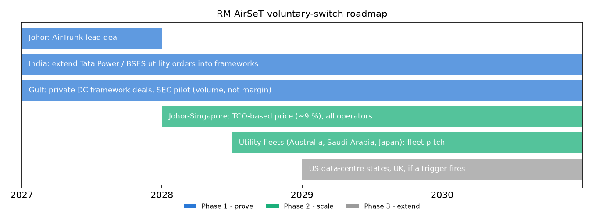
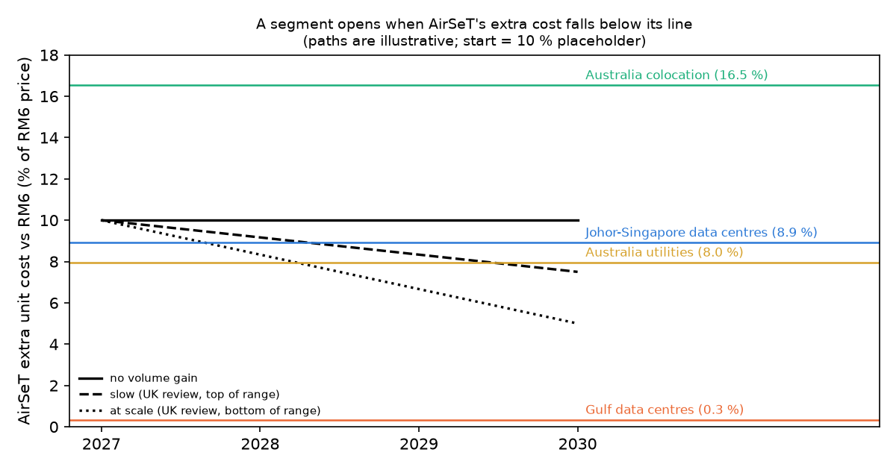

# Problem 2 – Strategy: roadmap, win conditions and final story (Steps 9–10)

*Owner: Karin · Status: done. BOM v1 numbers; strategy revised on 26 Nov with the customer-needs review (§9.0) and new market evidence (E175–E185).*

> **Sources:** E-numbers refer to rows of [`market_evidence/evidence.csv`](../../market_evidence/evidence.csv). "01 §3.4" means section 3.4 of [01_market_and_regulation.md](01_market_and_regulation.md); likewise for [02](02_cost_and_tco.md) and [03](03_value_and_pricing.md). H1–H6 are the hypotheses in the [problem framing](00_problem_framing.md) (§6); H7 is new (§9.6). C1–C6 are the customer-needs findings in §9.0.

> **Run from the repo root:**
>
> ```bash
> uv run python -m src.strategy          # win conditions, window opening, triggers, CO2 KPI
> uv run python -m src.strategy_plots    # charts 12-13
> uv run python -m pytest tests/test_strategy.py
> ```

| What | Where |
|---|---|
| Code | [`src/strategy.py`](../../src/strategy.py), [`src/strategy_plots.py`](../../src/strategy_plots.py) |
| Tests | [`tests/test_strategy.py`](../../tests/test_strategy.py) |
| Tables | [`04_tables/`](04_tables/) |
| Charts | `plots/problem2/12_window_opening.png`, `13_roadmap.png` |
| Inputs | TCO model (`src/tco.py`), Step 7 price window (`src/value_pricing.py`), Problem 1 Step 9 tables (`quote_rule.csv`, `outlook_2027.csv`) |

> **SF6 and carbon prices, in brief.** SF6 is the insulating gas sealed inside each RM6 (≈ 1.5 kg). It is not bought or sold by the customer; it matters because it is a very strong greenhouse gas: 1 kg ≈ 23.5 t of CO₂-equivalent, so one RM6 holds ≈ 35 t CO₂e. A **carbon price** (€/t CO₂e) is the cost a company puts on its emissions in its decisions, usually an internal "shadow" price (median ≈ €22/t, E56), not a market price for the gas. How much of the gas a customer **counts** as an emission decides what avoiding it is worth (02 §4.4):
>
> | View | What is counted | t CO₂e per unit | Value at €22/t |
> |---|---|---|---|
> | Leaks only | Gas leaking during use (Scope 1) | ≈ 2.8 over 40 years | ≈ €21 |
> | Leaks + end of life | Plus the gas released when the unit is scrapped | ≈ 6 | ≈ €25 (discounted) |
> | Whole fill | All the gas in the unit, as a liability from day one | ≈ 35 | ≈ €776 |

`src/strategy.py` adds no new model. It reuses the Step 4 TCO model and the Step 7 price window without changing their settings, and turns them into thresholds. Its tests check that it reproduces the Step 7 windows exactly.

---

## Summary

- **Where to play: where the customer has a structural reason to pay, not everywhere.** In unregulated markets the gas costs an RM6 owner almost nothing (C2–C4). Customers pay the premium for three reasons only (C5): an **ESG or green-finance target**, a **phased build** in a tight electrical room, or a **large or remote fleet** where gas logistics add up. Everywhere else, **RM6 stays the standard offer** (C6).
  - **2027:** Johor–Singapore with **AirTrunk** as lead customer (net-zero target and green financing: E85, E182; phased campus builds to confirm per site). **Indian distribution utilities**, which already buy RM AirSeT without a rule (Tata Power, BSES: E175, E176). The **Gulf** as a volume and reference market, not a margin market.
  - **Not a 2027 lead: Australia colocation.** Its 16.5 % threshold rests on €50/yr of SF6 upkeep that no owner-side rule supports (03 §7.2). Without it, it behaves like Johor (8.9 %).
  - **Later:** utility fleets in Australia, Saudi Arabia and Japan; then the US data-centre states and the UK if their regulation moves. China is the source of the low-price competition, not a target (E180, E181).
- **The one number that decides the roadmap is AirSeT's extra unit cost compared with RM6.** It is not the carbon price or raw materials. Each segment opens below a threshold:

  | Segment | Opens when AirSeT's extra cost is below |
  |---|---|
  | Johor–Singapore data centres | **8.9 %** |
  | Australia utilities | **8.0 %** (0.3 % without the upkeep) |
  | Australia colocation | **16.5 %** (8.9 % without the upkeep) |
  | Gulf data centres | **0.3 %**: never, on cost alone |

  If the cost falls as the UK review expects at scale (E166), Johor–Singapore opens in **2028** (chart 12).
- **How a customer counts SF6 sets the price ceiling, but Schneider can't change it at scale.** Counting the whole fill instead of leaks raises AirSeT's value from about €21 to about €776 per unit. But only 1 of 11 operators counts SF6 at all (AirTrunk, 01 §7). The data-centre carbon format counts manufacturing only (E184), and the Singapore-Asia Taxonomy behind AirTrunk's green loan doesn't name SF6 (E183). So the whole fill is a ceiling to price within for customers who already count it, not a lever to push.
- **The quote format matters as much as the price.** Buyers screen bids on headline price, and Chinese dry-air RMUs claim only +5–12 % over SF6 (E180, vendor claims). In standalone tenders, quote **RM6 as the base with AirSeT as a priced option**. Make AirSeT the standard only in package bids and at the specification stage, where the structural reason is known.
- **Problem 1 protects the margin; it doesn't close the gap.**
  - Every 9-month AirSeT quote carries a copper, steel and stainless indexation clause.
  - Problem 1's monthly forecast is the alarm: AirSeT's raw-material cost is €941 today (BOM v1), with a 9-month P90 of **€1,105** by June 2027.
  - The raw-material gap between RM6 and AirSeT is **not** a reason to move: it changes by at most €41 (P90), about 2 % of the premium.
- **Success measure (framing §7):** AirSeT's share of new medium-voltage orders **in the qualifying segments** of the target markets by 2030, with the margin on each offer kept at or above RM6's. The only exception is up to 1 point on named lead-customer deals. Elsewhere, success is RM6's margin held.

---

## 9.0 What customers pay for (customer-needs review)

The strategy starts from why a customer outside the EU would pay more. The team's customer-needs review found:

| # | Finding | What it means for the strategy |
|---|---|---|
| C1 | Installed SF6 is grandfathered: adopted rules target new equipment, and repairs and extensions stay allowed (also 01 §4, E61) | **Don't sell "future-proof" or stranded-asset risk** |
| C2 | Leakage is mainly a high-voltage issue. MV RMUs hold 0.2–1 kg, MV GIS 2–3 kg; sealed MV units leak ≤ 0.1 %/yr. Gas running costs are near zero where nothing is regulated | **Don't sell leak-based TCO** |
| C3 | Sealed MV tanks rarely fail. Toxic by-products come from arcing, so handling matters only after a fault or at end of life; secondary parts are replaced without opening the tank | **Don't sell safety** to utilities |
| C4 | Reporting and end-of-life gas recovery (≈ €1–2k, 30+ years out) have a low present value | **Don't sell end-of-life savings** |
| C5 | Three real reasons to pay: **(a)** corporate ESG, Scope 1 or net-zero targets, green financing, building certification; **(b)** phased builds in tight rooms: when an SF6 line is discontinued, extending the busbar directly needs an adapter panel or a cable-linked board (busbar geometry, IEC 62271-200 internal-arc rating); **(c)** remote sites without recyclers, or large distributed fleets, where HAZMAT handling, recovery rigs and chain-of-custody costs add up | **Sell to these three, and only these** |
| C6 | A single fixed-capacity site with no ESG target has no financial reason to pay the premium | **RM6 stays the standard offer there** |

Three consequences for the numbers in this report:
- **The model is more generous to AirSeT than C2.** It uses RM6's 1.5 kg fill (E02) and a 0.2 %/yr base leak rate (02 §4.1), both above the C2 ranges. So the leak-based values here are an upper bound, which strengthens "don't sell leak-based TCO".
- **The TCO thresholds (§9.3) capture C5a only,** through the carbon price and the whole fill. C5b (an adapter panel avoided) and C5c (fleet gas logistics) are not in the one-unit TCO (02 §4.6), so the utility and phased-build ceilings are understated. They are not quantified yet (§9.10).
- **C5c does not apply everywhere:** Malaysia has a utility-run SF6 recycling centre (TNB, E185), so the "no recycler nearby" argument is weak in Johor. It is strongest for remote and distributed fleets.

---

## 9.1 The strategy on one page

| Deliverable | Answer | From |
|---|---|---|
| **Target markets and segments** | 1. Johor–Singapore data centres (AirTrunk first) · 2. Indian distribution utilities (Tata Power, BSES) · 3. Gulf (Saudi Arabia, UAE) data centres, for volume. Second wave: utility fleets in Australia, Saudi Arabia and Japan; Australia colocation if the upkeep is confirmed. Later: US data-centre states, UK. China: watched as a competitor, not targeted. | 01 §3.4, E175–E176, §9.0 |
| **Value proposition** | "Same job, no SF6", with a different lead per customer: **expansion-proof** for phased builds (C5b); **no gas logistics** for fleets and remote sites (C5c); **net-zero and green-finance ready** for ESG-led buyers (C5a), using the whole fill only with customers who already count SF6. **Don't** sell on leak-based TCO, future-proofing, safety or raw-material convergence (C1–C4). | 03 §6, §9.0 |
| **Pricing** | A TCO-based premium within each segment's ceiling: ≈ 9 % Johor–Singapore; Australia only once the upkeep is confirmed. **Quote format:** RM6 base + AirSeT priced option in standalone tenders; AirSeT as standard in package bids and specifications for qualifying customers. No price competition in the Gulf. Bundles (take-back, monitoring) for fleets. | 03 §7, E180 |
| **Offer structure (Problem 1)** | Quotes up to 6 months: fixed price plus ≤ 0.6–0.85 points (PPI or market steel). 9-month quotes: copper, steel and stainless indexation clause plus a small uplift. | 03 §7.5, P1 Step 9 |
| **Adoption levers** | Multi-phase framework agreements (phased campuses, utility programmes) · "SF6-free" at the specification stage · AirTrunk and Tata Power references · local integration or production (India, Saudi Arabia) · SEC pilot · take-back for fleets · training · channel incentives | 03 §8, E176, E178 |
| **Roadmap and win conditions** | This report: §9.2–9.5 | – |

---

## 9.2 Roadmap



### Phase 1 – Prove (2027)

**Goal:** two public references (one data centre, one utility), the real AirSeT extra cost, and its lead time outside Europe.

| Market | Move | Price | Why now |
|---|---|---|---|
| **Johor–Singapore** | **AirTrunk lead deal and reference site** in Johor, as a framework covering later campus phases (expansion-proof, C5b). AirTrunk counts SF6 in Scope 1, is exploring SF6-free equipment (E85) and finances its campuses with A$16bn of green and sustainability-linked loans (E182) | ≈ 9 %, accepting about 1 margin point as an entry price | Strongest fit with C5a and C5b. With a 1-point entry give the window opens up to a 9.9 % extra cost, just short of the 10 % placeholder: opening it in 2027 takes 1.1 points (03 §7.6), or a cost below 9.9 % (§9.3). ⚠️ The ≈ 9 % ceiling assumes AirTrunk values the whole fill; today it counts leaks (E85) |
| **Indian distribution utilities** | Turn Tata Power's order (Mumbai, Delhi, then Odisha: E175) and the BSES pilot (E176) into multi-year framework agreements | At least RM6's margin: price set by the local extra cost, which is unknown | Utilities are the only voluntary MV buyers seen outside the EU (E126, E175, E176). Fleet logistics (C5c), not TCO: on leaks and end of life, the modelled utility and Gulf ceilings are ≈ 0.4 % (Indian utilities are not modelled). The remote-terminal-unit integration is already done in India (MVI plant, E176); the switchgear itself came from Schneider's global plant |
| **Gulf** | Framework agreements with private AI and data-centre campus developers; join SEC's SF6-free pilots | List price for customers with their own SF6 policy; otherwise a few reference projects only | Fastest growth (Saudi Arabia ≈ +59 %/yr). Build volume; don't buy share. SEC's RMU specification still requires SF6 (E28). Saudi capacity is nearly tripling (E178), so local supply is possible |
| *Australia colocation (qualify, don't lead)* | Confirm whether any owner-side SF6 cost exists; sell only to phased-build or ESG-led operators | TCO-based, ≈ 9 % without upkeep | 16.5 % rests on €50/yr of upkeep; the rules found target importers, not owners (03 §7.2) |

**Enablers, all markets, 2027:**
- **Get the real AirSeT extra unit cost** from the organisers' cost overview. It replaces the 10 % placeholder that every threshold depends on.
- **Get AirSeT's production site and lead time to APAC and the Gulf.** The only expansion found is in Hungary, "for Europe" (E177), while MV switchgear lead times run 52–80 weeks in the US (E179; no APAC or Gulf figure found). A longer lead time than RM6 would cancel the phased-build argument.
- **Quote template:** RM6 base + AirSeT priced option for standalone tenders (§9.1).
- **Copper, steel and stainless indexation clause** as standard on every 9-month AirSeT quote (P1 Step 9).
- **An honest environmental comparison.** Prepare RM6 vs AirSeT figures for both the manufacturing-only (A1–A3) format data-centre operators use (E184) and the full life. Know which one favours AirSeT before entering either.
- **Footprint and extension check** on each tender (E171 vs E168): same footprint, and how an AirSeT unit joins an existing RM6 lineup (adapter panel or cable link, space and cost).
- **Bundle for fleets:** take-back of old SF6 units (≥ 99 % recovered, E17) and a monitoring service contract.

### Phase 2 – Scale (2028–2029)

**Goal:** volume and local supply bring AirSeT's extra cost below the next thresholds.

| Market | Move | When it opens (at-scale / slow path) |
|---|---|---|
| **Johor–Singapore** | Move from the entry price to the TCO-based price (≈ 9 %) across operators with an ESG target, not only AirTrunk | **2028 / 2029** |
| **Indian utilities** | Scale frameworks to other discoms if local integration or production brings the extra cost down | When the local extra cost is known (§9.10) |
| **Utility fleets: Australia, Saudi Arabia, Japan** | Multi-year frameworks pitched on **fleet gas logistics** (C5c), not cost or safety (C3). In Australia, extend the utilities' high-voltage SF6-free choice (E126) to distribution | Not on single-unit cost: threshold 8.0 % with the Australian upkeep, 0.3 % without. Opens only if the fleet savings are real (§9.10) |
| **Gulf** | Price like Johor–Singapore **only if** customers start counting the whole fill. Otherwise stay a volume market | 2028 / 2029 in the whole-fill case; never otherwise |
| **Australia colocation** | TCO-based price if the upkeep is confirmed; otherwise the Johor–Singapore timeline | 2027 with upkeep; 2028 / 2029 without |

### Phase 3 – Extend (2029–2030+)

**Goal:** enter large markets when a trigger fires (§9.5), not before.

- **US data-centre states (Texas, Virginia, Ohio):** the largest voluntary market, but there are gas-free incumbents (S&C, G&W) and no customer pull. Move when another state adopts a phase-out after New York, or when a US operator starts counting SF6 (01 §3.4).
- **UK:** if the phase-out under study becomes a proposal (E71), treat it as a "regulation coming" market.
- **China: not a target.** Local makers dominate (01 §3.3), State Grid reportedly dropped SF6 from its 12 kV RMU design (E181, unconfirmed), and Chinese makers export dry-air RMUs (CHINT, E101) at claimed premiums of 5–12 % (E180). China matters as the **price benchmark** in Asian tenders (W6, §9.5).

---

## 9.3 Win conditions

### What must be true, per segment

([`win_conditions.csv`](04_tables/win_conditions.csv); carbon price €22/t, Problem 1 raw-material risk at 9 months)

| Segment | How SF6 is counted | Customer ceiling | **Opens if AirSeT's extra cost <** | … with 1-point entry give | Or if the carbon price ≥ (at 10 % extra cost) | Carbon price for today's 22 % premium |
|---|---|---|---|---|---|---|
| Johor–Singapore data centres | Whole fill | 8.9 % | **8.9 %** | 9.9 % | **€25/t** | €54/t |
| Australia utilities | Leaks + end of life + upkeep | 8.0 % | **8.0 %** | 9.0 % | €177/t | €1,080/t |
| Gulf data centres | Leaks + end of life | 0.4 % | **0.3 %** | 1.3 % | €753/t | €1,657/t |
| *Gulf, if it counts the whole fill* | Whole fill | 8.9 % | 8.9 % | 9.9 % | €25/t | €54/t |
| *Australia colocation, without SF6 upkeep* | Whole fill | 8.9 % | 8.9 % | 9.9 % | €25/t | €54/t |
| Australia colocation, with €50/yr upkeep (unconfirmed) | Whole fill + SF6 upkeep | 16.6 % | 16.5 % | 17.5 % | €6/t | €35/t |

How to read it:
- **"Opens if AirSeT's extra cost <":** below this, there is a premium at which the customer saves over the unit's life **and** Schneider keeps RM6's margin. It doesn't depend on the 10 % placeholder.
- **"Or if the carbon price ≥":** if the extra cost stays at 10 %, the carbon price the customer would need to apply to SF6 for the window to open.
- **Johor–Singapore is close:** €25/t against a €22/t median internal price, or 1.1 points of margin. But the ceiling assumes the whole fill is valued; on AirTrunk's current leak-based accounting (E85) the threshold would be ≈ 0.3 %, as in the Gulf. The deal is won on C5a and C5b and priced inside the whole-fill ceiling.
- **Both Australian rows with upkeep rest on €50/yr that the evidence doesn't support** (03 §7.2); the colocation one is shown last for that reason. Without the upkeep, Australian utilities fall to a 0.4 % ceiling and a 0.3 % threshold.
- **The Gulf and utilities can't be opened by carbon prices.** €177–753/t is far above any price that reaches them (01 §6). Utilities buy for fleet reasons (C5c) that this one-unit table doesn't capture.

### The win conditions, as statements

| # | Win condition | Threshold | Status today | Owner of the evidence |
|---|---|---|---|---|
| W1 | AirSeT's extra unit cost vs RM6 falls with volume | < 8.9 % for Johor–Singapore | **Unknown** (10 % placeholder). Volume outside the EU lowers it only if production is shared or local (E177) | Organisers' cost overview (framing §8) |
| W2 *(upside)* | More data-centre operators value the **whole SF6 fill**, not only leaks | Ceiling rises from 0.4 % to 8.9 % | 1 of 11 operators counts SF6 at all (AirTrunk, leaks only). No channel pushes it: the OCP/iMasons format counts manufacturing only (E184); the Singapore-Asia Taxonomy has no SF6 criterion (E183) | 01 §7 |
| W3 | Two lead customers sign and become public references | AirTrunk in Johor; an Indian utility framework (Tata Power or BSES) | AirTrunk: no contact yet (03 §6.4). Tata Power: first order placed (E175) | Sales |
| W4 | Raw-material risk stays priced, not absorbed | Every 9-month AirSeT quote has a copper, steel and stainless clause; realised erosion stays within the quote rule's accepted loss | Rule exists (P1 Step 9) | Problem 1 |
| W5 | AirSeT fits where RM6 fits, **and extends an existing lineup** | Same footprint per project; a defined adapter route into RM6 lineups, with its space and cost | Schneider claim (E171) vs UK review +20–30 % (E168); adapter route not documented | Product team |
| W6 | AirSeT's price holds against **Eaton and Chinese dry-air RMUs** | Rival price ≥ AirSeT's TCO-based price in Australia, Singapore, Malaysia, India | Not observed (synthetic EU prices only); Chinese vendors claim +5–12 % over SF6 (E180) | Sales intelligence |
| W7 | AirSeT is **available locally**, with a lead time no longer than RM6's | Lead time ≤ RM6's in each target market | Unknown: Hungary is the only expansion found (E177); integration in India (E176); Saudi capacity growing (E178) | Supply chain |

### When each segment opens, if AirSeT gets cheaper with volume



([`window_opening.csv`](04_tables/window_opening.csv))

| Segment | No volume gain (10 % flat) | Slow (→ 7.5 % in 2030) | At scale (→ 5 % in 2030) | At scale, with 1-point entry give |
|---|---|---|---|---|
| Johor–Singapore data centres | never | 2029 | **2028** | 2028 |
| Australia utilities (with upkeep) | never | 2030 | **2029** | 2028 |
| Australia colocation (with upkeep) | 2027 | 2027 | 2027 | 2027 |
| Gulf data centres | never | never | never | never |

**The paths are illustrative, not a forecast.** They start at the 10 % placeholder and assume AirSeT's extra cost falls in the same proportion as the UK review's expected premium, from 15–30 % today to 5–10 % at scale (E166). The thresholds hold whatever the path. Once the real extra cost is known, read the opening year off chart 12. With BOM v1, a 1-point entry give no longer opens Johor–Singapore in 2027 (9.9 % threshold vs the 10 % placeholder); it brings the slow path forward from 2029 to 2028. Without the upkeep, both Australian rows follow other rows: colocation the Johor–Singapore timeline, utilities the Gulf's (never on cost).

---

## 9.4 KPIs

| KPI | Why | Target | Source / frequency |
|---|---|---|---|
| **AirSeT share of RMU orders in qualifying segments** (ESG target, phased build, fleet) | The success measure (framing §7), limited to where AirSeT has a reason to win (C5, C6) | Baseline in 2027; target **to agree** with the client | Sales, quarterly |
| **RM6 margin held** in non-qualifying segments | Shows AirSeT isn't pushed where customers won't pay (C6) | No erosion vs 2026 | Finance, quarterly |
| AirSeT **win rate** when quoted as an option vs as the standard, and vs Eaton and Chinese dry-air units | Tests the quote format and W6 | Win rate ≥ RM6's in the same market | Sales, quarterly |
| **Margin vs RM6 per offer** (points) | "Profitably" | ≥ 0 points; ≥ −1 point on named lead-customer deals | Finance, per offer |
| **AirSeT extra unit cost vs RM6** | W1: decides when each segment opens | < 8.9 % (Johor–Singapore) | Finance, half-yearly |
| **AirSeT lead time vs RM6**, per target market | W7 | ≤ RM6's | Supply chain, quarterly |
| **Reference sites and utility frameworks** | W3 | 1 data-centre reference and 1 utility framework by end 2027 (proposed) | Sales |
| **9-month AirSeT quotes with a copper, steel and stainless clause** | W4 | 100 % | Sales ops, per quote |
| **Realised raw-material erosion on AirSeT quotes** | W4: checks Problem 1's buffer | Within the quote rule's accepted loss | Problem 1 monthly run |
| Target customers counting SF6 (whole fill) | W2, upside only | Watch; no target | Sustainability reports, yearly |
| **CO₂e avoided** | ESG claim to customers | 35 t per unit (whole fill); 2.8 t (leaks over 40 years) | [`co2_avoided.csv`](04_tables/co2_avoided.csv) |

**CO₂e avoided per AirSeT unit sold instead of an RM6** (t CO₂e):

| View | Pessimistic | Base | Optimistic |
|---|---|---|---|
| Leaks over the life | 1.0 | **2.8** | 12.8 |
| Leaks + end-of-life release | 1.2 | **6.1** | 32.0 |
| Whole fill | 16.4 | **35.2** | 60.8 |

Report the **whole-fill** figure as "SF6 kept out of the installed base", and the **leaks** figure as "Scope 1 emissions avoided". Mixing them up would overstate the Scope 1 claim by 12×.

---

## 9.5 Triggers to accelerate or pause

([`triggers.csv`](04_tables/triggers.csv); thresholds computed from the Problem 1 and Step 4 tables)

| Watch | Threshold | Action | Source |
|---|---|---|---|
| **AirSeT raw-material cost** (Problem 1 monthly run) | > **€1,105** by Jun 2027 (9-month P90; €941 today) | The copper, steel and stainless clause triggers; re-quote fixed-price offers; check the price floor | P1 Step 9 |
| **RM6 raw-material cost** | > **€1,098** by Jun 2027 (9-month P90; a floor, because copper's upside tail was underestimated) | Copper clause on RM6 quotes. The gap narrows, so mention it in tenders | P1 Step 9 |
| **RM6 − AirSeT raw-material gap** | Change > **+€41** (P90) or < **−€45** (P10) | Above: "convergence" can be mentioned, but it is still < 3 % of the premium. Below: AirSeT is relatively dearer; re-check the floor | P1 Step 9 |
| **AirSeT extra unit cost** | < **8.9 %** (< 9.9 % with entry give) | **Accelerate:** open Johor–Singapore at the TCO-based price (Phase 2) | §9.3 |
| **Carbon price a target customer applies to SF6** | ≥ **€25/t**, counting the whole fill | **Accelerate:** the Johor–Singapore window opens at today's cost | §9.3 |
| **Carbon price that justifies today's 22 % premium** | ≥ **€54/t** (whole fill) | Move ESG-led segments from the TCO-based price to the list price | 02 §4.4 |
| **SF6 rule in a target market** | Status 0/1 → 2 or 3 (phase-out adopted, or a ban) | **Accelerate:** "no SF6 obligations" pitch, list price, more sales capacity. Candidates: US states, UK (01 §2.1) | `regulation.csv` |
| **SF6-free rival price** (Eaton, Chinese dry-air RMUs) | Below AirSeT's TCO-based price in a target market | Quote RM6 base + AirSeT option; keep the bundle for fleets. **Pause** the market if the price would have to go below the floor | `competitors.csv`, E180 |
| **RM6 end-of-sale date** | Schneider announces one for a target market | **Accelerate** phased-build sales: the expansion-proof pitch becomes concrete for campuses with later phases (C5b) | Product team |
| **Taxonomy or lender criterion naming SF6** | A green-loan or taxonomy rule in a target market requires or rewards SF6-free switchgear | **Accelerate:** ESG-financed customers must comply; list price for them | E182, E183 |
| **Local AirSeT production** | Schneider decides to build or assemble AirSeT in India or Saudi Arabia | **Accelerate** India and Gulf utility frameworks; re-check the extra cost and lead time | E176, E178 |
| **Footprint** | A tender where AirSeT is larger than the RM6 it replaces | Price the extra space into the TCO; don't claim "same footprint" there | E171, E168 |

---

## 9.6 Hypotheses: final status

| # | Hypothesis | Result |
|---|---|---|
| H1 | Operators apply one SF6-free standard worldwide | **Not supported:** 9 of 11 never mention SF6 (01 §7), and their carbon format counts manufacturing only (E184). Hence W2 is upside, not plan |
| H2 | Non-EU markets will regulate soon | **Partly:** US states and the UK; not Asia or the Middle East before 2030 (01 §2.1). In Asia the movement is **utility-led, not law-led** (India E175–E176; China E181, unconfirmed). Hence Phase 3 triggers |
| H3 | TCO favours AirSeT once the whole fill is valued | **Only in the whole-fill view:** break-even €54/t; ≈ 9 % premium at €22/t (02 §4.4). The real reasons to pay (C5b, C5c) are outside the one-unit TCO |
| H4 | The raw-material outlook narrows the cost gap | **Direction yes, size no:** 0.3 % of the premium at P50 (02 §5) |
| H5 | AirSeT can be priced closer to RM6 without losing margin | **Yes where the extra cost allows:** in Johor–Singapore below 8.9 %; in Australia colocation only if the upkeep is real. Raw-material risk is not the obstacle: €83 for AirSeT vs €81 for RM6 on a 9-month quote, covered by the clause (03 §7). **The extra unit cost is.** |
| H6 | EU convergence repeats elsewhere | **Not through raw materials.** Through volume and local supply (the extra-cost path, §9.3; W7) or regulation (triggers, §9.5) |
| **H7** *(new)* | Outside the EU, utilities, not data centres, are the voluntary early adopters of SF6-free MV | **Supported:** Tata Power and BSES buy RM AirSeT without a rule (E175, E176); announced non-EU SF6-free buyers are utilities (E126); no non-EU data-centre SF6-free project found (E86). Hence Indian utilities in Phase 1 |

---

## 9.7 Check against "what a good answer looks like" (framing §7)

| Criterion | Met by |
|---|---|
| Specific: 2–3 named market × segment targets | Johor–Singapore with AirTrunk, Indian distribution utilities, Gulf private data centres (§9.2) |
| Quantified, with ranges and sources | Thresholds and carbon prices per segment (§9.3); every input sourced in `assumptions.csv` and `evidence.csv` |
| Profitable: every pricing move checked against margin after the risk buffer | Thresholds include Problem 1's 9-month raw-material risk; KPIs "margin vs RM6 ≥ 0" and "RM6 margin held" |
| Linked to Problem 1 | Indexation clause on every 9-month quote; raw-material triggers from the Problem 1 forecast (§9.5) |
| Actionable: dated roadmap, KPIs, triggers | §9.2, §9.4, §9.5 |
| Honest | The 10 % placeholder, the unsupported Australian upkeep, the whole-fill assumption behind Johor, the unquantified fleet and phased-build value, and the illustrative cost paths are flagged; limits in §9.9 |

---

## 9.8 Assumptions

| Assumption | Value | Effect | Status |
|---|---|---|---|
| AirSeT's extra unit cost vs RM6, 2027 | **10 %** (Step 7 placeholder) | Decides which segments open when. The thresholds don't depend on it; the opening years do | **To replace** with the organisers' cost overview |
| Extra-cost paths to 2030 | Flat 10 %, → 7.5 %, → 5 % | Opening years in §9.3 | Illustrative: UK review premium ratio (E166) applied to cost |
| Margin given up vs RM6 | 0 points; 1 point for named lead-customer deals | +1 point on each threshold | **To agree** with the team |
| Customer carbon price | €22/t (CDP median internal price, E56) | Ceilings | Sourced |
| Johor–Singapore customers value the whole fill | Whole-fill view | Ceiling 8.9 % instead of 0.3 % | **Assumption:** AirTrunk counts leaks today (E85) |
| SF6 upkeep in Australia | €50/yr (optimistic value) | Australia colocation 16.5 % vs 8.9 % without; utilities 8.0 % vs 0.3 % | **Not supported:** the rules found target importers, not owners (03 §7.2), and gas running costs are near zero (C2) |
| Price comparator | RM6 + 22 % (Eaton vs Schneider, synthetic EU) | Today's premium | **Unverified outside the EU;** Chinese dry-air RMUs claim +5–12 % (E180) |
| Problem 1 raw-material risk | 9-month quote, 0.5 points accepted loss, 90 % confidence, steel PPI | ±0.1 point on every threshold | As in Step 7 |

## 9.9 Limits

- **Everything hinges on one unknown,** AirSeT's real extra unit cost. That is why the roadmap is expressed as thresholds and triggers, not as fixed dates.
- **Synthetic, EU-only prices,** and Eaton stands in for AirSeT (02 §4.6). No non-EU tender price was found; the Chinese figures are vendor claims (E180).
- **One unit, one configuration.** The TCO leaves out the two reasons customers actually pay beyond ESG: avoided adapter panels on phased builds (C5b) and fleet gas logistics (C5c). It is conservative for AirSeT in those segments.
- **Our €31 is not comparable with Schneider's "up to 50 % lifetime cost savings" (E175).** The €31 is a floor: gas only (leaks, end-of-life release, an €80 recovery fee) for one unit, with no maintenance difference and no fleet costs (02 §4.3). Even at the €1–2k end-of-life cost in C4, discounting 30–40 years adds only ≈ €70–260. What could close the gap are the fleet costs paid during the life (gas-handling kit, certified staff, HAZMAT transport, chain-of-custody records: C5c), which are not modelled. The basis of Schneider's figure is not published; ask for it (§9.10) rather than set the two side by side.
- **Supply is unknown outside Europe:** where AirSeT is built for APAC and the Gulf, and at what lead time (E177, E179).
- **The China and India evidence is from press and vendor sources,** read via search summaries (E175, E176, E180, E181); State Grid's change is unconfirmed.
- **No customer interviews.** Willingness to pay is stated (EU buyers, E173), and no contact with AirTrunk has been made.
- **KPI targets for share are not set.** There is no baseline data; agree them with the client.
- **Supply capacity is not analysed.** The supplier balance sheets (`Supplier_balancesheet/`) could test whether the supply base can follow Phase 2.

## 9.10 Open points for the team

1. **Organisers' cost overview** ("RM AirSeT and RM6 Product and Cost Overview"). Rerun `src.value_pricing` and `src.strategy` with the real extra cost, then update §9.2–9.3.
2. **Questions for the client:**
   - Where is RM AirSeT built for APAC and the Gulf, and what is its lead time against RM6's?
   - How is the "up to 50 % lifetime savings" in the Tata Power announcement calculated?
   - What are non-EU tender prices for AirSeT, against RM6 and against Chinese dry-air RMUs?
   - Is there an RM6 end-of-sale date, and how does an AirSeT unit join an existing RM6 lineup (adapter, space, cost)?
3. **Margin give for lead customers (1 point):** agree it with the team. With BOM v1, 1 point opens Johor–Singapore only if AirSeT's extra cost is below 9.9 %; at the 10 % placeholder it takes 1.1 points.
4. **Australian SF6 upkeep:** confirm whether any owner-side rule applies. If not, drop the upkeep rows: colocation moves to the Johor–Singapore timeline (2028 at scale), and Australian utilities to the fleet pitch only.
5. **Quantify C5b and C5c:** the cost of an adapter panel or cable-linked board on a phased build, and per-site SF6 handling costs for a utility fleet. Either could change the utility and phased-build ceilings.
6. **Reports 01 and 03** don't cover Indian utilities, and 03 still calls Australia colocation the strongest pricing case (§7.2, §7.4) without discounting the upkeep. Align them with this report, or note the change in the final story.
7. **KPI targets:** set the order-share and reference targets with the client.
8. **Problem 1 dependencies:** done. This report uses the corrected BOM (v1): P1 Steps 8–9, `src.value_pricing` and `src.strategy` were rerun. Thresholds moved by about 0.15 points; the raw-material triggers in §9.5 rose with the higher BOM costs (AirSeT €941, RM6 €931 per unit).

---

# Step 10 – Final story

## 10.1 One engine, two outcomes

The client's chain: **RM forecast → BOM exposure → product-cost evolution → margin at risk → pricing decision → AirSeT market strategy**. One number per link:

| Link | Result | Where |
|---|---|---|
| **1. RM forecast** | The median is no better than "no change", but the P10–P90 band is calibrated (80–84 % coverage on the hold-out) and narrower than the naive forecast's | P1 Steps 6–7 |
| **2. BOM exposure** | RM6 €931, copper 52 %. AirSeT €941, copper 38 %, steel and stainless 52 % | P1 Step 2 (BOM v1) |
| **3. Product-cost evolution** | To June 2027: P50 +2–3 %; P90 €1,098 (RM6), €1,105 (AirSeT) | P1 Step 8 |
| **4. Margin at risk** | A 9-month fixed price risks 1.9 points (RM6) and 1.6 points (AirSeT) at P90 | P1 Step 8 |
| **5. Pricing decision** | Up to 6 months: fixed price + uplift (≤ 1 point). 9 months: indexation clause (±10–15 %) + uplift of 0.8–1.0 points. AirSeT's clause follows copper, steel and stainless: worst past loss 0.6 points, against 3.3 at a fixed price | P1 Step 9 |
| **6. AirSeT strategy** | Raw materials explain 0.5 % of the premium and won't converge (gap moves €7 at P50 to mid-2027). So: sell AirSeT where customers have a structural reason (ESG, phased build, fleet), price within each segment's ceiling, quote it as an option where buyers screen on price, and use the clause from link 5 to protect the sharper price | This report, 02, 03 |

**The message for the jury:** the same engine that tells sales how to price a 9-month quote also tells strategy how much margin AirSeT can afford to give up. The forecast doesn't make AirSeT cheaper. It makes a sharper AirSeT price safe, and the customer-needs review says where that price is worth offering.

## 10.2 Problem 2 in the final presentation (8 slides)

1. **The question:** voluntary switch, profitably. Today's 22 % premium against a gas-only saving of €31 per unit; fleet handling costs come on top and are not yet quantified.
2. **Raw materials aren't the reason:** RM6 €931 vs AirSeT €941; the forecast moves the gap by €7.
3. **Why customers would pay (§9.0):** not leaks, safety or future-proofing; ESG, phased builds and fleets. How they count SF6 sets the ceiling: 0.4 % (leaks + end of life) → ≈ 9 % (whole fill).
4. **Where to play:** Johor–Singapore with AirTrunk, Indian utilities, the Gulf for volume; Australia only if the upkeep is real (01 §3, §9.2).
5. **Value proposition per customer reason**, and the quote format: RM6 base + AirSeT option vs AirSeT as standard (§9.1).
6. **Price window and margin investment:** the §9.3 table; the "opens if AirSeT's extra cost <" column.
7. **Roadmap, win conditions and triggers** (§9.2–9.5), including supply and lead time (W7).
8. **One engine, two outcomes:** the §10.1 chain, with the clause as the bridge.

Hypotheses: see §9.6. Limits: see §9.9.

---

**AI use:** Claude helped write `src/strategy.py`, its tests and charts, and draft this report from the Step 1–8 reports. On 26 Nov Claude also helped revise the strategy against the team's customer-needs review and new web evidence (E175–E185, sources and reliability in `evidence.csv`). Every figure is computed by the code from the committed tables, or quoted from the earlier reports with its section.
